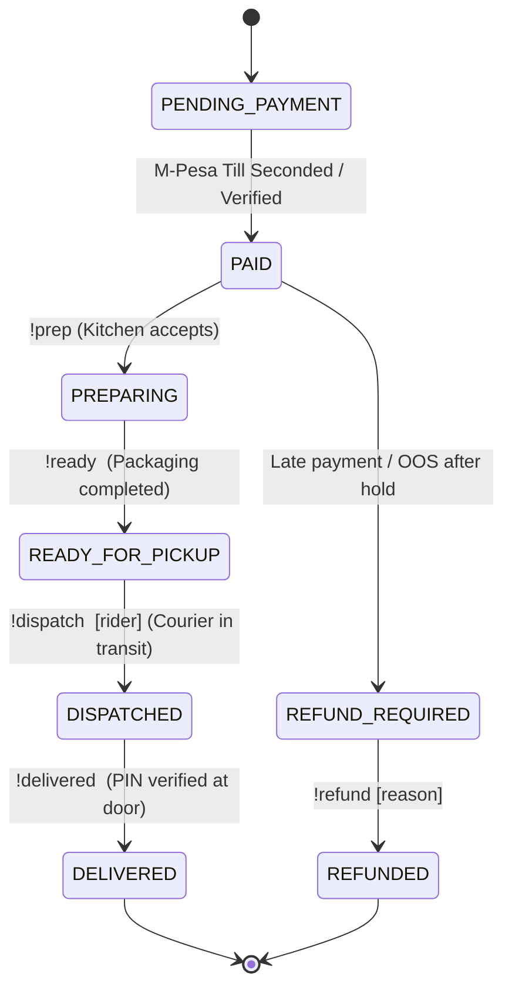

# End-to-End Order Fulfillment & Delivery Protocol
**Standard Operating Procedure (SOP) — Station Progression, Dispatch & Handover Invariants**
*Document Version: 1.0.0 | Author: Platform Operations & Logistics Sentinel*

---

## 1. Executive Summary & Purpose

This protocol establishes the end-to-end lifecycle of every physical and digital order processed through the TMS Whitelabel Core platform and Perpetual WhatsApp Gateway. It ensures that once an order is paid:
1. **Zero silent kitchen bottlenecks**: The kitchen staff are immediately notified with clear prep items.
2. **Deterministic station progression**: Orders move through strict state gates (`PAID` $\rightarrow$ `PREPARING` $\rightarrow$ `READY_FOR_PICKUP` $\rightarrow$ `DISPATCHED` $\rightarrow$ `DELIVERED`).
3. **Automated customer transparency**: Customers receive real-time 1-on-1 WhatsApp progress updates, courier contact info, and an anti-fraud 4-digit Delivery Verification PIN.
4. **Dispute elimination**: A delivery is only marked settled when the customer hands the 4-digit PIN to the courier or acknowledges handover.

---

## 2. Order Station State Machine



### State Definitions & Trigger Contracts

| State | Status in DB | Triggering Agent / Actor | Automated System Actions | Customer Notification |
| :--- | :--- | :--- | :--- | :--- |
| **`PAID`** | `paid` | Safaricom Till Webhook or Manager `!second` | • Reserves inventory permanently<br>• Emits order ticket to Merchant Kitchen WhatsApp Group | 1-on-1 WhatsApp receipt with order summary and 4-digit PIN |
| **`PREPARING`** | `preparing` | Kitchen Supervisor (`!prep <id>`) | • Timestamps prep start in `fulfillment_events`<br>• Updates kitchen bottleneck telemetry | None (avoids notification spam) |
| **`READY_FOR_PICKUP`** | `ready_for_pickup` | Kitchen Dispatcher (`!ready <id>`) | • Timestamps packaging completion<br>• Alerts awaiting courier riders in dispatch pool | *"Your order is freshly packaged and ready for handover!"* (Optional pickup SMS) |
| **`DISPATCHED`** | `dispatched` | Dispatch Manager (`!dispatch <id> [rider]`) | • Links rider name / phone to order record<br>• Starts delivery SLA timer (default 45 min) | **High-Priority Alert**: *"🛵 Your order is on the way with [Rider]! Share PIN: [XXXX] upon delivery."* |
| **`DELIVERED`** | `delivered` | Courier / Store Admin (`!delivered <id>`) | • Closes order SLA<br>• Marks order eligible for T+1 B2C Net Settlement | *"🎉 Order delivered! Enjoy your order from [Shop]. Reply here if any assistance needed."* |

---

## 3. The 4-Digit Delivery Verification PIN

To prevent doorstep fraud, misdeliveries, and bogus rider claims:
1. **Generation**: Upon payment confirmation, the system assigns a 4-digit PIN (`pickup_pin`). If not explicitly set in the database, the system deterministically takes the last 4 characters of the hexadecimal Order ID (`order.id.slice(-4).toUpperCase()`).
2. **Customer Possession**: The PIN is sent **exclusively to the paying customer's WhatsApp number** upon order confirmation and dispatch. It is never broadcast to public rider groups.
3. **Handover Contract**:
   - The courier arrives at the customer's doorstep.
   - The customer inspects the sealed tamper-evident package.
   - The customer reads the 4-digit PIN to the courier.
   - The courier inputs the PIN or reports it to dispatch.
   - Dispatch executes `!delivered <order_id>`.

---

## 4. Kitchen Bottleneck & Delivery SLA Guards

1. **Kitchen Prep SLA**:
   - Maximum kitchen prep target: **25 minutes**.
   - If an order remains in `PAID` without moving to `PREPARING` after **15 minutes**, the Platform Cadence Daemon flags a ⚠️ *Kitchen Stall Warning* on the 12:00 PM or 22:00 PM docket.
2. **Transit SLA**:
   - Maximum transit target: **45 minutes** from dispatch.
   - If an order remains in `DISPATCHED` after **60 minutes**, an incident ticket is automatically created in `merchant_infractions` for delivery investigation.

---

## 5. Reverse Logistics & Replacement Vouchers

If an item is delivered damaged or incorrect:
- Under Handbook Rule 2.4, merchants **must issue a replacement voucher** rather than forcing customer cash clawbacks:
  ```text
  !voucher <order_id> [amount] [reason]
  ```
- The gateway creates a one-time promotional discount code linked to the customer's phone number for their next order.
