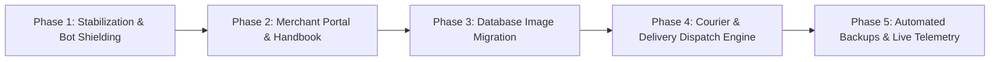

# TMS Whitelabel Ecosystem: Merchant Operations Handbook & Platform Governance

**Document Version:** 1.0.0  
**Effective Date:** 2026-11-16  
**Audience:** Platform Managers, Merchant Onboarding Desk, Finance & Accounting, Floor Operations  

---

## 1. Urgent Incident Post-Mortem: Personal WhatsApp Bot Interference

### 1.1 The Incident
During live testing, incoming personal WhatsApp messages on the owner's primary line (`+254 710 720 949`) were repeatedly intercepted by an autonomous bot process. The bot sent unsolicited *"Welcome to Creative Galore"* cards and attempted to parse everyday English conversation words (specifically the word **"appreciate"**) as M-Pesa transaction codes, triggering payment check errors.

### 1.2 Root Cause Analysis
Two compounding flaws in `Savannah_Secure_Home_Server/server.mjs`:
1. **Unbounded 10-Character Regex Matching**:  
   The regex `trimmed.match(/\b([A-Z0-9]{10})\b/i)` matched **any 10-letter English word** (e.g. `appreciate`, `understand`, `everything`) because of the case-insensitive flag `/i` and the absence of a digit requirement.
2. **Aggressive Direct Message Trigger**:  
   Any 1-on-1 DM containing general trigger terms (`help`, `order`, `shop`, `items`) automatically triggered the default shop welcome card (`Creative Galore`), with no per-user conversation state check or sender whitelisting.

### 1.3 Permanent Remediation & Invariants
```
             [Incoming WhatsApp Message]
                          │
            Is it a 1-on-1 Personal DM?
                   /             \
                 YES              NO (Group Chat)
                 /                  \
   Does it start with '!' ?      Does it start with '!' or @bot?
         /           \                  /            \
       YES            NO              YES             NO
       /               \              /                \
Execute Command    PASS THROUGH   Execute Command    Passive Group Listener
(Strict Syntax)    (100% SILENT)  (Authorized Role)  (Receipts/Notes Only)
```

1. **Strict M-Pesa Code Invariant**:
   An M-Pesa code **must** satisfy `^(?=[A-Z0-9]{10}$)(?=.*[0-9])(?=.*[A-Z])[A-Z0-9]{10}$`. It must be exactly 10 characters and contain **both letters and digits**. Pure alphabetical words like `appreciate` are mathematically impossible M-Pesa codes.
2. **Personal Line Silence Rule**:
   On personal 1-on-1 DMs (`@s.whatsapp.net`), the bot is **100% passive** unless the message explicitly starts with an exclamation point command (e.g. `!order #1234` or `!help`). Casual conversations, greetings, and human chatting will **never trigger a response**.
3. **Decoupled Business Phone Numbers**:
   For production multi-tenancy, each merchant or the platform must bind a dedicated Twilio/Meta Cloud API or dedicated SIM for store bots, preventing mixing of personal WhatsApp correspondence with customer automation.

---

## 2. Commercial Pricing & Commission Models

The platform provides merchants with two flexible fee models depending on their business size, order volume, and capital preference:

| Dimension | **Plan A: SaaS + Low Processing (High Volume)** | **Plan B: Pure Rev-Share (Zero Upfront Risk)** |
| :--- | :--- | :--- |
| **Best For** | Established restaurants, high-turnover grocery/beverage stores | Pop-ups, boutique craft artisans, weekend chefs |
| **Onboarding / Setup Fee** | KES 5,000 (One-time, covers menu digitisation, photography audit, staff training) | KES 1,500 (One-time, self-service catalog setup) |
| **Monthly Subscription** | **KES 3,500 / month** (Billed on the 1st) | **KES 0 / month** |
| **Platform Take Rate** | **2.5%** of gross sales | **10.0% – 12.0%** of gross sales |
| **M-Pesa Transaction Fee** | Passed at cost to customer or absorbed by merchant | Deducted from platform gross settlement |
| **Daily Sales Volume Cap** | Unlimited | KES 50,000 / day (upgrades to Plan A upon reaching cap) |
| **KDS / WhatsApp Floor Desk** | Included (Unlimited cashier/management groups) | Included (1 Staff WhatsApp group) |

---

## 3. Merchant Settlement Schedule & Financial Governance

### 3.1 Payout Cadence: **T+1 Rolling Daily Settlement**
* **Why not T+0 (Same-Hour)?**  
  Immediate instant payouts leave the platform exposed to customer chargebacks, food cancellation disputes, and M-Pesa transaction reversal fraud.
* **Why not T+7 (Weekly)?**  
  Kenyan food and retail merchants rely on fast working capital for morning market sourcing (dairy, fresh greens, bread).
* **The Policy**:
  - All orders settled between **00:00:00 and 23:59:59** on Day T are audited and consolidated during the midnight EOD run.
  - Payouts are dispatched via M-Pesa B2C / Bank PesaLink to the merchant's verified settlement account by **09:30 AM on Day T+1**.

### 3.2 Minimum Settlement Threshold
* **Threshold:** **KES 1,000.00**.
* If a merchant’s net payable for the day is below KES 1,000, the balance rolls forward to the following morning until the threshold is met, preventing micro-transaction fee erosion.

### 3.3 Rolling Security Reserve
* A **5.0% rolling reserve** is held for **7 days** to absorb legitimate customer refunds, missing delivery disputes, or food safety chargebacks. 
* On Day 8, the Day 1 reserve is unlocked and released into the daily payout.

---

## 4. Merchant KYC & Onboarding Requirements

Before any shop is switched from `pilotMode: true` to `active: true` on the platform, the merchant must submit verified copies of:

1. **Identity & Authority**:
   - National ID or Passport of the Business Owner / Managing Director.
   - KRA PIN Certificate (Personal and Corporate where applicable).
2. **Commercial Legality**:
   - County Government Single Business Permit (Trade License).
   - Public Health / Food Hygiene Certificate (Mandatory for dining/kitchen tenants like Botanica).
3. **Settlement Verification**:
   - Safaricom M-Pesa Buy Goods Till Letter / Paybill Confirmation Notice / Bank Stamped Statement showing verified account name matching the business identity.
4. **Contractual Acceptance**:
   - Signed **Platform Merchant Service Agreement (MSA)** confirming acceptance of fee schedules, refund deductions, and delivery SLAs.

---

## 5. Merchant SLA, Poor Service & Refund Policy

### 5.1 Service Level Agreements (SLAs)
* **Order Acknowledgement SLA:** Kitchens and stores must accept or acknowledge incoming orders within **7 minutes** during operational hours.
* **Prep / Dispatch SLA:**
  - Fast Food / Salads / Beverages: Ready for courier handoff within **25 minutes**.
  - General Retail: Ready within **60 minutes**.
* **Out of Stock SLA:** If an ordered item is unavailable, the merchant must reject or notify the customer via the floor desk within **10 minutes**.

### 5.2 Refund & Dispute Protocols
```
  [Customer Reports Issue within 60 mins of delivery]
                        │
         Is it a Merchant Fault? (Missing item, spoiled, wrong dish)
             /                              \
           YES                               NO (Customer changed mind late)
           /                                  \
  • 100% Refund to customer          • Dispute mediated by Platform Manager
  • Deducted from merchant T+1       • Delivery fee retained
  • Platform fee waived on order     • Merchant keeps food cost
```

* **Merchant Fault**: If an order arrives spoiled, cold beyond reason, missing items, or prepared incorrectly:
  - Customer receives an instant refund or replacement voucher.
  - The refund is deducted from the merchant's T+1 settlement ledger.
  - The merchant absorbs the M-Pesa reversal transaction fee (KES 15 – 35).
* **Repeated Infractions**: 
  - 3 unfulfilled orders in 7 days = Temporary catalog suspension (24-hour review).
  - High refund rate (> 4% of gross orders over 30 days) = Mandatory management meeting and possible platform termination.

---

## 6. What the Platform Offers vs. What It Does NOT Offer

| Platform Responsibility (TMS Ecosystem) | Merchant Commercial Responsibility |
| :--- | :--- |
| High-speed, responsive, branded mobile storefront (`/s/<tenant>`) | Quality, hygiene, safety, and freshness of all products |
| Automated M-Pesa Till reconciliation & SMS seconding cascade | Physical inventory sourcing, warehousing, and refrigeration |
| Real-time WhatsApp Floor Desk, Cashier alerts & KDS management | Accurately updating product availability (toggling out-of-stock items) |
| Customer order tracking, SMS/WhatsApp delivery updates | Physical packing and tamper-evident sealing of bags |
| End-of-Day financial consolidation and automated settlement | Local county tax compliance (VAT, ETR filing where applicable) |
| Cloud infrastructure, DDoS shielding, SSL certificates, 99.9% uptime | Handling direct customer inquiries regarding custom culinary tastes |

---

## 7. Platform Manager Operating Cadence (Standard Operating Procedures)

### 7.1 Daily Routine (Morning & Evening)
* **08:30 AM**: Review overnight EOD reconcile reports. Verify zero unseconded ghost payments in the Sentinel queue (`!unseconded`).
* **09:30 AM**: Authorize and release T+1 M-Pesa B2C settlements to verified merchants.
* **12:00 PM – 02:00 PM (Lunch Rush)**: Monitor live order telemetry on the Ops Portal (`http://localhost:5180` / `ops.tmsavannah.com`). Verify zero checkout bottlenecks.
* **10:00 PM**: Review daily store closure tallies. Ensure all delivered orders are moved out of active fulfillment states.

### 7.2 Weekly Routine (Every Monday)
* Reconcile rolling 7-day security reserves.
* Audit merchant refund ratios and flag any store with > 3% chargeback volume.
* Execute weekly database backup snapshot verification.

### 7.3 Monthly Routine (1st of the Month)
* Invoicing and deduction of Plan A SaaS subscription fees (KES 3,500).
* Review server capacity, Tailscale mesh connectivity, and Cloudflare bandwidth logs.
* Issue Monthly Merchant Statements of Account (PDF receipts).

---

## 8. Code Freeze, Architecture Isolation & Git Hygiene

To ensure the platform remains production-stable and easily maintainable, the following architectural invariants are enforced:

### 8.1 The Feature Code Freeze
1. **Zero New Experimental Features on `main`**:  
   All experimental sidecars or prototypes must live on isolated branches (e.g. `feat/spatial-vr`, `feat/ai-recommendations`) or in designated archive folders.
2. **Dynamic Brand Neutrality**:  
   Core files (`src/pages`, `src/components`, `api/`) must remain 100% brand-agnostic. No hardcoded tenant slugs, colors, or mock products outside of `src/tenants/<tenantId>/`.

### 8.2 Database Asset Decoupling (Git Hygiene)
* **Current Anti-Pattern**: Checking in product image files (`.jpg`, `.png`) directly into Git bloats the repository history and slows down deployments.
* **Production Standard**:  
  All product packshots and media are stored in **Supabase Storage (`product-images` bucket)**. The Git repository only holds code, schemas, and lightweight SVG icons.

---

## 9. Technical Roadmap & Execution Priorities



1. **Phase 1: Bot Shielding (IMMEDIATE)**:  
   Deploy silence guardrails to the live WhatsApp daemon. Eliminate casual DM auto-replies; enforce strict alphanumeric M-Pesa regex.
2. **Phase 2: Merchant Handover Pack**:  
   Generate the Merchant Welcome PDF, fee contracts, and self-service onboarding forms.
3. **Phase 3: Image Cloud Migration**:  
   Push all tenant product photos from `public/tenants/` into the public Supabase bucket `product-images`, stripping binary assets from Git.
4. **Phase 4: Delivery & Courier Dispatch Integration**:  
   Formalize boda boda rider tracking, parcel handoff OTPs, and delivery fee calculations per kilometer.
5. **Phase 5: Technical Reliability Guard**:  
   Automated Supabase WAL backups, PM2 process monitoring on Pavilion, and live telemetry on the Ops Portal.
