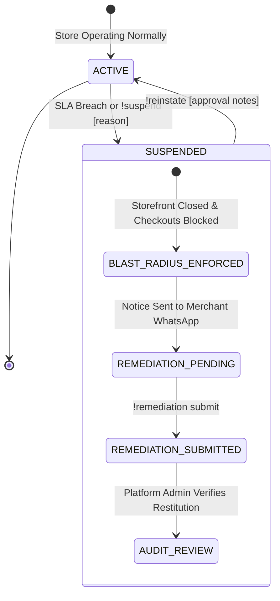

# Merchant Suspension & Reinstatement Protocol
**Standard Operating Procedure (SOP) — Blast Radius Isolation, Remediation Gates & Reinstatement**
*Document Version: 1.0.0 | Author: Platform Operations & Merchant Governance Sentinel*

---

## 1. Executive Summary & Purpose

When a merchant repeatedly breaches service standards (e.g., failing to prepare meals, neglecting customer orders, accumulating chargebacks, or suffering severe inventory drift), the platform must take swift, deterministic action to protect consumer trust and platform integrity.

This protocol establishes:
1. **The Suspension Blast Radius**: Exactly what happens in code and infrastructure when a store is suspended.
2. **The 3-Point Merchant Remediation Roadmap**: What the merchant must do and prove before they can be considered for reinstatement.
3. **The Dual-Control Reinstatement Gate**: How platform management audits, approves, and automatically re-activates the merchant's storefront.

---

## 2. Suspension State Machine & Blast Radius



### 2.1. Suspension Triggers

A merchant storefront is suspended under any of the following three conditions:
1. **Automated Infraction Trigger (Rule 1)**:
   - $\ge 3$ unfulfilled or cancelled orders within a rolling 7-day window.
   - Detected automatically by the `merchant_infraction_sentinel.mjs` during the 06:30 AM or 22:00 PM cadence sweeps.
2. **Quality & Chargeback Trigger (Rule 2)**:
   - Refund rate exceeds **4.0%** of gross orders over a 30-day window.
3. **Administrative Manual Suspension**:
   - Platform executive executes:
     ```text
     !suspend <shop_slug> [reason]
     ```
     *(Available from management WhatsApp groups or via direct 1-on-1 private WhatsApp DM with the bot).*

---

## 3. The Suspension Blast Radius (Immediate System Actions)

The moment a shop is suspended, the platform executes a four-tier isolation blast radius:

| Layer | System Action | Customer Experience |
| :--- | :--- | :--- |
| **1. Database & Cache** | `shops.is_active` set to `false`, `is_online` set to `false`. `fulfillment_settings.quality_suspension` records reason, timestamp, and audit trail. Cache invalidated immediately. | N/A |
| **2. Catalog Barrier** | `/api/v1/storefront/:slug/catalog` returns `is_suspended: true` with zeroed available stock (`available_today: 0`). | Catalog displays: *"Store Temporarily Closed for Maintenance & Quality Review"*. "Add to Cart" disabled. |
| **3. Checkout Barrier** | Order Guard and `/api/v1/storefront/checkout` reject requests with **HTTP 403 `SHOP_SUSPENDED`**. | Attempted checkouts are safely blocked before any M-Pesa payment prompt is generated. |
| **4. Communication Channel** | Gateway dispatches **Official Suspension Notice** to merchant WhatsApp operations and management groups. | In-flight paid orders are protected; new incoming orders are halted. |

---

## 4. The Official Merchant Suspension Notice

Upon suspension, the merchant receives this exact alert in their linked WhatsApp group / owner phone:

```text
🛑 [OFFICIAL NOTICE: STOREFRONT TEMPORARILY SUSPENDED]
━━━━━━━━━━━━━━━━━━━━━━━━━━━━
• Store: Botanica Kitchen (`botanica`)
• Status: SUSPENDED FROM PUBLIC ORDERING 🔴
• Reason: 3 unfulfilled cancellations in 7 days (SLA Breach)
• Action Taken: Storefront checkout blocked & buyable stock hidden.

📋 MANDATORY REMEDIATION CHECKLIST:
1. Resolve Unfulfilled Orders: Clear all customer refund claims or issue replacement vouchers.
2. Inventory Audit: Update physical stock daily caps to prevent stockouts.
3. SLA Re-Commitment: Re-confirm kitchen readiness for our 25-minute prep SLA.

👉 HOW TO REQUEST REINSTATEMENT:
Once actions are complete, reply in this group with:
`!remediation submit <summary of fixes and inventory adjustments>`
Our governance desk will audit and unblock your storefront.
```

---

## 5. The 3-Gate Merchant Remediation Workflow

To lift a suspension, the merchant must satisfy **all 3 gates**:

### Gate 1: Customer Restitution (Zero Open Grievances)
- The merchant must resolve every customer affected by recent cancellations or cold/damaged orders:
  - Issue full monetary refunds where applicable.
  - Or issue **replacement vouchers** (`!voucher <order_id> [amount] [reason]`).
- The system verifies that zero unresolved customer complaints remain in the queue.

### Gate 2: Physical Inventory & Capacity Audit
- The root cause of most cancellations is kitchen stock drift (accepting orders for items already sold out).
- The merchant must audit physical ingredients and set realistic `daily_cap` limits on their menu:
  ```text
  !product stock
  !product edit <item_name>
  ```

### Gate 3: Staffing & SLA Commitment
- The merchant owner confirms in writing via WhatsApp that dedicated kitchen staff are assigned to the Order Guard tablet/phone and committed to the **25-minute prep SLA**.

---

## 6. Submitting Remediation & The Reinstatement Workflow

### Step 1: Merchant Submits Plan
From their registered WhatsApp group, the merchant manager submits:
```text
!remediation submit All 3 customer refunds cleared via Till, daily samosa cap reduced to 30, and new line cook on duty.
```
* **System Action**: Updates `fulfillment_settings.quality_suspension.remediation_submission` and alerts the Platform Operations Group (`GROUPS.general.jid`).

### Step 2: Platform Admin Review
The platform manager reviews the submission and checks store vitals:
```text
!infractions botanica
```

### Step 3: Formal Reinstatement Execution
If satisfied, the manager executes:
```text
!reinstate botanica Remediation plan verified. Stock caps updated and staff on duty.
```

### Step 4: Automated Welcome Back & Unblocking
The system immediately:
1. Updates `shops.is_active` to `true` and `is_online` to `true`.
2. Marks `quality_suspension.is_suspended` to `false`.
3. Unlocks the storefront catalog and enables checkout in Order Guard.
4. Broadcasts the Welcome Back alert to the merchant channel:
   ```text
   🎉 [STORE CATALOG REINSTATED — WELCOME BACK!]
   ━━━━━━━━━━━━━━━━━━━━━━━━━━━━
   • Store: Botanica Kitchen (`botanica`)
   • Status: LIVE & ACTIVE 🟢
   • Approved By: @PlatformAdmin
   • Review Notes: Remediation plan verified.

   ✅ Your online catalog has been re-enabled and is now actively accepting customer checkouts.
   Wishing you great sales and smooth operations today!
   ```
