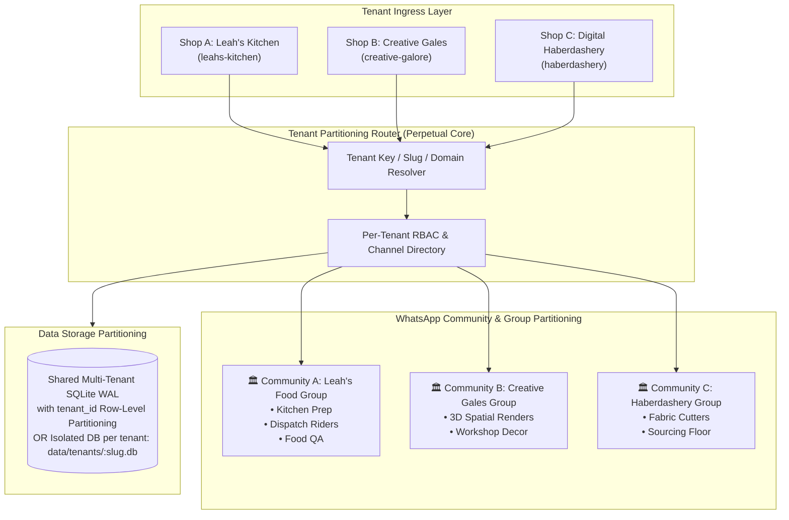

# Perpetual One: Multi-Tenancy Partitioning Specification & Architecture Blueprint

**System:** Perpetual One Enterprise  
**Document Version:** 1.0.0-MULTI-TENANT  
**Date:** October 2026  
**Status:** Approved for Implementation  

---

## 1. Executive Summary

Yes, **Perpetual One is architecturally designed to support full multi-tenancy partitioning**. 

Multi-tenancy allows a single running instance of Perpetual One to host multiple independent businesses (e.g., **Leah's Kitchen**, **Creative Gales**, **Digital Nairobi Haberdashery**, and external partner shops) with **complete operational, data, and notification isolation**.



---

## 2. The 4 Partitioning Dimensions

To make Perpetual One multi-tenant, four distinct operational dimensions are partitioned:

### Dimension 1: Data Partitioning (Row-Level or Database-Per-Tenant)
Each record in the database is tagged with its `tenant_id`:
- **`orders`**: `(order_id, tenant_id, customer_name, total_amount, station, ...)`
- **`tasks`**: `(task_id, tenant_id, title, state, claimed_by, ...)`
- **`tickets`**: `(ticket_id, tenant_id, severity, status, ...)`

```sql
-- Queries are strictly scoped to the active tenant:
SELECT * FROM orders WHERE tenant_id = 'leahs-kitchen' AND station = 'PENDING';
SELECT * FROM tasks WHERE tenant_id = 'creative-galore' AND state = 'IN_PROGRESS';
```
*(Alternative for enterprise data compliance: Isolated SQLite file per tenant, e.g., `tenants/leahs_kitchen.db` and `tenants/creative_gales.db`).*

---

### Dimension 2: Communication & WhatsApp Channel Partitioning
Each tenant gets its own dedicated WhatsApp channels or sub-groups:
- **Tenant A (Leah's Kitchen)**:
  - Floor Ops: `Leah's Kitchen Prep Station`
  - Couriers: `Leah's Runner Desk (Gate A/B)`
  - Helpdesk: `Leah's Incident Desk`
- **Tenant B (Creative Gales)**:
  - Spatial Floor: `Creative Gales Studio`
  - Executive: `Creative Gales Admin`

When an order arrives with `X-Tenant-ID: leahs-kitchen`, Perpetual's event router dispatches notifications **exclusively** to Leah's WhatsApp groups, ensuring Creative Gales never sees food pre-orders and Leah never sees 3D furniture renders.

---

### Dimension 3: Business Logic & Workflow Partitioning
Different businesses require different finite state machines:
| Tenant | FSM Lifecyle | Cutoff & Delivery Logic |
| :--- | :--- | :--- |
| **Leah's Kitchen** | `PENDING` $\to$ `PAID` $\to$ `PACKAGING` $\to$ `VERIFIED` $\to$ `DISPATCHED` | Daily 17:00 cutoff, 15m grace window, Gate A/B pickup points |
| **Creative Gales** | `QUOTE` $\to$ `RENDERED` $\to$ `APPROVED` $\to$ `FABRICATION` $\to$ `SHIPPED` | 3D spatial matrix render previews, custom artisan dimensions |
| **Haberdashery** | `ORDERED` $\to$ `CUTTING` $\to$ `HEMMING` $\to$ `READY` | Yardage measurement, fabric swatches |

---

### Dimension 4: Role-Based Access Control (RBAC) Partitioning
Staff members are partitioned by tenant:
- Chef Leah (`+254700000001`) can execute `!pack` and `!verify` for **Leah's Kitchen**, but cannot run `!add books to shelf` for **Creative Gales**.
- Decor artist Peter (`+254700000002`) can trigger 3D renders for Creative Gales, but cannot clear food orders.

---

## 3. Configuration Architecture: `tenants.json`

The root configuration moves from a single organization to a multi-tenant registry:

```json
{
  "tenants": {
    "leahs-kitchen": {
      "name": "Leah's Kitchen",
      "currency": "KES",
      "timezone": "Africa/Nairobi",
      "fulfillment": {
        "is_preorder": true,
        "cutoff_time": "17:00",
        "grace_minutes": 15,
        "pickup_points": ["Gate A", "Gate B", "Main Kitchen"]
      },
      "whatsapp_groups": {
        "floor": "120363429929736148@g.us",
        "helpdesk": "120363432040872305@g.us"
      }
    },
    "creative-galore": {
      "name": "Creative Gales Spatial Decor",
      "currency": "USD",
      "timezone": "Africa/Nairobi",
      "fulfillment": {
        "is_preorder": false,
        "requires_3d_render": true
      },
      "whatsapp_groups": {
        "floor": "120363499999999999@g.us",
        "admin": "120363488888888888@g.us"
      }
    }
  }
}
```

---

## 4. Implementation Steps for Multi-Tenancy

1. **Add `tenant_id` Column to Database Tables**:
   - `ALTER TABLE orders ADD COLUMN tenant_id TEXT DEFAULT 'default';`
   - `ALTER TABLE tasks ADD COLUMN tenant_id TEXT DEFAULT 'default';`
   - `ALTER TABLE tickets ADD COLUMN tenant_id TEXT DEFAULT 'default';`
2. **Update Ingress Routes**:
   - `POST /api/orders/webhook` accepts header `X-Tenant-ID: leahs-kitchen` or payload `"tenant_id": "leahs-kitchen"`.
3. **Route WhatsApp Dispatches Dynamically**:
   - Gateway resolves `tenant_id` and looks up the corresponding JID from `tenants.json`.
4. **Command Scoping**:
   - When a worker texts `!orders` in a tenant group, the bot queries `SELECT * FROM orders WHERE tenant_id = :group_tenant_id AND station != 'DISPATCHED'`.

---
*Perpetual One Multi-Tenancy Architectural Certification.*
