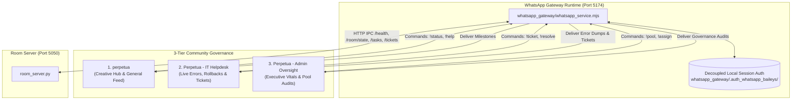

# Operator & Developer Manual
## Cyber-Physical Studio Ecosystem, Shared Agent Room & WhatsApp Gateway

```
Document ID:     MAN-PERPETUAL-2026-V2
Target Audience: System Operators, Agent Developers, Creative Directors, DevOps
Classification:  Standard Operating Procedure & Developer Reference
Status:          RELEASE READY / UPGRADED
Date:            October 24, 2026
Codebase:        c:\Users\user\Documents\Perpetual
Ports:           5050 (Shared Agent Room) | 5174 (WhatsApp Baileys Gateway)
```

---

## 1. System Setup & Installation

### 1.1 Prerequisites & Python Environment

The system runs on **Python 3.10+** (verified on Python 3.13) and **Node.js 18+** (for the Baileys WhatsApp Gateway).

#### Python Dependencies
Install required packages for the Flask microservice, linear algebra, and image rasterization:

```powershell
# Navigate to the Perpetual workspace
cd c:\Users\user\Documents\Perpetual

# Install necessary Python libraries
pip install flask numpy pillow
```

#### Node.js Dependencies (WhatsApp Gateway)
Ensure `@whiskeysockets/baileys` and `pino` are available in `whatsapp_gateway/` or in the Node environment:

```powershell
cd c:\Users\user\Documents\Perpetual\whatsapp_gateway
npm install @whiskeysockets/baileys pino qrcode-terminal
```

### 1.2 Starting the Shared Agent Room Microservice (`room_server.py`)

The microservice runs on port **5050** by default, automatically binding to `0.0.0.0` and opening the SQLite database (`agent_room.db`) in WAL mode:

```powershell
# Run from repository root
python room_server.py
```

#### Expected Terminal Boot Output:
```text
=== Shared Agent Room Microservice ===
Listening on http://0.0.0.0:5050
Room Dashboard: http://localhost:5050/room
Drive Ingest Webhook: http://localhost:5050/api/drive/ingest
```

---

## 2. Operating the WhatsApp Community Gateway (`whatsapp_service.mjs`)

The Perpetual system features an autonomous, multi-department WhatsApp operations center running on port **5174**, connecting human operators, directors, and system daemons via `@whiskeysockets/baileys`.



### 2.1 Starting the WhatsApp Gateway Daemon

Launch the service using Node.js:

```powershell
cd c:\Users\user\Documents\Perpetual
node whatsapp_gateway/whatsapp_service.mjs
```

#### First-Time Authentication & QR Code Pairing:
1. When launched for the first time without cached credentials, the terminal displays an ASCII QR code.
2. Open WhatsApp on your mobile device $\to$ **Settings** $\to$ **Linked Devices** $\to$ **Link a Device**.
3. Scan the terminal QR code.
4. The gateway writes its cryptographic session state into:
   ```
   whatsapp_gateway/.auth_whatsapp_baileys/
   ```

> [!TIP]
> **Decoupled Architecture**: Authentication credentials are strictly contained within `whatsapp_gateway/.auth_whatsapp_baileys/`. This eliminates cross-project candidate path searches, preventing credential contamination between different projects on the host.

### 2.2 The 3-Tier Group Architecture

Upon connection (`connection === "open"`), the gateway scans participating groups. If they do not exist, it automatically creates them with pre-configured welcome orientations:

1. **`perpetua` (Creative Hub & Task Feed)**:
   - Automated broadcasts of newly created generation tasks, reference image ingest notifications, and completed scene renders.
2. **`Perpetua - IT Helpdesk` (Incident Monitoring & Error Tracing)**:
   - Dedicated channel for real-time operational failures: unhandled worker exceptions, 60-second lease timeout rollbacks, and newly logged tickets (`TICK-XXXXXX`).
3. **`Perpetua - Admin Oversight` (Executive Governance & Capacity)**:
   - Executive oversight channel: room health vitals, active task pool audits, manual agent reassignments, and ticket resolution audit trails.

### 2.3 Interactive Two-Way Command Reference

Any member of the community groups can issue commands directly in the WhatsApp chat:

```
+----------------------------------------------------------------------------------------------------+
|                                    WHATSAPP INTERACTIVE COMMANDS                                   |
+------------------------------------+---------------------------------------------------------------+
| Command Syntax                     | Description & Action                                          |
+------------------------------------+---------------------------------------------------------------+
| !status  or  !health               | Displays real-time room vitals: active online agents, open    |
|                                    | IT tickets, and task counts across all 5 FSM stages.          |
|------------------------------------+---------------------------------------------------------------|
| !pool                              | Lists all active in-flight tasks (PENDING, CLAIMED,           |
|                                    | IN_PROGRESS) with remaining lease countdowns & claimer agents.|
|------------------------------------+---------------------------------------------------------------|
| !ticket <issue description>        | Creates a formal IT Helpdesk incident ticket (TICK-XXXXXX)    |
|                                    | and immediately notifies Perpetua - IT Helpdesk.              |
|------------------------------------+---------------------------------------------------------------|
| !assign <task_id> to <agent>       | Assigns or reassigns an active task directly to a specific    |
|                                    | worker node or department, engaging a 60s claim lease.       |
|------------------------------------+---------------------------------------------------------------|
| !resolve <ticket_id> [notes]       | Marks an incident ticket as RESOLVED in SQLite and broadcasts |
|                                    | resolution audit notes to Admin Oversight & IT Helpdesk.      |
|------------------------------------+---------------------------------------------------------------|
| !help                              | Renders the interactive command syntax guide in chat.         |
+------------------------------------+---------------------------------------------------------------+
```

#### Example Usage Scenarios:

- **Querying Room Vitals**:
  ```text
  User: !status
  Bot:  📊 Room Health & Real-time Vitals
        • Service: Shared Agent Room
        • Status: 🟢 healthy
        • Active Agents Online: 3
        • Open IT Tickets: 1
        
        FSM Pipeline Pool:
          ⏳ PENDING: 2
          ✋ CLAIMED: 1
          ⚙️ IN_PROGRESS: 1
          🔍 VERIFIED: 0
          ✅ DONE: 14
  ```

- **Logging an Operational Ticket**:
  ```text
  User: !ticket Sconce photometric render timeout on left wall
  Bot:  🚨 Incident Ticket Logged
        • Ticket ID: TICK-E4D2A1
        • Issue: Sconce photometric render timeout on left wall
        • Severity: HIGH
        • Status: OPEN
        • Reported By: 123456789
        
        Notified Perpetua - IT Helpdesk.
  ```

- **Reassigning an Abandoned Task**:
  ```text
  User: !assign task_c7bf2651 to Worker_Render_02
  Bot:  👤 Task Assigned Successfully
        • Task ID: task_c7bf2651
        • Title: Render Amber Sconce Pass
        • Assigned Agent: Worker_Render_02
        • Status: CLAIMED (60s lease engaged)
  ```

- **Resolving an Incident Ticket**:
  ```text
  User: !resolve TICK-E4D2A1 Adjusted photometric radius and verified render
  Bot:  ✅ Ticket Resolved
        • Ticket ID: TICK-E4D2A1
        • Resolution Notes: Adjusted photometric radius and verified render
        • Resolved By: 123456789
        • Status: RESOLVED
  ```

---

## 3. Modular Spatial Package & Dynamic Asset Factory

The spatial graphics and scene topology engine is organized as a modular Python package: `room_assets/`.

### 3.1 Package Organization

```
room_assets/
├── __init__.py                     # Package facade exposing all core classes & factory functions
├── registry.py                     # AssetRegistry dynamic lookup, introspection & registration
├── core/                           # Base mathematical primitives (SceneObject, Wall, Camera, etc.)
├── fixtures/                       # Sconce and luminaires
├── furniture/                      # Shelf, BlueVelvetSofa, SwivelBracketTVMount
└── decor/                          # Books, Plants, Containers, Textiles
```

### 3.2 Dynamic Asset Factory (`AssetRegistry`)

Assets can be instantiated dynamically by string name without hardcoded imports:

```python
from room_assets import AssetRegistry, create_asset

# 1. Query registered asset classes (19 unique types)
all_assets = AssetRegistry.list_assets()
print(f"Available assets: {all_assets}")

# 2. Case-insensitive dynamic instantiation via create_asset()
sconce = create_asset(
    "Sconce",
    style="modern_cylindrical_industrial",
    housing_color="dark_grey",
    light_state="on",
    light_temperature="warm_amber_glow"
)

# 3. Dynamic furniture instantiation
sofa = create_asset("BlueVelvetSofa", fabric="royal_blue_velvet", cushions=3)
tv_mount = create_asset("SwivelBracketTVMount", screen_size_inches=65)
```

### 3.3 Event-Driven Spatial Listener (`asset_listener.py`)

`asset_listener.py` subscribes to the Shared Agent Room message stream (`/api/messages`), intercepts `INSTANTIATE_ASSET` and `MODIFY_SCENE` topics, instantiates assets dynamically, pins them to surfaces with matrix locking (`locking=True`), computes photometric lighting, and outputs updated renders.

#### Running the Listener in Background Mode:
```powershell
# Run continuous polling daemon (checks every 2 seconds)
python asset_listener.py --loop --interval 2.0 --output room_updated_locked.png
```

#### Dispatching Dynamic Asset Instantiation Events via REST:
An agent or operator can trigger dynamic asset placement by posting to `/api/messages`:

```powershell
# Example: Dynamically instantiate a Sconce via curl
curl.exe -X POST http://localhost:5050/api/messages `
  -H "Content-Type: application/json" `
  -d '{
    "sender": "Agent_Director",
    "topic": "INSTANTIATE_ASSET",
    "payload": {
      "class_name": "Sconce",
      "surface_id": "left_matte_white_wall",
      "coordinates": [0.22, 0.18, 0.0],
      "locking": true,
      "params": {
        "style": "modern_cylindrical_industrial",
        "housing_color": "dark_grey",
        "light_temperature": "warm_amber_glow"
      },
      "lighting": {
        "strength": 0.7,
        "throw": "downward_and_outward_falloff"
      }
    }
  }'
```

`asset_listener.py` immediately intercepts the message, anchors the sconce with **0.00000000 drift**, computes the lighting falloff, saves `room_updated_locked.png`, and publishes an `ASSET_INSTANTIATED` confirmation message back to the room.

---

## 4. Deploying Google Drive Ingestion via Google Apps Script

The system includes an automated Google Drive ingestion script (`drive_apps_script.js`) that monitors a designated cloud folder, encodes newly uploaded reference photos into Base64 blobs, and POSTs them directly to the microservice webhook (`/api/drive/ingest`).

### Step-by-Step Deployment Walkthrough

1. Open [Google Drive](https://drive.google.com) and create a dedicated folder (e.g. `Studio-References`).
2. Copy the **Folder ID** from the URL (the string after `/folders/`).
3. Open [script.google.com](https://script.google.com), create a new project named `Shared Agent Room - Drive Ingestion`, and paste the contents of `c:\Users\user\Documents\Perpetual\drive_apps_script.js`.
4. Configure `CONFIG.FOLDER_ID` and `CONFIG.ROOM_WEBHOOK_URL` in the script header.
5. In the toolbar, select `testWebhookConnection` and click **Run** to authorize permissions and verify connectivity.
6. Select `installTrigger` and click **Run** to schedule automatic checks every **5 minutes**.

---

## 5. Operating the `/room` DOM Dashboard & Kanban Board

Open your web browser and navigate to:
```
http://localhost:5050/room
```

### Key UI Capabilities:
1. **ASADF 5-Stage Kanban Board**:
   - Visual columns for `PENDING`, `CLAIMED`, `IN_PROGRESS`, `VERIFIED`, and `DONE`.
   - Cards display task priority badges (`P1`, `P2`, `P3`), assigned agent ID, remaining lease countdown, and action buttons (`Claim`, `Start`, `Verify`, `Complete`).
2. **Active Agents Panel**:
   - Displays all registered worker agents, their operational status (`IDLE` vs `BUSY`), currently leased task ID, and time elapsed since last heartbeat.
3. **Drive Reference Assets Gallery**:
   - Interactive thumbnail cards for all ingested Google Drive reference images with direct download links.
4. **Machine-Readable Telemetry**:
   - Headless browser agents can scrape the DOM or query `GET http://localhost:5050/room/state` for real-time JSON state.

---

## 6. IT Helpdesk Incident Ticketing API

The microservice includes full REST endpoints for managing incident tickets:

### Create Ticket
- **Endpoint**: `POST /api/tickets`
- **Request Body**:
  ```json
  {
    "title": "Worker node dropped during video render",
    "description": "Connection reset by peer after 45s",
    "reported_by": "Worker_Alpha",
    "severity": "HIGH",
    "associated_task_id": "task_12345678"
  }
  ```

### List Tickets
- **Endpoint**: `GET /api/tickets?status=OPEN&severity=HIGH`

### Resolve Ticket
- **Endpoint**: `POST /api/tickets/{ticket_id}/resolve`
- **Request Body**:
  ```json
  {
    "resolved_by": "Admin_Ops",
    "resolution_notes": "Restarted worker node and verified asset cache"
  }
  ```

---

## 7. Verification & Automated Test Harness

The codebase includes comprehensive verification test suites:

```powershell
# 1. Microservice, ASADF FSM, Pub/Sub & Drive Ingest Suite
python test_room_service.py

# 2. Coordinate Pinning & Photometric Lighting Suite
python test_scene_setup.py

# 3. Dynamic Asset Registry & Event-Driven Listener Suite
python test_dynamic_instantiation.py
```

### Verification Checklist:
- [x] `test_room_service.py`: 6/6 tests passed (HTTP 200, 60s lease timeout rollback verified).
- [x] `test_scene_setup.py`: Zero drift verified across 5 camera poses ($\Delta = 0.00000000$).
- [x] `test_dynamic_instantiation.py`: 19 asset classes registered, message-driven instantiation verified, zero drift confirmed.
