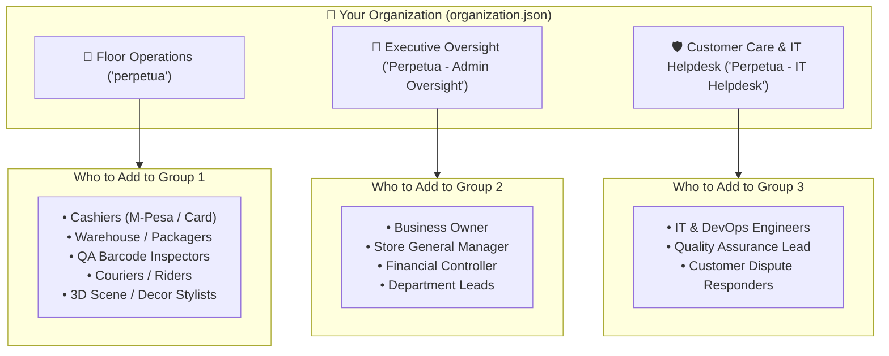
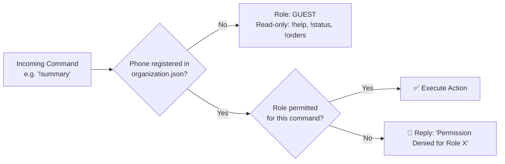

# Organization Architecture, RBAC Policy & Business Process Manual
## Operator & Systems Engineer Specification

**System:** Perpetual Shared Agent Room  
**Configuration Root:** [`config/organization.json`](file:///c:/Users/user/Documents/Perpetual/config/organization.json)  
**Policy Engine:** [`room_server/models/organization.py`](file:///c:/Users/user/Documents/Perpetual/room_server/models/organization.py)  
**Revision:** 2.1.0-ENTERPRISE  

---

## 1. Where Everything Is Defined

In Perpetual, an organization's departments, operational stations, staff roles, and communication rules are defined declaratively in a single source of truth:

```text
c:\Users\user\Documents\Perpetual\
├── config/
│   └── organization.json       <--- [THE SOURCE OF TRUTH] Full business definition
├── room_server/
│   ├── models/
│   │   └── organization.py     <--- Runtime RBAC engine & SLA evaluator
│   └── routes/
│       └── organization_api.py <--- REST API (/api/organization)
└── whatsapp_gateway/
    └── command_handler.mjs     <--- Inbound command RBAC gatekeeper
```

---

## 2. Who to Keep in What Group

Every business in Perpetual is structured into **3 Departmental WhatsApp Groups** to eliminate noise while guaranteeing complete operational visibility:



---

## 3. Who Receives What Message (Information Granularity Gradient)

Messages are not blasted uniformly. The [`EnterpriseEventBus`](file:///c:/Users/user/Documents/Perpetual/room_server/services/event_bus.py) filters events by **Information Granularity**:

| Group | Granularity Level | Events Received | Example Message |
| :--- | :--- | :--- | :--- |
| **`perpetua`** *(Floor Ops)* | `RAW_TELEMETRY` | `TASK_*`, `ORDER_*`, `DRIVE_*`, `ASSET_*` | Full JSON payloads, item lists, coordinates, file sizes. |
| **`Admin Oversight`** | `AGGREGATED_PULSE` | `HOURLY_ROLLUP`, `MINIMAL_TASK_DISPATCH`, `PULSE` | Clean, 3-line alerts: *"Task X sent to @Agent Y"*. Zero intermediate box-tape chatter. |
| **`IT Helpdesk`** | `EXCEPTION_ONLY` | `TIMEOUT_ROLLBACK`, `SERVER_ERROR`, `TICKET_*` | Silent until a worker freezes or a lease expires $>60\text{s}$. |

---

## 4. Who Can Send What (The RBAC Permission Matrix)

The gateway checks the sender's phone number against the **Role-Based Access Control (RBAC)** matrix in [`organization.json`](file:///c:/Users/user/Documents/Perpetual/config/organization.json):



### The Permission Table

| Role | Permitted Commands | Prohibited Commands |
| :--- | :--- | :--- |
| **`EXECUTIVE`** | `*` *(All commands: `!summary`, `!pulse`, `!assign`, `!pool`, `!details`, `!add`)* | None (Superuser) |
| **`CASHIER`** | `!paid`, `!orders`, `!status`, `!help` | Cannot trigger `!pulse`, `!summary`, `!assign`, `!resolve` |
| **`PACKAGER`** | `!pack`, `!orders`, `!status`, `!help` | Cannot verify payment or trigger P&L rollups |
| **`QA_INSPECTOR`** | `!verify`, `!ticket`, `!orders`, `!status` | Cannot dispatch orders or reassign tasks |
| **`COURIER`** | `!dispatch`, `!orders`, `!help` | Cannot box items or change room decor |
| **`SPATIAL_ARTIST`**| `!add`, `!remove`, `!turn`, `!light`, `!orders` | Cannot mark payments or resolve tickets |
| **`SUPPORT_ENGINEER`**| `!ticket`, `!resolve`, `!health`, `!details` | Cannot edit store catalog or orders |

---

## 5. How to Define Business Processes (The 5 Stations & SLAs)

In [`config/organization.json`](file:///c:/Users/user/Documents/Perpetual/config/organization.json), orders advance through a 5-station Finite State Machine with strict **Service Level Agreements (SLAs)**:

$$\text{PENDING} \xrightarrow[10\text{ min SLA}]{\text{!paid}} \text{PAID} \xrightarrow[20\text{ min SLA}]{\text{!pack}} \text{PACKAGING} \xrightarrow[15\text{ min SLA}]{\text{!verify}} \text{VERIFIED} \xrightarrow[30\text{ min SLA}]{\text{!dispatch}} \text{DISPATCHED}$$

* **If an order exceeds its SLA:** The background reconciler automatically raises a `SLA_BREACH_ALERT` ticket in **`Perpetua - IT Helpdesk`** and notifies the Store Lead!

---

## 6. Step-by-Step: How to Onboard a New Organization / Shop

### Step 1: Edit [`config/organization.json`](file:///c:/Users/user/Documents/Perpetual/config/organization.json)
Set your company's name, currency, and members:
```json
{
  "organization": {
    "org_id": "org_shop_02",
    "name": "Nairobi Luxury Linens",
    "currency": "USD"
  },
  "members": [
    {
      "member_id": "mbr_owner",
      "name": "Alice Manager",
      "phone": "+254711223344",
      "role": "EXECUTIVE"
    },
    {
      "member_id": "mbr_cashier",
      "name": "Bob Cashier",
      "phone": "+254722334455",
      "role": "CASHIER"
    }
  ]
}
```

### Step 2: Auto-Provision WhatsApp Groups
Restart the WhatsApp gateway:
```powershell
cd c:\Users\user\Documents\Perpetual\whatsapp_gateway
node whatsapp_service.mjs
```
* The gateway automatically provisions the WhatsApp Community, creates the 3 departmental groups, sets their descriptions and tutorial cheat-sheets, and binds them to the system.

### Step 3: Add Staff to Their Respective Groups
Using WhatsApp on your phone:
1. Open the **`perpetua`** group $\rightarrow$ Add Cashiers, Warehouse staff, and Couriers.
2. Open **`Perpetua - Admin Oversight`** $\rightarrow$ Add Owners and Managers.
3. Open **`Perpetua - IT Helpdesk`** $\rightarrow$ Add IT/Support leads.

### Step 4: Connect E-Commerce / POS Webhook
Point your Shopify, WooCommerce, or custom storefront webhooks to:
```http
POST http://your-server-ip:5050/api/orders/webhook
Content-Type: application/json

{
  "customer_name": "Sarah Connor",
  "items": [{"name": "Linen Duvet Set", "qty": 1, "price": 120.00}],
  "total_amount": 120.00,
  "currency": "USD"
}
```
* **Instant Result:** Floor Operations immediately receives the order card, prompting the cashier to confirm payment (`!paid`). Once dispatched, the executive pulse updates automatically.
