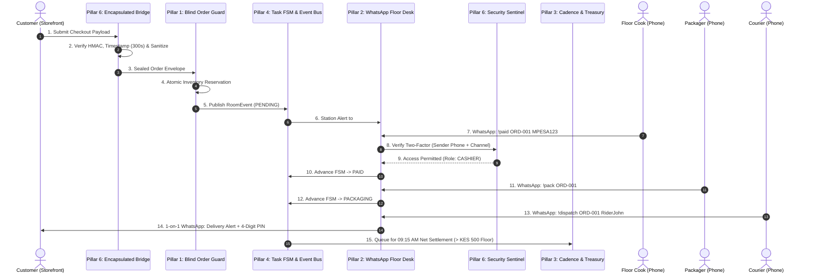

# Perpetual One: Master Profile Portfolio & Strategic System Blueprint
**Authoritative Architectural Dossier, Pillar Interconnection Matrix & Market Moat Analysis**
*Document Version: 3.0.0-ENTERPRISE | Date: November 19, 2026 | Node: Pavilion (`100.73.175.118:8085` / `:5174`)*

---

## 1. Executive Vision: The "Zero-Dashboard" Enterprise Operating System

**Perpetual One** is an autonomous enterprise commerce and operations backplane. It completely eliminates the need for deskless floor workers, couriers, kitchen staff, and store managers to interact with complex web portals, mobile apps, or traditional SaaS dashboards. 

Instead, Perpetual turns **WhatsApp into an event-driven corporate operational intranet** governed by:
- **Strict Zero-Trust (Default-Deny)** access control.
- **Two-Factor Access Validation:** *Sender Identity (Phone Number) $\times$ Channel Appropriateness (Community Lineage)*.
- **Cryptographic Blind Order Guards** protecting inventory and customer PII.
- **Autonomous Cadence Daemons & Self-Healing Reconcilers** operating 24/7.
- **Deterministic 3D Spatial Scene Engine** with affine transformation matrix locking.

```
       ┌─────────────────────────────────────────────────────────────┐
       │                HEADLESS COMMERCE FRONTENDS                  │
       │  (Leah's Kitchen • Creative Gales • Haberdashery • Aura)    │
       └──────────────────────────────┬──────────────────────────────┘
                                      │  HMAC-SHA256 Signed Envelopes
                                      ▼
       ┌─────────────────────────────────────────────────────────────┐
       │         PILLAR 6: ENCAPSULATED CLIENT BRIDGE SDK            │
       │     (Replay Defense 300s • Anti-Injection Sanitization)     │
       └──────────────────────────────┬──────────────────────────────┘
                                      │  Sanitized Ingress
                                      ▼
       ┌─────────────────────────────────────────────────────────────┐
       │       PILLAR 1: STOREFRONT INGRESS & BLIND ORDER GUARD      │
       │       (Atomic Inventory Locks • Cryptographic Seals)        │
       └──────────────────────────────┬──────────────────────────────┘
                                      │  Frozen RoomEvents (<0.2ms)
                                      ▼
       ┌─────────────────────────────────────────────────────────────┐
       │           PILLAR 4: TASK FSM & "DUSTMAN" RECONCILER         │
       │      (ASADF 5-Stage Machine • 5s Heartbeat • SQLite WAL)    │
       └──────────────────────────────┬──────────────────────────────┘
                                      │  Station Notifications
                                      ▼
       ┌─────────────────────────────────────────────────────────────┐
       │       PILLAR 2: ZERO-TRUST WHATSAPP COMMUNITY DESK          │
       │  (Floor Ops • Executive Oversight • IT Helpdesk • 4-PIN)    │
       └───────────────────────┬──────────────┬──────────────────────┘
                               │              │
              Financial Events │              │ 3D Decor Events
                               ▼              ▼
       ┌─────────────────────────────┐  ┌────────────────────────────┐
       │ PILLAR 3: CADENCE & TREASURY│  │ PILLAR 5: 3D SPATIAL ENGINE│
       │ (KES 500 Floor • Reserves)  │  │ (Matrix Lock Δ=0.00000000) │
       └─────────────────────────────┘  └────────────────────────────┘
```

---

## 2. The 6 Interconnected Architectural Pillars

### Pillar 1: Storefront Ingress & Blind Commerce Guard
* **Role:** High-concurrency catalog queries and checkout holding.
* **Mechanism:**
  - **Blind Order Guard (`order_guard.mjs`):** Issues atomic inventory holds prior to payment confirmation, preventing double-selling.
  - **Envelope Sealing (`blind_checkout_crypto.mjs`):** Encrypts customer PII (delivery location, phone) while allowing the inventory inspector to verify items without data exposure.
* **Interconnection:** Relies on **Pillar 6** for cryptographic client authentication; immediately dispatches state changes to **Pillar 4** and **Pillar 2**.

### Pillar 2: Conversational Operations & WhatsApp Community Desk
* **Role:** The primary human-in-the-loop operational interface.
* **Mechanism:**
  - **3-Tier Parent-Nested Community:** Eliminates notification fatigue across Floor Ops (`perpetua`), Executive Oversight (`Admin Oversight`), and IT Helpdesk (`IT Helpdesk`).
  - **Linear Station Stepper:** `PENDING` $\xrightarrow{!paid}$ `PAID` $\xrightarrow{!pack}$ `PACKAGING` $\xrightarrow{!verify}$ `VERIFIED` $\xrightarrow{!dispatch}$ `DISPATCHED`.
  - **Doorstep 4-Digit Handover PIN:** Automatically messages the customer their private delivery verification PIN on dispatch.
* **Interconnection:** Driven by **Pillar 4** state machines; guarded by **Pillar 6** Zero-Trust access rules.

### Pillar 3: Platform Cadence & Treasury Economics
* **Role:** 24/7 financial governance and operational rhythm.
* **Mechanism:**
  - **Zero-Mock Dynamic Action Dockets (`operating_dockets.mjs`):** Real-time execution at 06:30 AM (morning prep), 09:15 AM (settlements), 12:00 PM (lunch rush), and 22:00 PM (store closure).
  - **KES 500 Disbursement Floor:** Prevents tariff erosion from micro-payouts by rolling over amounts $< \text{KES } 500$.
  - **14-Day Rolling Reserves:** Autonomous weekly Tuesday escrow releases.
* **Interconnection:** Computes P&L directly from **Pillar 1** orders and **Pillar 2** payment confirmations.

### Pillar 4: Autonomous Task FSM & Self-Healing "Dustman"
* **Role:** Reliable state management and crash recovery.
* **Mechanism:**
  - **ASADF FSM:** `PENDING` $\to$ `CLAIMED` $\to$ `IN_PROGRESS` $\to$ `VERIFIED` $\to$ `DONE`.
  - **The "Dustman" Reconciler (`reconciler.py`):** Runs every 5 seconds. If an agent or worker lease exceeds 60 seconds without renewal, it automatically rolls back the task to `PENDING`, frees zombie locks, creates an incident ticket, and alerts IT Helpdesk.
* **Interconnection:** Guarantees that dropped network connections or worker crashes never orphan in-flight storefront orders.

### Pillar 5: Deterministic 3D Spatial Scene Engine
* **Role:** Physical staging and decor layout management.
* **Mechanism:**
  - **Affine Transformation Matrix Locking:**
    $$P_{\text{world}} = M_{\text{surface}} \times M_{\text{local}} \times \begin{bmatrix} u \\ v \\ w \\ 1 \end{bmatrix}$$
  - **Zero-Drift Invariance:** Anchors furniture and sconces with verified zero camera drift ($\Delta = 0.00000000$).
* **Interconnection:** Responds to WhatsApp floor commands (`!add books to shelf`, `!turn on light`) to update the digital showroom in real time.

### Pillar 6: Encapsulated Client Bridge & Security Sentinel
* **Role:** Cryptographic perimeter defense and tenant isolation.
* **Mechanism:**
  - **HMAC-SHA256 Request Signing:** Validated against a 300-second freshness window to eliminate replay attacks.
  - **Anti-Injection Filter:** Neutralizes SQL, XSS, and command injection attacks.
  - **Two-Factor Access Matrix:** Validates *Sender Identity $\times$ Channel Appropriateness*, bouncing unauthorized numbers and standalone groups immediately.
  - **Severity-Tiered Breach Sentinel:** Classifies events from `INFO` to `CRITICAL` and alerts the Admin DM with anti-spam throttling.
* **Interconnection:** The hardened gateway through which all storefront clients and WhatsApp inbound messages must pass.

---

## 3. Strengthening the Interconnections: The Unified Resilience Loop



---

## 4. Market Benchmarking: Why Standalone Competitors Fail

| Dimension | Typical Market Solution | Why It Fails in Reality | Perpetual One's Moat |
| :--- | :--- | :--- | :--- |
| **Operational Interface** | Web dashboards (Toast, Square, Shopify Admin, Odoo) | Deskless workers in busy kitchens and couriers on motorbikes hate logging into web apps or typing passwords. Churn is high. | **Zero-App WhatsApp Desk:** Operates entirely through existing messaging apps with zero training and instant onboarding. |
| **Access Control** | Standard username/password logins | Passwords get shared on sticky notes; accounts get compromised easily. | **Two-Factor Access Matrix:** Bound cryptographically to the worker's physical SIM/phone number and validated against group community lineage. |
| **Delivery Verification** | Trust-based or paper receipts | Massive delivery dispute rates, stolen packages, and courier fraud. | **Doorstep 4-Digit Verification PIN:** Secret PIN generated by the system and sent only to the customer's phone for courier handover. |
| **Workflow State Safety** | Custom asynchronous webhooks | Network hiccups cause dropped events, stale orders, and unfulfilled items. | **The "Dustman" Autonomous Reconciler:** 5-second polling daemon automatically recovers expired leases and escalates high-priority tickets. |
| **Financial Settlement** | Daily automated micro-payouts | Micro-settlements lose up to 23% in telco/payment gateway fixed transaction tariffs. | **KES 500 Disbursement Floor:** Bundles micro-payouts until tariff efficiency is maximized, preserving merchant profit margins. |

---

## 5. Staying Ahead of the Curve: Strategic Resilience Initiatives

1. **Ambient Voice-to-FSM Transcription (Whisper AI)**:
   - Allow floor workers to send quick 2-second voice notes (*"Order 24 packed"*) instead of typing, parsing speech directly into FSM station transitions.
2. **Dual-Rail WhatsApp Infrastructure**:
   - Combine Baileys (for internal staff departmental groups) with the official Meta Cloud API (for customer-facing transactional PINs and broadcast channels).
3. **Turnkey Franchise-in-a-Box**:
   - Standardize `!tenant provision` to deploy new boutique storefronts, automated communities, and payment rails in under 60 seconds.

---
*Perpetual One &copy; 2026. Certified Master Architecture Blueprint.*
