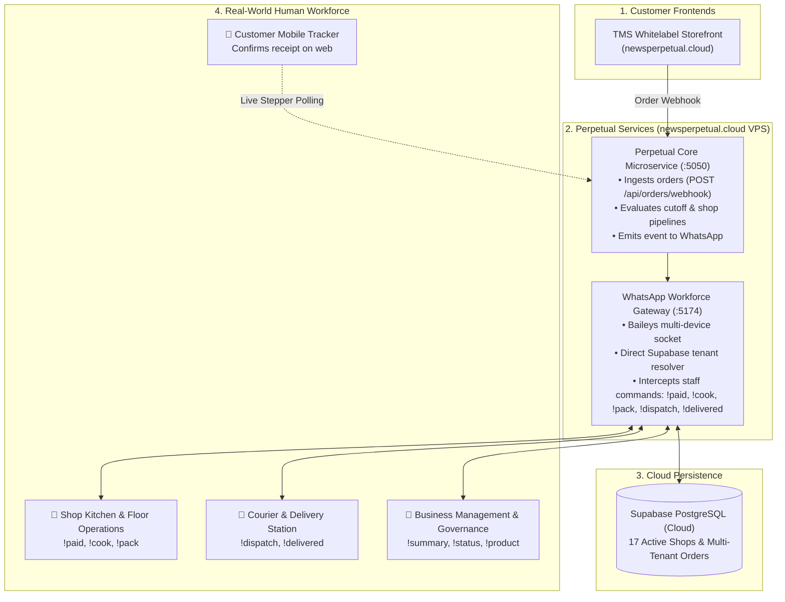

# Perpetual: Production Deployment & Operations Runbook 🚀

**Domain:** `newsperpetual.cloud`  
**Core Technologies:** Node.js (Baileys WhatsApp Socket), Python Flask (API & Pipelines), Supabase PostgreSQL (Production Multi-Tenant Data Store)

---

## 1. High-Level Architecture Overview



---

## 2. Environment Configuration

The WhatsApp Gateway connects directly to production Supabase:
- **`whatsapp_gateway/.env`**:
  ```env
  SUPABASE_URL=https://ocsuqfabqsyrbsewcaez.supabase.co
  SUPABASE_SERVICE_ROLE_KEY=eyJhbGciOiJIUzI1NiIsInR5cCI6...
  PORT=5174
  WHATSAPP_AUTH_DIR=/app/.auth_whatsapp_baileys
  ```

---

## 3. How to Deploy on `newsperpetual.cloud`

### Prerequisites
A Linux server (Ubuntu 22.04 / 24.04 LTS) with DNS pointed:
- `newsperpetual.cloud` $\to$ `<YOUR-SERVER-IP>`
- Ports open in firewall: `80`, `443`, `5050`, `5174`.

### Step 1: Clone Repository
```bash
git clone https://github.com/Mercy-Em-t/Perpetual.git
cd Perpetual
```

### Step 2: One-Command Docker Cluster Boot
```bash
docker compose up -d --build
```
This launches:
1. `perpetual-core-server` on port `5050`
2. `perpetual-whatsapp-gateway` on port `5174`

### Step 3: Link WhatsApp Device via QR Code
Run:
```bash
docker compose logs -f whatsapp-gateway
```
1. Scan the terminal QR code using WhatsApp on the operations phone (**Linked Devices** $\to$ **Link a Device**).
2. The session keys are saved permanently to `./whatsapp_gateway/.auth_whatsapp_baileys` and persist across container restarts.

---

## 4. Local Development Quickstart

If developing locally on Windows / Mac without Docker:

```powershell
# Terminal 1: Run the Python Core Microservice (Port 5050)
python room_server.py --port 5050

# Terminal 2: Run the WhatsApp Gateway (Port 5174)
cd whatsapp_gateway
node whatsapp_service.mjs
```

- **Storefront Portal:** [http://localhost:5050/storefront](http://localhost:5050/storefront)
- **Gateway Health:** [http://localhost:5174/health](http://localhost:5174/health)

---

## 5. Shop Staff WhatsApp Command Reference

| Group / Role | Command | Function |
| :--- | :--- | :--- |
| **Cashier / Floor** | `!paid <order_id> <ref>` | Confirms M-Pesa till payment $\to$ order moves to `COOKING`. |
| **Kitchen Chef** | `!cook <order_id>` | Confirms cooking is finished $\to$ order moves to `PACKAGING`. |
| **Packager** | `!pack <order_id>` | Confirms tamper-proof boxing $\to$ order moves to `READY`. |
| **Counter / Gate** | `!dispatch <order_id> <rider>` | Hands package to rider $\to$ order moves to `IN_TRANSIT`. |
| **Rider / Courier** | `!delivered <order_id>` | Rider confirms drop-off $\to$ order moves to `DELIVERED`. |
| **Customer** | *(Web Button / `!confirm`)* | Customer confirms receipt $\to$ order closes as `COMPLETED`. |
| **Management** | `!summary [today]` | Real-time P&L, gross revenue, order counts. |
| **Management** | `!status` | Open orders in queue, till status, and shop health. |
