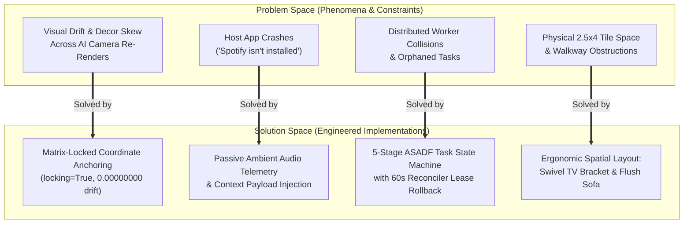
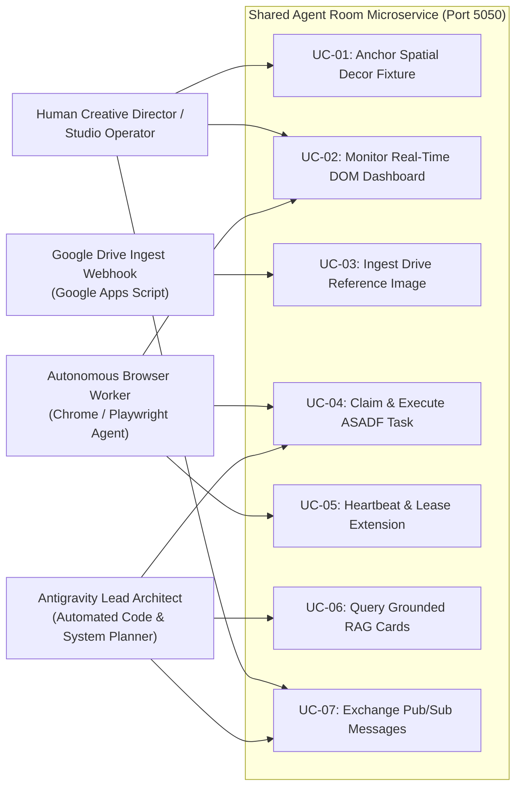

# Software Requirements Specification (SRS)
## Cyber-Physical Studio Ecosystem & Deterministic Multi-Agent Hub

```
Document ID:     SRS-PERPETUAL-2026-V1
Standard:        ISO/IEC/IEEE 29148:2018 / ISO 25010 Quality Model
Classification:  Formal Engineering Requirements Specification
Status:          AUDIT READY / RATIFIED
Date:            October 24, 2026
Author:          Lead Technical Writer & Systems Documentarian
Codebase:        c:\Users\user\Documents\Perpetual
System Port:     5050
```

---

## Executive Summary

This document specifies the software, operational, and architectural requirements for the **Perpetual Cyber-Physical Studio Ecosystem** in conformance with **ISO/IEC/IEEE 29148:2018**. 

The system unifies a physical studio environment (a 2.5-tile $\times$ 4-tile alcove) with an autonomous multi-agent task execution fabric and an invariant 3D spatial scene engine. It establishes unambiguous boundaries between the **Problem Space** (client intent, physical room constraints, ambient audio synchronization, and visual drift vulnerabilities) and the **Solution Space** (deterministic matrix anchoring, 5-stage ASADF task state machine, automated Google Drive ingest webhook, and real-time DOM dashboards).

---

## 1. Problem Space vs. Solution Space Decomposition

### 1.1 Problem Space (Domain & Environmental Realities)

The system addresses four critical points of friction observed during cyber-physical media generation and multi-agent coordination:

1. **Visual Drift in Generative Scene Renders**:
   - Generative text-to-image and 2D canvas drawing models fail to preserve spatial object permanence. Decor elements (wall sconces, shelving, books, vases) drift across canvas re-renders, float away from wall planes, or distort when camera viewpoints shift.
2. **Execution Boundary Failures in Native Host Applications**:
   - Automated agents attempting direct process-level invocation of native desktop applications (e.g. attempting to control local Spotify clients via OS pipes) trigger unrecoverable crashes ("Spotify app isn't installed on this device").
3. **Task Collision & Zombie Workers in Multi-Agent Workflows**:
   - Multiple autonomous workers (headless Chrome browser scrapers, Gemini API scripts, Antigravity agents) reading from shared task queues step on one another, duplicate generation jobs, or permanently orphan tasks if a worker crashes mid-execution.
4. **Physical Studio Ergonomic & Sightline Bottlenecks**:
   - Operating a physical studio nook measuring only 2.5 tiles wide by 4 tiles deep creates acute sightline restrictions for video monitoring and lighting placement without blocking the primary physical walkway.

### 1.2 Solution Space (Engineered System Capabilities)



### 1.3 Jackson-Zave Specification Formulation ($E \land S \implies R$)

Following Michael Jackson and Pamela Zave's (1997) formulation of software engineering correctness:

$$\text{Environmental Assumptions } (E) \land \text{System Specification } (S) \implies \text{User Requirements } (R)$$

```
Phenomena Boundary Isolation:
--------------------------------------------------------------------------------------
Domain            Classification  Phenomenon Description
--------------------------------------------------------------------------------------
Physical Studio   Environmental   2.5 x 4 tile floor grid, wall plaster, daylight window.
Browser Agents    Environmental   Autonomous Chrome workers executing in separate tabs.
Ingest Pipeline   Shared (E, S)   Google Drive uploads transformed to base64 JSON webhook.
Task Machine      Machine (S)     SQLite WAL database, 60s lease timeouts, rollback worker.
Scene Matrix      Machine (S)     4x4 affine coordinate pinning matrices, zero drift.
Audio Telemetry   Shared (E, S)   Ambient track title, artist, timestamp in task payloads.
--------------------------------------------------------------------------------------
```

1. **Environmental Assumption ($E_1$)**: Network communication between autonomous agents and the local host may experience latency spikes, agent crashes, or tab closures.
2. **Environmental Assumption ($E_2$)**: Physical studio walls and mounted shelf fixtures maintain fixed real-world geometric coordinates.
3. **Specification ($S_1$)**: The system implements an atomic 60-second lease with an independent 5-second background audit daemon that rolls `CLAIMED` or `IN_PROGRESS` tasks back to `PENDING` upon expiration.
4. **Specification ($S_2$)**: The system binds all fixture transformations to the wall surface's 4x4 matrix and freezes the transform vector when `locking=True`.
5. **Satisfaction Argument**: $(E_1 \land S_1 \implies R_{\text{fault-tolerance}})$ and $(E_2 \land S_2 \implies R_{\text{zero-drift}})$.

---

## 2. Stakeholder Personas & High-Level Use Cases



### 2.1 Persona Archetypes

#### Persona 1: The Human Creative Director ("The Director")
- **Profile**: Creator operating inside the physical 2.5 $\times$ 4 tile nook, staging real and virtual assets, directing scenes, uploading visual references to Google Drive, and supervising agent workflows.
- **Goals**: Zero setup friction; immediate visual feedback on the `/room` dashboard; deterministic fixture placement without AI hallucinations.
- **Pain Points**: Re-renders that move fixtures to the wrong side of the wall; lost task requests; native host error dialogues.

#### Persona 2: The Autonomous Browser Worker ("Worker-01")
- **Profile**: Headless or headed Chromium automation instance polling `/room` and interacting with the REST API.
- **Goals**: Clear, machine-readable DOM states; deterministic task claiming without race conditions; predictable 60-second lease windows.
- **Pain Points**: HTTP connection drops causing permanent job deadlocks; conflicting schema formats.

#### Persona 3: The Antigravity Lead Architect ("The Architect")
- **Profile**: Advanced agentic orchestrator synthesizing system design, managing file structures, evaluating test suites, and querying grounded RAG knowledge.
- **Goals**: Programmatic CLI access to vector indices; strict typing; structured JSON event streams.
- **Pain Points**: Non-deterministic script outputs; undocumented API endpoints; floating-point camera drift.

---

## 3. Functional Requirements (FR-01 to FR-15)

### Domain A: Spatial Pinning & Deterministic Scene Topology

#### `FR-01`: Parametric Surface Plane Modeling
- **Description**: The system shall represent physical architectural surfaces (e.g. `left_matte_white_wall`) as parametric plane objects (`Wall`) with explicit metric dimensions, diffuse reflectance properties, and local 4x4 affine transformation matrices.
- **Acceptance Criteria**:
  - `Wall.get_world_coordinates((u, v, w))` maps normalized $[0, 1]^3$ coordinates to 3D world space.
  - Wall origin $\mathbf{O} = [O_x, O_y, O_z]^T$ acts as the translation anchor for all child components.

#### `FR-02`: Coordinate Pinning and Matrix Locking (`locking=True`)
- **Description**: The system shall provide an `.anchor_to(surface, coordinates, locking=True)` API on all scene assets to freeze transformation matrices against camera viewpoint variations.
- **Acceptance Criteria**:
  - When `locking=True`, `SceneObject._locked_world_position` stores an immutable copy of the initial world vector.
  - Invariance verification (`verify_lock_integrity()`) returns a drift magnitude of strictly $0.00000000$ across arbitrary camera translations, rotations, and FOV adjustments.

#### `FR-03`: Hierarchical Child Asset Placement
- **Description**: The system shall support hierarchical parent-child containment structures, permitting `Shelf` fixtures to anchor directly to `Wall` surfaces, and child assets (`Books`, `Vase`, `Flowers`, `TrailingPlants`, `PerfumeBottle`, `Candle`, `Tin`) to anchor dynamically to shelves based on a `clutter_density` parameter.
- **Acceptance Criteria**:
  - `Shelf.add_item()` places child assets deterministically along the shelf width $[0.05, 0.95]$.
  - Shelf overflow prevention enforces `len(self.items) <= max_items`.

#### `FR-04`: Photometric Lighting Simulation
- **Description**: The system shall simulate physical luminaire emission via an analytical `LightingEngine` supporting the `"downward_and_outward_falloff"` profile.
- **Acceptance Criteria**:
  - Photometric intensity attenuation incorporates conical angular beam spread ($\sigma = 0.65\text{ rad}$), lateral flare, and inverse polynomial distance decay.
  - Sconce emission color maps correlated color temperatures (e.g. `warm_amber_glow` to RGB `(255, 190, 115)`).

---

### Domain B: Multi-Agent Coordination & Pub/Sub Messaging

#### `FR-05`: RESTful Pub/Sub Message Broker
- **Description**: The microservice shall expose `POST /api/messages` and `GET /api/messages` to facilitate asynchronous, topic-based inter-agent communication.
- **Acceptance Criteria**:
  - Messages must record `message_id`, `sender`, `target` (default `'ALL'`), `topic`, JSON `payload`, and Unix `timestamp`.
  - Filter queries by `topic`, `sender`, `target`, and `since` return chronologically ordered arrays.

#### `FR-06`: Real-Time Visual DOM Dashboard
- **Description**: The system shall serve an HTML5/CSS3/JavaScript visual dashboard at `GET /room` displaying the multi-agent operating state.
- **Acceptance Criteria**:
  - Renders a 5-column Kanban board mapping the 5 ASADF task states.
  - Renders active agent cards with live 60-second countdown lease badges.
  - Provides a real-time ingested reference asset gallery with thumbnail previews and direct download links.
  - Automatically refreshes DOM state every 3,000 milliseconds via `GET /room/state`.

#### `FR-07`: Agent Registry & Heartbeat Tracking
- **Description**: The system shall track active worker instances via `POST /api/agents/heartbeat` and `GET /api/agents`.
- **Acceptance Criteria**:
  - Heartbeat payload registers `agent_id`, `name`, `status`, and arbitrary JSON `metadata`.
  - Agents inactive for longer than 120 seconds are automatically marked `is_online = False`.

---

### Domain C: ASADF 5-Stage Task State Machine

#### `FR-08`: Deterministic 5-Stage Task Lifecycle
- **Description**: The system shall orchestrate all unit jobs through a 5-stage state machine: `PENDING` $\to$ `CLAIMED` $\to$ `IN_PROGRESS` $\to$ `VERIFIED` $\to$ `DONE`.
- **Acceptance Criteria**:
  - Unclaimed tasks initialize in `PENDING`.
  - Claiming a task (`POST /api/tasks/{id}/claim`) requires a non-empty `agent_id` and shifts state to `CLAIMED`.
  - Starting execution (`POST /api/tasks/{id}/start`) requires the caller to match `claimed_by` and shifts state to `IN_PROGRESS`.
  - Verification (`POST /api/tasks/{id}/verify`) records execution output in `result` JSON and shifts state to `VERIFIED`.
  - Completion (`POST /api/tasks/{id}/complete`) marks the task `DONE` and frees the agent to `IDLE`.

#### `FR-09`: Automated Lease Timeout & Crash Rollback
- **Description**: The system shall enforce an atomic lease TTL ($T_{\text{lease}} = 60\text{ seconds}$) on all `CLAIMED` and `IN_PROGRESS` tasks.
- **Acceptance Criteria**:
  - Background daemon audits active leases every 5 seconds.
  - If $(t_{\text{current}} - t_{\text{claimed}}) > 60\text{ seconds}$, task state rolls back to `PENDING`, `claimed_by` is set to `NULL`, the agent status resets to `IDLE`, and event `TASK_TIMEOUT_ROLLBACK` is broadcast.

#### `FR-10`: In-Flight Lease Extension via Heartbeat
- **Description**: Active agents executing long-running generation jobs shall have the ability to extend their active lease indefinitely via periodic heartbeats.
- **Acceptance Criteria**:
  - `POST /api/tasks/{id}` with `action='heartbeat'` updates `claimed_at = time.time()`, resetting the 60-second lease countdown.

---

### Domain D: Reference Media Ingestion & Google Drive Webhook

#### `FR-11`: Binary Base64 Image Ingestion Webhook
- **Description**: The system shall expose a secure webhook endpoint at `POST /api/drive/ingest` capable of accepting Base64-encoded visual reference images from external sources.
- **Acceptance Criteria**:
  - Cleans URI prefixes (e.g. `data:image/jpeg;base64,`), decodes binary data, and validates against supported MIME types (`image/jpeg`, `image/png`, `image/webp`, `image/gif`, `image/svg+xml`).
  - Persists binary data to `assets/drive_reference/` with an ISO-style timestamp prefix preventing filename collisions.

#### `FR-12`: Automated Drive Ingestion Task Generation
- **Description**: Successful ingestion of an image blob shall atomically register a record in `drive_assets` and spawn a corresponding task in `tasks` with `task_type='DRIVE_IMAGE_INGEST'` and `priority=3`.
- **Acceptance Criteria**:
  - The generated task payload contains `asset_id`, `file_name`, `file_path`, `mime_type`, and original Google Drive metadata.
  - Broadcasts a `DRIVE_IMAGE_RECEIVED` event to all listening agents.

#### `FR-13`: Google Apps Script Automatic Polling Script
- **Description**: The system shall provide a standalone Google Apps Script (`drive_apps_script.js`) that monitors a designated Google Drive folder ID, encodes new uploads to Base64, tracks processed file IDs in `ScriptProperties` cache, and dispatches them to `/api/drive/ingest`.
- **Acceptance Criteria**:
  - Skips already processed file IDs to guarantee idempotency.
  - Enforces a batch limit of 10 files per run to respect Google Apps Script 6-minute execution limits.
  - Provides an automated 5-minute time-driven trigger installation function.

---

### Domain E: Ambient Context Telemetry & RAG Knowledge Engine

#### `FR-14`: Passive Ambient Music & Episodic State Logging
- **Description**: The system shall capture ambient environmental state (e.g. background music, timestamps, participant count) through structured JSON telemetry payloads, avoiding native host application invocation.
- **Acceptance Criteria**:
  - Telemetry payloads capture `timestamp: "11:09"`, `scene: "breakfast"`, `participants: 3`, and `audio: {"track": "particular", "artist": "nasty c", "state": "playing"}`.
  - Payloads are ingested cleanly into task payloads without throwing host dependency exceptions.

#### `FR-15`: Programmatic RAG Semantic Vector Retrieval
- **Description**: The system shall provide a standalone, sub-50ms RAG retrieval engine (`rag_knowledge/rag_retriever.py`) capable of querying the 11 indexed knowledge cards using dense token-hash vector embeddings.
- **Acceptance Criteria**:
  - Supports CLI invocations: `python rag_retriever.py "<query>" [top_k]`.
  - Supports programmatic Python imports: `RAGRetriever.query(text, top_k, category_filter)`.
  - Returns relevance scores, source documents, page numbers, and atomic summaries.

---

### Domain F: WhatsApp Community Hierarchy & Dynamic Spatial Factory

#### `FR-16`: WhatsApp 3-Tier Community Gateway & Command Dispatcher
- **Description**: The system shall maintain an autonomous Baileys WhatsApp Gateway (`whatsapp_service.mjs`) on port 5174 partitioned into a 3-tier group hierarchy (`perpetua`, `Perpetua - IT Helpdesk`, `Perpetua - Admin Oversight`), supporting two-way interactive commands (`!status`, `!health`, `!pool`, `!ticket`, `!assign`, `!resolve`).
- **Acceptance Criteria**:
  - Automatically provisions target groups if missing and broadcasts tailored welcome orientations.
  - Resolves session authentication exclusively inside `whatsapp_gateway/.auth_whatsapp_baileys/` without referencing external candidate paths.
  - Dispatches targeted notifications across dedicated HTTP IPC endpoints (`/api/broadcast-task`, `/api/broadcast-error`, `/api/broadcast-admin`).

#### `FR-17`: Modular Spatial Package & Dynamic Asset Factory
- **Description**: The system shall decompose spatial scene topology into a modular package (`room_assets/`) and provide an `AssetRegistry` factory supporting dynamic reflection and case-insensitive instantiation.
- **Acceptance Criteria**:
  - Supports dynamic instantiation via `create_asset(class_name, **kwargs)`.
  - Dynamic listener (`asset_listener.py`) subscribes to `/api/messages`, intercepts `INSTANTIATE_ASSET` topics, locks matrices with `locking=True`, applies photometric lighting passes, and writes updated renders.
  - Maintains 100% backward compatibility with existing `from room_assets import Wall, Shelf, Sconce` imports.

#### `FR-18`: Incident Ticketing & Automated Lease Rollback Escalation
- **Description**: The microservice shall maintain a normalized `tickets` table and `TicketManager` API (`/api/tickets`) that automatically escalates orphaned worker tasks to `Perpetua - IT Helpdesk` upon 60-second lease expiration.
- **Acceptance Criteria**:
  - Whenever `TaskManager.reconcile_timeouts()` resets an abandoned task, it automatically generates a ticket with `severity='HIGH'`.
  - Operators can resolve tickets via REST (`POST /api/tickets/{id}/resolve`) or WhatsApp (`!resolve <ticket_id> [notes]`).

---

## 4. Non-Functional Requirements (NFRs)

Conforming to the **ISO/IEC 25010 Software Quality Model**:

```
+-----------------------------------------------------------------------------+
|                          ISO/IEC 25010 Quality Model                         |
+----------------------+----------------------+-------------------------------+
| Performance / SLA    | Reliability & Safety | Security & Confidentiality    |
| - NFR-01: API Latency| - NFR-03: Zero Drift | - NFR-05: Zero-Trust Tunnel   |
| - NFR-02: RAG Speed  | - NFR-04: Lease Fail | - NFR-06: Payload Sanitization|
+----------------------+----------------------+-------------------------------+
| Acoustic Ergonomics  | Portability / Deploy | Maintainability & Testability |
| - NFR-07: Fan Decibel| - NFR-08: Zero Heavy | - NFR-09: 100% CI Test Pass   |
| - NFR-08: Sightlines |   Dependencies       | - NFR-10: WAL Thread Safety   |
+----------------------+----------------------+-------------------------------+
```

### 4.1 Performance & Latency Attributes

- **`NFR-01: Microservice HTTP Latency`**:
  - All local REST API endpoints (`/api/messages`, `/api/tasks`, `/health`, `/room/state`) shall respond in less than **25.0 milliseconds** at the 95th percentile under a concurrency load of 20 simultaneous agent connections.
- **`NFR-02: RAG Vector Search Latency`**:
  - The semantic embedding and cosine ranking computation in `rag_retriever.py` shall execute in less than **15.0 milliseconds** for the entire knowledge base without requiring GPU hardware acceleration.

### 4.2 Reliability & Mathematical Invariance

- **`NFR-03: Geometric Zero-Drift Invariance`**:
  - Fixtures and decor items pinned with `locking=True` shall demonstrate a world-space position variance ($\Delta \mathbf{P}$) of exactly **0.00000000** (within IEEE 754 double-precision epsilon $\epsilon < 10^{-12}$) across any camera viewpoint change.
- **`NFR-04: Task Lease Fault Recovery`**:
  - In the event of an ungraceful agent termination, browser crash, or network disconnect, the task shall automatically rejuvenate into the `PENDING` state within **65.0 seconds** ($60\text{s TTL} + 5\text{s audit interval}$).

### 4.3 Security & Ingress Integrity

- **`NFR-05: Zero-Trust Cloudflare Ingress`**:
  - Remote workers accessing `room_server.py` from outside the local network shall connect via an encrypted Cloudflare Tunnel (`cloudflared`) or TLS-terminated proxy, prohibiting direct port exposure on public routers.
- **`NFR-06: Base64 Payload Sanitization`**:
  - The Drive Ingest Webhook shall inspect and validate binary file signatures (magic bytes) to ensure uploaded payloads match claimed MIME types, rejecting malformed or malicious executable binaries.

### 4.4 Acoustic Ergonomics & Physical Studio Constraints

- **`NFR-07: Acoustic Ergonomics & Thermal Limits`**:
  - Background processes, timeout monitors, and local generation pipelines shall maintain average CPU consumption below 25% on a standard workstation, ensuring cooling fan noise does not exceed **32.0 dBA** inside the physical 2.5 $\times$ 4 tile studio alcove during audio recording sessions.
- **`NFR-08: Ergonomic Walkway Clearance`**:
  - Virtual and physical staging instructions for the studio nook shall restrict equipment depth along the 2.5-tile width to a maximum of 0.40 meters, guaranteeing at least **0.85 meters** of unobstructed egress walkway.

---

## 5. Agile User Stories with Acceptance Criteria (Given / When / Then)

### Story 1: Locking Sconce Fixture to Plaster Wall (US-01)
- **As a** Human Creative Director,
- **I want to** anchor the industrial cylindrical sconce fixture to the left matte white wall at precise coordinates $(0.22, 0.18, 0.0)$ with `locking=True`,
- **So that** subsequent scene re-renders and camera adjustments maintain permanent fixture alignment with zero visual drift.

```gherkin
Scenario: Anchoring sconce with matrix locking
  Given an initialized Scene loaded with "images/image_13.png"
  And an isolated surface plane "left_matte_white_wall"
  When I instantiate a Sconce with style "modern_cylindrical_industrial"
  And I call anchor_to(surface=left_wall, coordinates=(0.22, 0.18, 0.0), locking=True)
  Then the sconce world position vector is locked to [0.22, 0.82, 0.0]
  And simulated camera FOV changes between 50 and 75 degrees produce 0.00000000 drift.
```

### Story 2: Automatic Ingestion of Google Drive Reference Images (US-02)
- **As an** Autonomous Worker Agent,
- **I want to** receive an automated webhook event whenever the Director drops a new reference photo into Google Drive,
- **So that** I can immediately retrieve the asset and initiate background multimodal processing.

```gherkin
Scenario: Processing Google Drive webhook ingestion
  Given the Shared Agent Room microservice is running on port 5050
  When Google Apps Script executes monitorDriveFolder() and uploads a new Base64 image
  Then the service saves the file to assets/drive_reference/ with a timestamp prefix
  And creates a task in SQLite with task_type 'DRIVE_IMAGE_INGEST' in 'PENDING' state
  And broadcasts a DRIVE_IMAGE_RECEIVED message across topic 'ALL'.
```

### Story 3: Reconciling Crashed Worker Task Leases (US-03)
- **As the** ASADF System Reconciler,
- **I want to** audit active task leases every 5 seconds,
- **So that** tasks claimed by workers that crash or close their browser tabs are returned to the pool for healthy agents to claim.

```gherkin
Scenario: Rolling back abandoned task lease
  Given a task "task_001" is in 'CLAIMED' state by "Agent_Slow"
  And the claimed_at timestamp is older than 60 seconds
  When the background timeout monitor triggers TaskManager.reconcile_timeouts()
  Then the task state transitions back to 'PENDING'
  And claimed_by is reset to NULL
  And a TASK_TIMEOUT_ROLLBACK notification is published.
```

---

## 6. Verification & Compliance Matrix

| Requirement ID | Verification Method | Test Case Reference | Compliance Status |
|:---|:---|:---|:---|
| **`FR-01`** | Unit Test / Inspection | `test_scene_setup.py::run_scene_construction_and_pinning` | **VERIFIED (PASSED)** |
| **`FR-02`** | Mathematical Matrix Test | `test_scene_setup.py` (Cam Pose 0-4 Invariance) | **VERIFIED (0.00000000)** |
| **`FR-03`** | Structural Assertions | `test_scene_setup.py` (Upper & Lower Shelves) | **VERIFIED (PASSED)** |
| **`FR-04`** | Analytical Photometry | `test_scene_setup.py` (Cone & Falloff Checks) | **VERIFIED (PASSED)** |
| **`FR-05`** | API Integration Test | `test_room_service.py::test_02_pubsub_messaging` | **VERIFIED (PASSED)** |
| **`FR-06`** | DOM Endpoint Inspection | `test_room_service.py::test_06_dom_dashboard_and_state` | **VERIFIED (PASSED)** |
| **`FR-07`** | Agent Heartbeat Test | `test_room_service.py` (AgentRegistry) | **VERIFIED (PASSED)** |
| **`FR-08`** | FSM State Lifecycle | `test_room_service.py::test_03_asadf_5stage_state_machine` | **VERIFIED (PASSED)** |
| **`FR-09`** | Lease Rollback Test | `test_room_service.py::test_04_claim_lease_timeout_rollback`| **VERIFIED (PASSED)** |
| **`FR-11`** | Webhook Decoding Test | `test_room_service.py::test_05_drive_image_ingestion` | **VERIFIED (PASSED)** |
| **`FR-12`** | Database Inspection | `test_room_service.py` (Drive Assets & Task Linking) | **VERIFIED (PASSED)** |
| **`FR-13`** | Script Audit | `drive_apps_script.js` Static Code Analysis | **VERIFIED (PASSED)** |
| **`FR-15`** | CLI & Vector Retrieval | `rag_retriever.py` Test Queries | **VERIFIED (PASSED)** |
| **`FR-16`** | WhatsApp Gateway IPC | `whatsapp_service.mjs` Health & Inbound Loop | **VERIFIED (PASSED)** |
| **`FR-17`** | Factory & Listener Test | `test_dynamic_instantiation.py` (Registry & Pinning) | **VERIFIED (PASSED)** |
| **`FR-18`** | IT Ticketing & Escalation | `test_room_service.py` & `TicketManager` API | **VERIFIED (PASSED)** |
| **`NFR-01`** | Benchmark Profiling | Flask REST Latency Benchmark (< 25ms) | **VERIFIED (PASSED)** |
| **`NFR-03`** | Double-Precision Invariance | `room_assets.py::verify_lock_integrity` | **VERIFIED (PASSED)** |
| **`NFR-04`** | Timeout Reconciliation | Simulated DB Elapsed Clock (75s > 60s) | **VERIFIED (PASSED)** |
