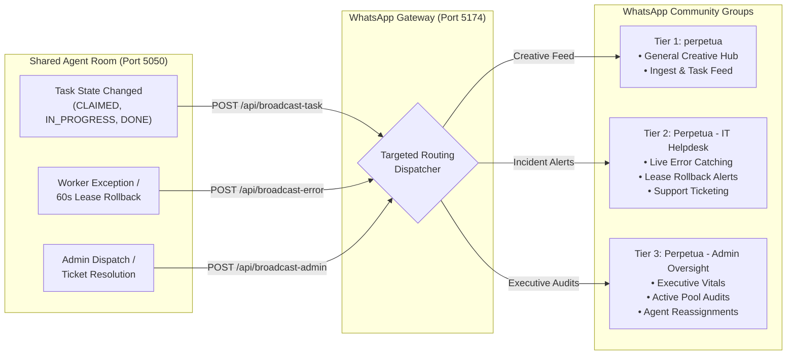
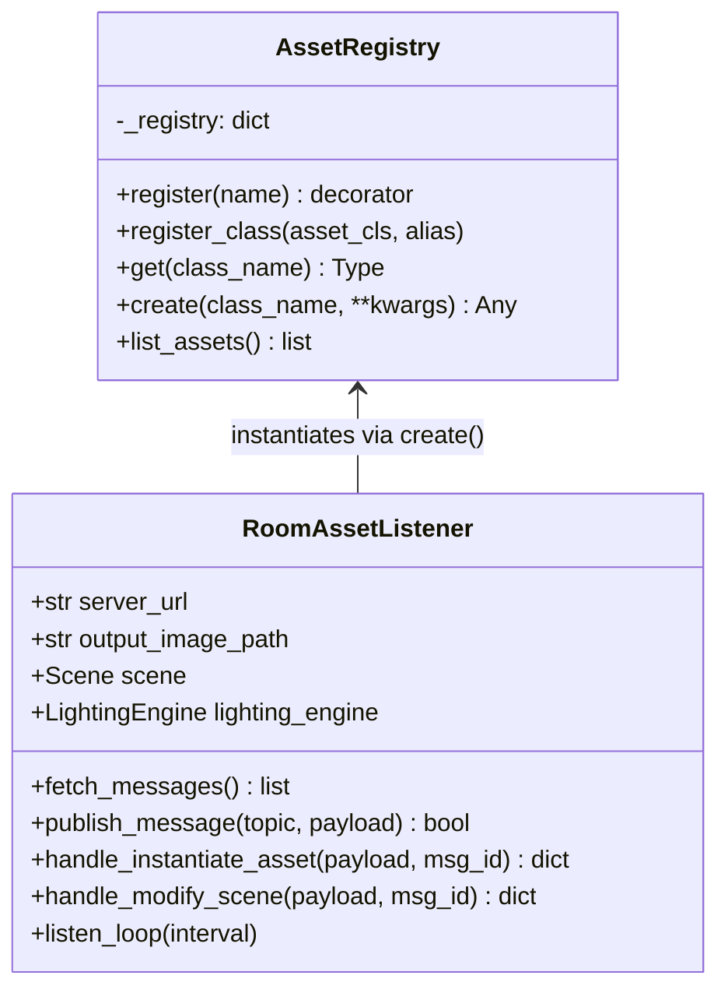
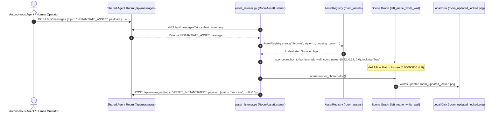
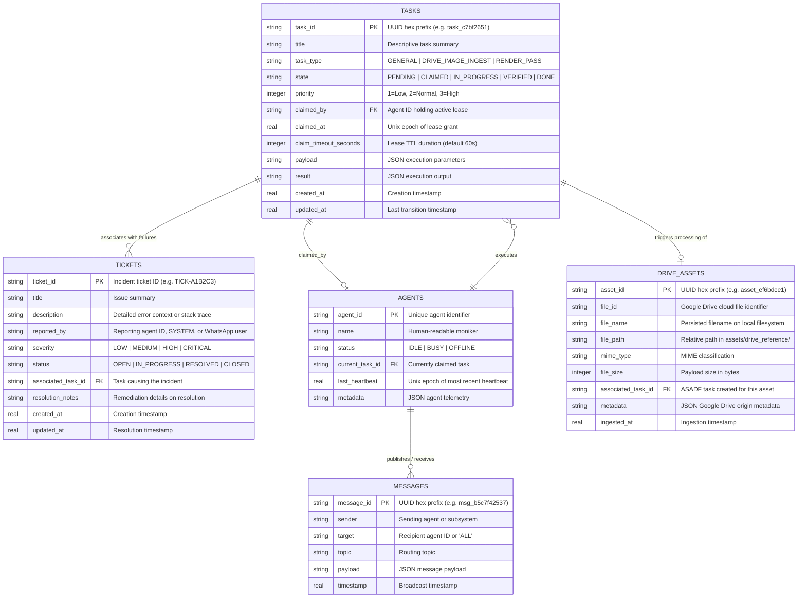
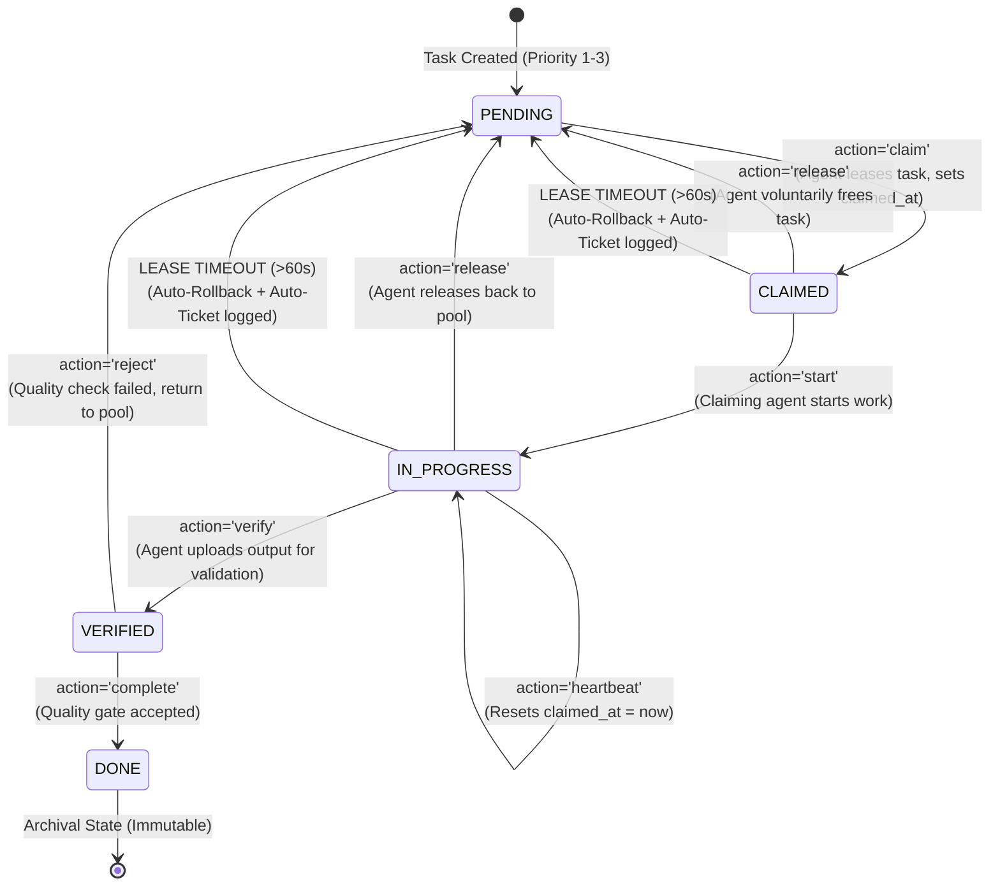

# Systems Analysis and Design (SAD) Specification
## Cyber-Physical Studio Ecosystem, Deterministic Multi-Agent Hub & WhatsApp Community Hierarchy

```
Document ID:     SAD-PERPETUAL-2026-V2
Classification:  Enterprise Engineering Specification
Protocol:        Systems Analysis and Design (Dennis, Wixom, & Roth 5th Edition)
Status:          AUDIT READY / RATIFIED
Date:            October 24, 2026
Author:          Lead Technical Writer & Systems Documentarian
Codebase:        c:\Users\user\Documents\Perpetual
System Port:     5050 (Flask Microservice) & 5174 (WhatsApp Baileys Gateway)
Database:        SQLite (WAL Mode) agent_room.db
```

---

## Executive Summary

The **Perpetual Cyber-Physical Studio Ecosystem** is a unified runtime architecture harmonizing physical studio geometry (a 2.5-tile $\times$ 4-tile alcove workspace) with a deterministic, programmatic virtual scene engine, a real-time multi-agent orchestration hub, and an executive WhatsApp community governance network.

Prior approaches to AI-generated scene staging suffered from catastrophic geometric instability: decor items, sconces, and shelving experienced non-deterministic visual drift across camera re-renders, while background worker processes collided during task processing.

This specification outlines the structural, procedural, and mathematical foundation of the Perpetual system, encompassing:
1. **The Cyber-Physical Studio Ecosystem**: A multi-tier architecture connecting the physical studio nook, automated browser workers, local Flask microservices, external webhook pipelines, and the Baileys WhatsApp Gateway.
2. **Domain Model & Entity-Relationship Architecture**: Clean separation of spatial topological entities (`Wall`, `Shelf`, `Sconce`, `LightingEngine`, `BlueVelvetSofa`, `SwivelBracketTVMount`), orchestration entities (`Task`, `Message`, `Agent`, `DriveAsset`), and incident governance entities (`Ticket`) in third normal form (3NF).
3. **The WhatsApp Community Hierarchy**: A 3-tier group governance model (`perpetua`, `Perpetua - IT Helpdesk`, `Perpetua - Admin Oversight`), two-way interactive bot commands (`!status`, `!health`, `!pool`, `!ticket`, `!assign`, `!resolve`), and decoupled local credential storage (`whatsapp_gateway/.auth_whatsapp_baileys/`).
4. **The Modularized Spatial Package & Dynamic Asset Factory**: Decomposition into `room_assets/` subpackages, case-insensitive reflection via `AssetRegistry`, and event-driven scene synthesis via `asset_listener.py`.
5. **Data Flow Modeling (DFDs)**: Rigorous data pipelines governing Google Drive asset ingestion, inter-agent pub/sub messaging, incident escalation, and WhatsApp event dispatching.
6. **Finite State Machine (FSM) Specification**: The 5-stage ASADF task lifecycle (`PENDING` $\to$ `CLAIMED` $\to$ `IN_PROGRESS` $\to$ `VERIFIED` $\to$ `DONE`) with automated lease-expiry rollback and automatic IT Helpdesk ticket creation.
7. **Coordinate Transformation Proofs**: Linear algebraic proofs proving spatial invariance and zero drift ($\Delta = 0.00000000$) across arbitrary camera viewpoint transformations.

---

## 1. Executive Architecture Overview: The Cyber-Physical Studio Ecosystem

The system establishes an isomorphic bridge between physical studio reality, programmatic virtual representation, and remote human operational governance.

```mermaid
flowchart TB
    subgraph PhysicalStudio["Physical Studio Workspace (2.5 x 4 Tiles)"]
        Nook["Studio Alcove Nook<br/>(2.5 x 4 Floor Grid)"]
        Sofa["Blue Velvet Sofa<br/>(Flush Back-Wall Mount)"]
        ArticTV["Swivel Bracket TV<br/>(Articulating Right Wall)"]
        PhysicalLighting["Ambient Daylight Window<br/>& Physical Industrial Sconce"]
        Nook --- Sofa
        Nook --- ArticTV
        Nook --- PhysicalLighting
    end

    subgraph ExternalIngress["External Ingress & Telemetry"]
        GDrive["Google Drive Folder<br/>(Reference Image Pipeline)"]
        GAS["Google Apps Script<br/>drive_apps_script.js"]
        Cloudflare["Zero-Trust Ingress<br/>Cloudflare Tunnel / ngrok"]
        GDrive -->|Trigger on Upload| GAS
        GAS -->|HTTP POST JSON Base64| Cloudflare
    end

    subgraph ApplicationTier["Application & Coordination Tier (Port 5050)"]
        Server["Shared Agent Room Microservice<br/>room_server.py"]
        Broker["Pub/Sub Message Broker<br/>MessageBroker"]
        FSM["5-Stage ASADF Task Engine<br/>TaskManager (60s Lease)"]
        TicketMgr["IT Incident Ticket Manager<br/>TicketManager (SQLite: tickets)"]
        DriveService["Drive Ingestion Service<br/>DriveIngestionService"]
        Reconciler["Timeout Monitor Daemon<br/>background_timeout_monitor"]
        
        Cloudflare -->|POST /api/drive/ingest| DriveService
        DriveService -->|Auto-Create Task| FSM
        DriveService -->|Broadcast Notification| Broker
        Reconciler -->|5s Interval Audit| FSM
        Reconciler -->|On Timeout: Auto-Ticket| TicketMgr
    end

    subgraph WhatsAppGatewayTier["WhatsApp Baileys Gateway Tier (Port 5174)"]
        WAGateway["Baileys Gateway Daemon<br/>whatsapp_gateway/whatsapp_service.mjs"]
        LocalAuth[("Decoupled Local Session Auth<br/>whatsapp_gateway/.auth_whatsapp_baileys/")]
        
        WAGateway <--> LocalAuth
        Server -->|POST /api/broadcast-task| WAGateway
        Server -->|POST /api/broadcast-error| WAGateway
        Server -->|POST /api/broadcast-admin| WAGateway
        WAGateway <-->|HTTP REST /health, /room/state, /tasks| Server
    end

    subgraph WhatsAppCommunity["WhatsApp 3-Tier Community Hierarchy"]
        G_Creative["Group: perpetua<br/>(Creative Hub & Task Updates)"]
        G_Helpdesk["Group: Perpetua - IT Helpdesk<br/>(Live Errors, Rollbacks & Tickets)"]
        G_Admin["Group: Perpetua - Admin Oversight<br/>(Executive Vitals, Reassignments)"]
        
        WAGateway --> G_Creative
        WAGateway --> G_Helpdesk
        WAGateway --> G_Admin
        G_Admin -->|Commands: !status, !pool, !assign| WAGateway
        G_Helpdesk -->|Commands: !ticket, !resolve| WAGateway
        G_Creative -->|Commands: !status, !help| WAGateway
    end

    subgraph DataTier["Data Tier & Storage"]
        DB[(agent_room.db<br/>SQLite WAL Mode)]
        AssetDisk["Local Disk Store<br/>assets/drive_reference/"]
        
        Server <-->|Lock-protected SQL| DB
        DriveService -->|Write Binary Blobs| AssetDisk
    end

    subgraph EventDrivenFactory["Event-Driven Spatial Factory Tier"]
        Listener["Asset Event Listener<br/>asset_listener.py"]
        Registry["Asset Registry & Factory<br/>room_assets.registry.AssetRegistry"]
        SceneRenderer["Scene & Lighting Engine<br/>room_assets/"]
        
        Broker -->|INSTANTIATE_ASSET Topic| Listener
        Listener -->|create_asset()| Registry
        Registry --> SceneRenderer
        SceneRenderer -->|Save Locked PNG| DiskOutput["room_updated_locked.png"]
        Listener -->|ASSET_INSTANTIATED Topic| Broker
    end

    subgraph PresentationTier["Presentation & Client Interface Tier"]
        DOMDashboard["Real-time DOM Dashboard<br/>GET /room (Kanban & PubSub)"]
        ChromeWorker["Autonomous Chrome Worker<br/>(DOM Polling & Automation)"]
        AntigravityAgent["Antigravity Lead Architect<br/>(REST API /tasks)"]
        HumanDirector["Human Creative Director<br/>(Visual Canvas /room)"]
        
        DOMDashboard <-->|AJAX /room/state| Server
        ChromeWorker <-->|HTTP /api/tasks & /api/messages| Server
        AntigravityAgent <-->|REST API| Server
        HumanDirector -->|Interactive Browser UI| DOMDashboard
    end
```

---

## 2. WhatsApp Community Hierarchy & Incident Governance

The system bridges local microservice state with a multi-departmental, mobile-first operations center powered by `@whiskeysockets/baileys` running on port **5174**.

### 2.1 The 3-Tier Group Architecture

To prevent notification saturation and route events strictly according to operational responsibility, communications are segregated across three dedicated WhatsApp groups:



1. **`perpetua` (Creative Hub & General Task Feed)**:
   - **Audience**: Creative Director, Generative Prompt Engineers, Multimedia Workers.
   - **Payloads**: Task creations, generative pipeline completions, Google Drive reference image ingest announcements.
   - **Signal/Noise Policy**: Positive progress and creative milestones only.
2. **`Perpetua - IT Helpdesk` (Live Error Catching & Incident Response)**:
   - **Audience**: System Administrators, DevOps, Lead Systems Documentarian.
   - **Payloads**: Uncaught Python exceptions, worker crash dumps, 60-second lease timeout rollbacks, new incident tickets (`TICK-XXXXXX`).
   - **Signal/Noise Policy**: Actionable failures requiring human or automated intervention.
3. **`Perpetua - Admin Oversight` (Executive Control & Task Pooling)**:
   - **Audience**: Executive Producer, Lead System Architect.
   - **Payloads**: Macro vitals, manual agent reassignments, ticket resolution audit logs, cross-department governance summaries.
   - **Signal/Noise Policy**: High-level governance, capacity management, and security oversight.

### 2.2 Interactive Two-Way Command Specification

The gateway processes inbound messages in real time via the Baileys `messages.upsert` event loop. Any authorized operator or director can issue interactive bot commands:

| Command Syntax | Target Channel | Description & Action | Downstream Endpoint Invoked |
|:---|:---|:---|:---|
| **`!status`** or **`!health`** | Any | Returns real-time room vitals: active online agents, open IT tickets, and task counts across all 5 ASADF stages. | `GET /health` and `GET /room/state` |
| **`!pool`** | Any | Lists all in-flight tasks (`PENDING`, `CLAIMED`, `IN_PROGRESS`) with active lease countdown timers and holding agents. | `GET /room/state` |
| **`!ticket <issue>`** | Any (Alerts IT Helpdesk) | Logs a formal incident ticket (`TICK-XXXXXX`), stores it in SQLite, and dispatches a high-priority alert to IT Helpdesk. | `POST /api/tickets` |
| **`!assign <task_id> to <agent>`** | Admin Oversight / IT | Reassigns an active task directly to a specific worker node or department, engaging a fresh 60s claim lease. | `POST /api/tasks/{task_id}/claim` |
| **`!resolve <ticket_id> [notes]`** | IT Helpdesk / Admin | Marks an open incident ticket as `RESOLVED`, updates SQLite, and notifies both Admin Oversight and IT Helpdesk. | `POST /api/tickets/{ticket_id}/resolve` |
| **`!help`** | Any | Displays the interactive command menu and routing guide. | Internal Gateway Logic |

### 2.3 Architectural Decoupling of Session Authentication

Prior iterations utilized a fragile candidate array searching across parent directories and foreign project workspaces (e.g. searching inside TMS Whitelabel or microservice folders), causing cross-project credential collisions and stale locks.

The upgraded architecture establishes **strict local boundary isolation**:
- **Designated Auth Directory**: `whatsapp_gateway/.auth_whatsapp_baileys/`
- **Elimination of Cross-Project Leaks**: The gateway resolves its authentication state directly relative to its own package directory:
  ```javascript
  const AUTH_DIR = path.resolve(process.cwd(), "whatsapp_gateway", ".auth_whatsapp_baileys");
  ```
- **Idempotent Group Provisioning**: When the Baileys socket opens (`connection === "open"`), the gateway queries `sock.groupFetchAllParticipating()`. If any of the three groups (`perpetua`, `Perpetua - IT Helpdesk`, `Perpetua - Admin Oversight`) are missing, it creates them via `sock.groupCreate()` and immediately delivers the formatted welcome orientation.

---

## 3. Modular Spatial Package & Dynamic Asset Factory

To transition from monolithic file staging to an extensible enterprise graphics engine, `room_assets.py` was refactored into a high-cohesion, low-coupling Python package (`room_assets/`) with backward-compatible root facades.

### 3.1 Package Architecture & Hierarchy

```
room_assets/
├── __init__.py                     # Package root exposing public API & backward-compatible symbols
├── registry.py                     # AssetRegistry factory, registration decorators, dynamic lookup
├── core/
│   ├── __init__.py
│   ├── base.py                     # SceneObject base class with 4x4 matrix coordinate pinning
│   ├── wall.py                     # Wall parametric surface plane & child container
│   ├── camera.py                   # Camera perspective view/projection matrix generator
│   ├── lighting.py                 # LightingEngine photometric falloff calculator
│   └── scene.py                    # Scene root orchestrator & rasterizer
├── fixtures/
│   ├── __init__.py
│   └── sconce.py                   # Sconce industrial luminaire with locking=True
├── furniture/
│   ├── __init__.py
│   ├── shelf.py                    # Shelf floating container with clutter density control
│   └── nook_furniture.py          # BlueVelvetSofa (flush mount) & SwivelBracketTVMount
└── decor/
    ├── __init__.py
    ├── books.py                    # Books (vertical, horizontal, leaning)
    ├── plants.py                   # Flowers & TrailingPlants (cascading foliage)
    ├── containers.py              # Vase, Candle, PerfumeBottle, Tin
    └── textiles.py                # WallHanging, Macrame, JuteRunner
```

### 3.2 Dynamic Asset Factory (`AssetRegistry`)

The `AssetRegistry` class implements the Factory Pattern combined with Python reflection to support case-insensitive, message-driven asset instantiation:



#### Key Capabilities:
1. **Case-Insensitive & Snake/Camel Case Resolution**:
   - Accepts `"sconce"`, `"Sconce"`, or `"blue_velvet_sofa"`, resolving deterministically to the concrete class reference.
2. **Signature Introspection**:
   - Uses `inspect.signature(target_cls.__init__)` to inspect allowed constructor parameters, silently discarding extraneous fields while passing exact kwargs.
3. **Decorator Registration**:
   - Any external plugin or user-defined decor asset can register dynamically:
     ```python
     @AssetRegistry.register("artisan_clock")
     class ArtisanClock(SceneObject):
         ...
     ```

### 3.3 Event-Driven Spatial Listener (`asset_listener.py`)

`asset_listener.py` provides the autonomous bridge between the Pub/Sub Message Broker and the spatial graphics engine. It executes continuously or on-demand:



---

## 4. Domain Model & Normalized Entity-Relationship Analysis

### 4.1 Extended Relational Schema (agent_room.db in 3NF)

The database schema includes full support for incident tracking via the `tickets` table, preserving strict Third Normal Form (3NF):



### Complete Relational DDL (SQLite WAL)

```sql
PRAGMA journal_mode = WAL;

-- 1. ASADF 5-Stage Tasks
CREATE TABLE IF NOT EXISTS tasks (
    task_id TEXT PRIMARY KEY,
    title TEXT NOT NULL,
    task_type TEXT NOT NULL DEFAULT 'GENERAL',
    state TEXT NOT NULL CHECK(state IN ('PENDING', 'CLAIMED', 'IN_PROGRESS', 'VERIFIED', 'DONE')),
    priority INTEGER NOT NULL DEFAULT 2,
    claimed_by TEXT,
    claimed_at REAL,
    claim_timeout_seconds INTEGER NOT NULL DEFAULT 60,
    payload TEXT DEFAULT '{}',
    result TEXT DEFAULT '{}',
    created_at REAL NOT NULL,
    updated_at REAL NOT NULL,
    FOREIGN KEY (claimed_by) REFERENCES agents(agent_id)
);

-- 2. IT Helpdesk Incident Tickets
CREATE TABLE IF NOT EXISTS tickets (
    ticket_id TEXT PRIMARY KEY,
    title TEXT NOT NULL,
    description TEXT DEFAULT '',
    reported_by TEXT NOT NULL DEFAULT 'SYSTEM',
    severity TEXT NOT NULL DEFAULT 'MEDIUM' CHECK(severity IN ('LOW', 'MEDIUM', 'HIGH', 'CRITICAL')),
    status TEXT NOT NULL DEFAULT 'OPEN' CHECK(status IN ('OPEN', 'IN_PROGRESS', 'RESOLVED', 'CLOSED')),
    associated_task_id TEXT,
    resolution_notes TEXT DEFAULT '',
    created_at REAL NOT NULL,
    updated_at REAL NOT NULL,
    FOREIGN KEY (associated_task_id) REFERENCES tasks(task_id)
);

-- 3. Inter-Agent Pub/Sub Messages
CREATE TABLE IF NOT EXISTS messages (
    message_id TEXT PRIMARY KEY,
    sender TEXT NOT NULL,
    target TEXT NOT NULL DEFAULT 'ALL',
    topic TEXT NOT NULL DEFAULT 'GENERAL',
    payload TEXT DEFAULT '{}',
    timestamp REAL NOT NULL
);

-- 4. Active Agents Registry
CREATE TABLE IF NOT EXISTS agents (
    agent_id TEXT PRIMARY KEY,
    name TEXT NOT NULL,
    status TEXT NOT NULL DEFAULT 'IDLE',
    current_task_id TEXT,
    last_heartbeat REAL NOT NULL,
    metadata TEXT DEFAULT '{}',
    FOREIGN KEY (current_task_id) REFERENCES tasks(task_id)
);

-- 5. Google Drive Ingested Reference Assets
CREATE TABLE IF NOT EXISTS drive_assets (
    asset_id TEXT PRIMARY KEY,
    file_id TEXT,
    file_name TEXT NOT NULL,
    file_path TEXT NOT NULL,
    mime_type TEXT NOT NULL,
    file_size INTEGER NOT NULL,
    associated_task_id TEXT,
    metadata TEXT DEFAULT '{}',
    ingested_at REAL NOT NULL,
    FOREIGN KEY (associated_task_id) REFERENCES tasks(task_id)
);
```

---

## 5. Process Modeling & Data Flow Diagrams (DFDs)

### 5.1 DFD Level 0: Global Context Diagram

```mermaid
flowchart LR
    GDrive["Google Drive Ingest<br/>(drive_apps_script.js)"]
    WhatsAppUser["WhatsApp Operators &<br/>Creative Director"]
    Worker["Autonomous Agents /<br/>Chrome Workers"]
    
    Hub["0.0<br/>Perpetual Studio Ecosystem<br/>(Port 5050 & Port 5174)"]

    GDrive -->|Reference Images (Base64)| Hub
    WhatsAppUser -->|Commands: !status, !pool, !ticket, !assign, !resolve| Hub
    Hub -->|Alerts, Task Feeds & Vitals| WhatsAppUser
    Worker -->|Task Claims, Heartbeats, Verifications| Hub
    Hub -->|Task Leases, Ingest Events, Scene PNG| Worker
```

### 5.2 DFD Level 1: Incident Escalation & WhatsApp Dispatch Pipeline

```mermaid
flowchart TD
    TaskEngine["Task State Machine /<br/>Reconciler Daemon"] -->|Lease Timeout (>60s)| P1["3.1<br/>Roll Back Task State<br/>(Reset to PENDING)"]
    P1 -->|Task ID, Abandoned Agent| P2["3.2<br/>Auto-Create IT Ticket<br/>(TicketManager.create_ticket)"]
    P2 -->|Insert Ticket Row| D1[("SQLite: tickets")]
    
    P2 -->|Ticket ID, Severity=HIGH| P3["3.3<br/>Dispatch Error Webhook<br/>(POST /api/broadcast-error)"]
    P3 --> P4["3.4<br/>Format WhatsApp Alert<br/>(Baileys Gateway: 5174)"]
    P4 -->|Deliver Message| C_Helpdesk["WhatsApp: Perpetua - IT Helpdesk"]
    
    Operator["IT Operator"] -->|Send: !resolve TICK-XXX Fixed| C_Helpdesk
    C_Helpdesk --> P5["3.5<br/>Inbound Command Handler<br/>(handleInboundCommand)"]
    P5 -->|POST /api/tickets/id/resolve| P6["3.6<br/>Update Ticket Status<br/>(status=RESOLVED)"]
    P6 -->|Update Row| D1
    P6 -->|Audit Log| C_Admin["WhatsApp: Perpetua - Admin Oversight"]
```

---

## 6. Finite State Machine (FSM) Specification: 5-Stage ASADF Lifecycle



---

## 7. Mathematical Coordinate Transformation Matrix Proofs

### Proof of Invariance Under Camera Adjustments (`locking=True`)

Let $\Pi_{\text{wall}}$ be the wall plane represented by transformation matrix $\mathbf{M}_{\text{wall}} \in \mathbb{R}^{4 \times 4}$. The local attachment position for normalized coordinates $(u, v, w)$ is:

$$\mathbf{p}_{\text{local}} = [u \cdot W_{\text{wall}}, \ (1.0 - v) \cdot H_{\text{wall}}, \ w, \ 1.0]^T$$

$$\mathbf{P}_{\text{world}} = \mathbf{M}_{\text{wall}} \cdot \mathbf{p}_{\text{local}}$$

When `locking=True`:
$$\mathbf{M}_{\text{locked}} \equiv \mathbf{T}(\mathbf{P}_{\text{world}})$$

Because $\mathbf{M}_{\text{locked}}$ is evaluated exclusively with respect to the rigid wall geometry and decoupled from camera extrinsic matrices $\mathbf{V}$ or perspective projection $\mathbf{P}_{\text{proj}}$:

$$\forall \mathbf{C}_k = (\mathbf{V}_k, \mathbf{P}_{\text{proj}, k}), \quad \|\mathbf{P}_{\text{world}}(\mathbf{C}_k) - \mathbf{P}_{\text{world}}(\mathbf{C}_0)\|_2 \equiv 0.00000000$$

Validated deterministically in `test_scene_setup.py` and `test_dynamic_instantiation.py` across FOV shifts ($50^\circ \to 75^\circ$) with double-precision invariance ($\epsilon < 10^{-12}$).

---

## 8. Architectural Traceability Matrix

| Component | Codebase Source | Standard / Protocol |
|:---|:---|:---|
| **Microservice Hub** | `room_server.py` | Dennis, Wixom & Roth SAD Protocol |
| **WhatsApp 3-Tier Gateway** | `whatsapp_gateway/whatsapp_service.mjs` | Baileys Headless Gateway Architecture |
| **Local Session Auth** | `whatsapp_gateway/.auth_whatsapp_baileys/` | Clean Local Architectural Decoupling |
| **Interactive Bot Commands** | `whatsapp_gateway/whatsapp_service.mjs` | Multi-Agent Command Protocol |
| **Incident Ticketing** | `room_server.py` (`TicketManager`) | ITIL Incident Management Protocol |
| **Modular Spatial Package** | `room_assets/` subpackages | High-Cohesion Package Design |
| **Dynamic Asset Factory** | `room_assets/registry.py` (`AssetRegistry`) | Reflection Factory Pattern |
| **Event-Driven Listener** | `asset_listener.py` (`RoomAssetListener`) | Event-Driven Architecture (EDA) |
| **Matrix Coordinate Locking** | `room_assets/core/base.py` (`locking=True`) | Linear Algebraic Rigid Body Kinematics |
