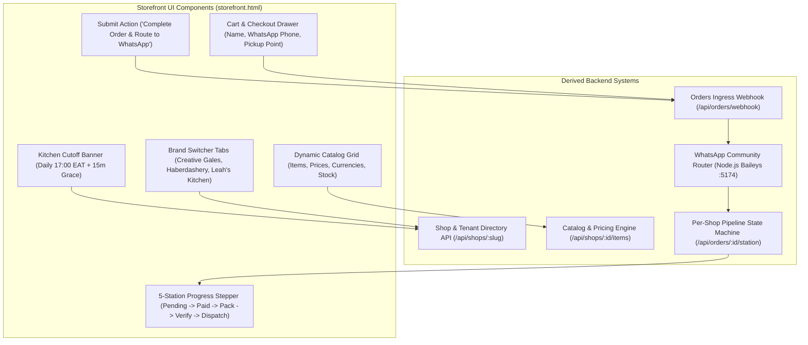
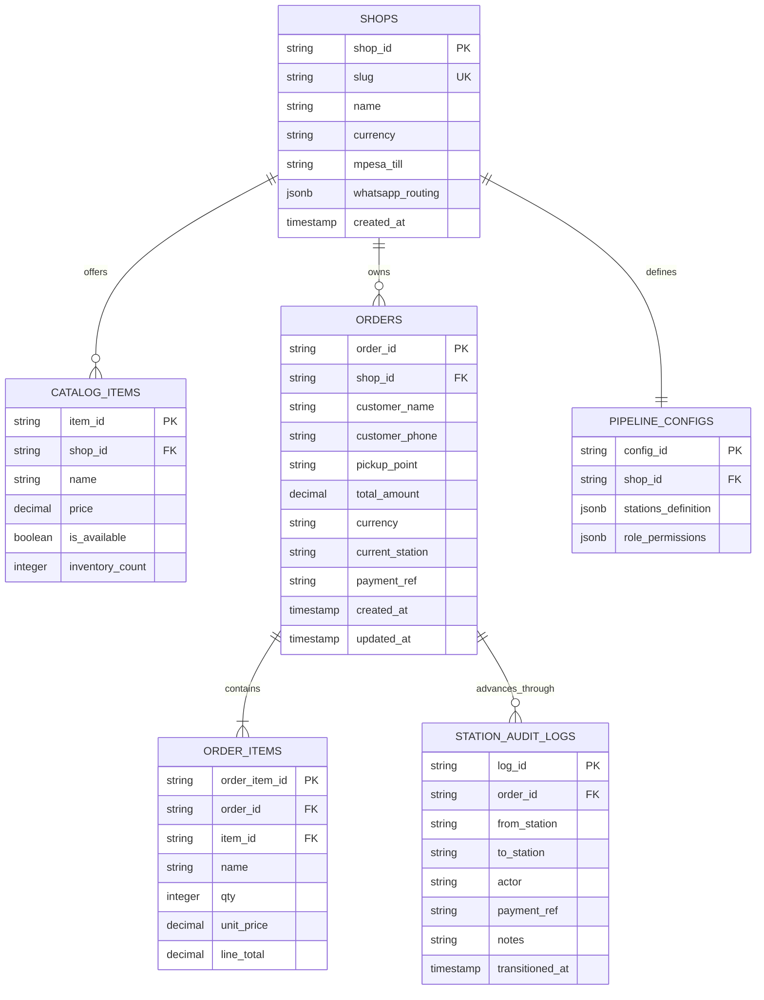

# UI-to-Backend Reverse-Engineering Specification
**Target Systems:** Multi-Tenant Storefront Gateway & Autonomous WhatsApp Operations  
**Framework:** 5-Stage Defensive Architectural Derivation (ISO/IEC 25010 & SOLID)  
**Derived From:** [`templates/storefront.html`](file:///c:/Users/user/Documents/Perpetual/templates/storefront.html) & Operational Floor Workflows

See the full specification and interactive model in the conversation artifact or review the sections below.

---

## Stage 1: Formal UI Deconstruction & Traceability Matrix

### 1.1 Screen & Component Inventory
Deconstructing the existing storefront interface into atomic data elements, user interactions, and required backend capabilities:



### 1.2 UI Attribute Harvesting & Traceability Matrix

| UI Component | Visible Data Attributes | User Actions & Triggers | Defensive Validation Constraints | Target Backend Endpoint |
| :--- | :--- | :--- | :--- | :--- |
| **Brand Selector** | Brand key, title, currency (`USD` vs `KES`) | `switchBrand(brandKey)` | Must exist in registered shops cache. | `GET /api/shops` |
| **Catalog Card** | `item.id`, `name`, `price`, `emoji`, `desc` | `addToCart(itemId)` | Price must be positive float; item must be in-stock. | `GET /api/shops/:slug/items` |
| **Cutoff Banner** | Daily cutoff: `17:00 EAT`, grace: `15 mins` | Displayed conditionally when brand = `kitchen` | Reject or warn orders submitted past cutoff timestamp. | `POST /api/orders/validate-cutoff` |
| **Customer Name** | Plain text string | User typing | $2 \le \text{length} \le 80$, sanitized against XSS. | Ingested in `POST /api/orders/webhook` |
| **WhatsApp Phone**| Local or international phone | User typing | Kenyan format `^(\+254\|0)[17]\d{8}$` or E.164 standard. | Ingested in `POST /api/orders/webhook` |
| **Pickup Point** | Dropdown options (`Gate A`, `Gate B`, `Kitchen Counter`) | Selection change | Must match registered pickup points for that shop. | Ingested in `POST /api/orders/webhook` |
| **Checkout Submit**| Order payload & total amount | `submitOrderToPerpetual()` | Cart count $\ge 1$; total $\equiv \sum (\text{qty} \times \text{price})$. | `POST /api/orders/webhook` |
| **Station Stepper**| Order ID pill, active station node | Polling `/api/orders/:id` | Read-only projection of database station ledger. | `GET /api/orders/:id` |

---

## Stage 2: Boundary Schema Contracts & Defensive Validation

All ingress data must pass zero-trust validation before hitting business logic or database persistence.

### 2.1 Pydantic V2 Request Schemas

```python
from pydantic import BaseModel, Field, field_validator, ConfigDict
from typing import List, Optional
import re
from datetime import datetime

class OrderItemSchema(BaseModel):
    model_config = ConfigDict(frozen=True)
    item_id: str = Field(..., min_length=2, max_length=64)
    name: str = Field(..., min_length=1, max_length=120)
    qty: int = Field(..., gt=0, le=100)
    price: float = Field(..., gt=0.0)

class CreateOrderRequest(BaseModel):
    model_config = ConfigDict(str_strip_whitespace=True)
    shop_slug: str = Field(..., pattern=r"^[a-z0-9-]+$")
    customer_name: str = Field(..., min_length=2, max_length=80)
    customer_phone: str = Field(...)
    pickup_point: str = Field(..., min_length=2, max_length=100)
    currency: str = Field(..., pattern=r"^(KES|USD|EUR)$")
    items: List[OrderItemSchema] = Field(..., min_length=1)
    notes: Optional[str] = Field(default="", max_length=500)

    @field_validator("customer_phone")
    @classmethod
    def validate_phone(cls, v: str) -> str:
        # Standardize Kenyan phone numbers to +254 format
        cleaned = re.sub(r"[\s\-]", "", v)
        if re.match(r"^0[17]\d{8}$", cleaned):
            return f"+254{cleaned[1:]}"
        if re.match(r"^\+254[17]\d{8}$", cleaned):
            return cleaned
        if re.match(r"^\+[1-9]\d{7,14}$", cleaned):
            return cleaned
        raise ValueError("Invalid phone number. Kenyan numbers must match +2547XXXXXXXX or 07XXXXXXXX.")

class AdvanceStationRequest(BaseModel):
    station: str = Field(..., min_length=2, max_length=32)
    actor: str = Field(..., min_length=2, max_length=64)
    payment_ref: Optional[str] = Field(default=None, max_length=64)
    courier_name: Optional[str] = Field(default=None, max_length=80)
    notes: Optional[str] = Field(default="", max_length=500)
```

---

## Stage 3: Domain Entity & Invariant Modeling (3NF Relational Schema)

### 3.1 Entity Relationship Diagram



### 3.2 Non-Negotiable Domain Invariants
1. **Total Invariance:**
   $$\text{total\_amount} \equiv \sum_{i \in \text{items}} (\text{qty}_i \times \text{unit\_price}_i)$$
   The microservice computes line totals on the server; it never trusts client-calculated totals.
2. **Station Monotonicity:** An order can only transition to a station defined as a valid `next` node in the shop's active `PIPELINE_CONFIG`. Direct jumps (e.g. `PENDING` $\to$ `DISPATCHED`) are rejected by invariant guards.
3. **Immutable Audit Ledger:** `STATION_AUDIT_LOGS` is strictly append-only. No updates or deletions are permitted on historical station records.

---

## Stage 4: Business Logic Isolation & SOLID Services

### 4.1 Shop Pipeline Engine Contract (`IPipelineService`)
```python
from abc import ABC, abstractmethod
from typing import Dict, Any, List

class IPipelineEngine(ABC):
    @abstractmethod
    def get_initial_station(self, shop_id: str) -> str:
        """Returns the entry station for a newly created order."""
        pass

    @abstractmethod
    def validate_transition(
        self, shop_id: str, current_station: str, target_station: str, actor_role: str
    ) -> bool:
        """Validates whether actor_role has permission to execute the transition."""
        pass

    @abstractmethod
    def get_stepper_nodes(self, shop_id: str) -> List[Dict[str, Any]]:
        """Returns ordered visual nodes for the customer UI progress stepper."""
        pass
```

### 4.2 Leah's Kitchen Pre-Order Cutoff Validator (Pure Service)
```python
from datetime import datetime
import pytz
from typing import Optional, Dict, Any

class KitchenCutoffValidator:
    EAT_TZ = pytz.timezone("Africa/Nairobi")
    CUTOFF_HOUR = 17      # 5:00 PM
    GRACE_MINUTES = 15    # Until 5:15 PM

    @classmethod
    def evaluate_order_time(cls, order_time: Optional[datetime] = None) -> Dict[str, Any]:
        """
        Pure business calculation evaluating cutoff windows with zero HTTP/DB dependencies.
        """
        current_time = (order_time or datetime.now(cls.EAT_TZ)).astimezone(cls.EAT_TZ)
        hour = current_time.hour
        minute = current_time.minute

        # Cutoff check
        is_past_cutoff = (hour > cls.CUTOFF_HOUR) or (hour == cls.CUTOFF_HOUR and minute > cls.GRACE_MINUTES)
        
        return {
            "current_time_eat": current_time.strftime("%H:%M:%S"),
            "is_scheduled_for_today": not is_past_cutoff,
            "batch_day": "TODAY" if not is_past_cutoff else "TOMORROW",
            "warning": "Order placed after 17:00 EAT. Scheduled for tomorrow's batch." if is_past_cutoff else None
        }
```

---

## Stage 5: API Layer Composition & Test Verification

### 5.1 Endpoints to Expose

| Method | Endpoint | Responsibility |
| :--- | :--- | :--- |
| `GET` | `/api/shops` | Lists all active shops and their currencies. |
| `GET` | `/api/shops/<slug>/pipeline` | Returns dynamic stepper nodes for the shop. |
| `POST` | `/api/orders/webhook` | Validates cart, evaluates cutoff, creates order in `PENDING`. |
| `GET` | `/api/orders/<id>` | Returns order telemetry and active station for frontend polling. |
| `POST` | `/api/orders/<id>/station` | Advances order station based on worker command. |

### 5.2 Dynamic Stepper Integration (Frontend Script)
Instead of hardcoding 5 fixed nodes in `storefront.html`, the frontend fetches the shop's pipeline nodes dynamically upon brand switch:

```javascript
async function loadShopPipeline(shopSlug) {
  const res = await fetch(`/api/shops/${shopSlug}/pipeline`);
  const pipeline = await res.json();
  const stepperEl = document.getElementById("station-stepper");
  stepperEl.innerHTML = pipeline.stations.map(st => `
    <div class="step-node" id="st-${st.id.toLowerCase()}">
      ${st.emoji} ${st.label}
    </div>
  `).join("");
}
```
When WhatsApp workers advance the order, the UI lights up the active node dynamically without any cross-brand pollution.
