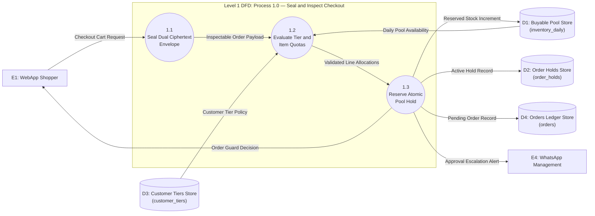
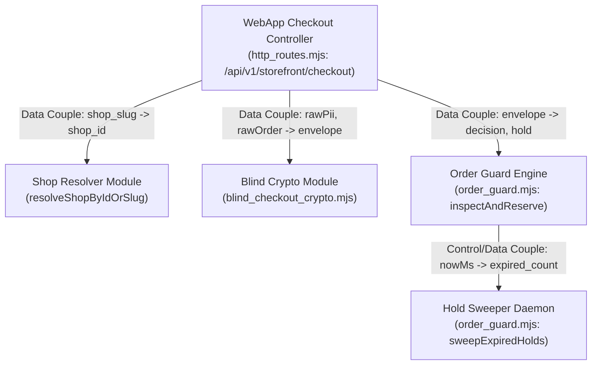

# Perpetual Live Orchestration Through WebApps: User Manual & Systems Analysis and Design (SAD) Technical Specification

**Document ID**: `SAD-WEBAPP-PERPETUAL-2026-V3`  
**Standard**: Dennis, Wixom, & Roth (*Systems Analysis and Design*, 5th Edition)  
**Repositories Covered**:
- **Perpetual Core & Gateway**: `c:\Users\user\Documents\Perpetual` (`templates/storefront.html`, `whatsapp_gateway/http_routes.mjs`, `whatsapp_gateway/order_guard.mjs`, `whatsapp_gateway/blind_checkout_crypto.mjs`)
- **TMS Whitelabel Multi-Tenant React Storefront**: `C:\Users\user\Documents\Quality assurance\tms-whitelabel-core` (`src/pages/Order.jsx`, `src/services/order-guard-client.js`, `src/tenants/keby254/tenant.config.ts`)

---

# PART I: WEBAPP LIVE ORCHESTRATION USER MANUAL

## 1. Overview of the Two Live WebApp Storefronts

Perpetual operates two live web storefront architectures connected to the same **Blind Checkout Inspector & Order Guard** (`http://localhost:5174/api/v1/storefront/*`):

| WebApp Surface | URL / Route | Target Use Case | Key Source Files |
|:---|:---|:---|:---|
| **1. Perpetual Unified Multi-Shop Storefront** | `http://localhost:5050/storefront` | Rapid multi-shop switching (`☕ Java House`, `🍗 QuickMart`, `🇰🇪 KEby254`), side-by-side testing, and direct M-Pesa Till checkout. | `templates/storefront.html`, `room_server.py` |
| **2. TMS Whitelabel Core Storefront (React/Vite)** | `http://localhost:5173/s/keby254/order` (or `?tenant=keby254`) | Branded, tenant-isolated customer storefront with custom theme CSS variables, hero banners, category filters, and delivery/pickup scheduling. | `src/pages/Order.jsx`, `src/services/order-guard-client.js`, `src/tenants/keby254/tenant.config.ts` |

---

## 2. Starting the WebApp Live Stack

### 2.1 Prerequisites & Production Secrets
In production (`NODE_ENV=production`), the gateway enforces a fail-fast startup guard requiring three 64-character hex (256-bit) keys in `.env`:
```env
PII_ENCRYPTION_KEY=<64-hex-char-256-bit-key-for-pii-vault>
ORDER_GUARD_KEY=<64-hex-char-256-bit-key-for-order-inspector>
ORDER_GUARD_HMAC_SECRET=<random-secret-for-customer-phone-hmac>
```

### 2.2 Launching the Servers
1. **Start the WhatsApp & Order Guard Gateway (Port 5174)**:
   ```powershell
   cd c:\Users\user\Documents\Perpetual
   node whatsapp_gateway/index.mjs
   ```
2. **Start the Perpetual Microservice Hub (Port 5050)**:
   ```powershell
   cd c:\Users\user\Documents\Perpetual
   python room_server.py
   ```
3. **Start the TMS Whitelabel React Storefront (Port 5173)**:
   ```powershell
   cd "C:\Users\user\Documents\Quality assurance\tms-whitelabel-core"
   npm run dev
   ```

---

## 3. Customer Walkthrough: Shopping & Live Pool Badges

1. **Select a Shop / Tenant**:
   - On `http://localhost:5050/storefront`, click the **`🇰🇪 KEby254`** tab (or `☕ Java House` / `🍗 QuickMart`).
   - On `tms-whitelabel-core`, navigate to `/s/keby254/order`.
2. **Live Buyable Pool Sync**:
   - On page load, the WebApp calls `GET http://localhost:5174/api/v1/storefront/:slug/catalog`.
   - Each product card displays real-time pool availability (`available = daily_cap - held - sold`) and per-order policy limits (`max_per_order`, `min_qty`, `step_qty`).
   - **No Cart Hoarding**: Adding items to your browser cart does **not** lock inventory for other shoppers. Stock is only reserved when you click **Proceed to Payment / Place Order**.
3. **Adjusting Quantities in the Cart**:
   - Use the **`-`** and **`+`** stepper buttons inside the cart panel to increment or decrement item quantities at any time.

---

## 4. The "See → Act → Remedy & Continue" Checkout Flow

When the customer clicks **Proceed to Payment** (`storefront.html`) or **Submit Order** (`Order.jsx`), the WebApp sends the cart to `POST /api/v1/storefront/checkout`. The Order Guard returns one of four structured outcomes:

### Outcome A: `APPROVED` (`can_show_payment: true`)
- **What the Customer Sees**: A green **Stock Reserved** confirmation banner (`#order-guard-till-banner`) with the exact **10-minute hold expiration time** and the shop's **M-Pesa Buy Goods Till Number** (e.g., Till `4109840`).
- **What the Customer Does**: Pays the exact amount to the M-Pesa Till on their phone and pastes the 10-character M-Pesa confirmation code (e.g., `SJK891234Z`) into the claim box.

### Outcome B: `REJECTED` (`can_show_payment: false`) — Over Per-Order Limit, Step Size, or Pool Exhausted
- **What the Customer Sees (`1. SEE`)**: The M-Pesa Till number is **hidden** (`can_show_payment: false`), and an amber/red **Order Guard Policy Notice** (`#order-guard-remedy-banner`) explains the exact violation (e.g., *"Order limit exceeded for Satin Bonnet (Double-Sided): requested 6, max allowed per order is 5 (tier: retail)."*).
- **What the Customer Clicks (`2. ACT`)**: A 1-tap **"⚡ Fix Quantity to 5 & Retry Checkout"** button inside the banner (or manual `-`/`+` buttons in the cart).
- **How the Customer Continues (`3. REMEDY & CONTINUE`)**: Clicking the remedy button automatically updates the offending item's quantity in the cart (or removes a sold-out item) and immediately re-submits checkout (`proceedToPayment()`), reserving the hold and revealing the M-Pesa Till instructions without re-typing name or phone details.

### Outcome C: `TRIMMED` (`over_limit_mode = 'surebet'`, `can_show_payment: true`)
- When a shop item is configured in `surebet` mode, requesting more than the allowed limit automatically trims the cart to the maximum buyable quantity, reserves the trimmed stock for 10 minutes, updates the total in KES, and shows the M-Pesa Till immediately.

### Outcome D: `NEEDS_APPROVAL` (`can_show_payment: false`)
- Triggered when an order exceeds `max_order_value` (default `50,000 KES`) or when a wholesale/bulk request requires manager review.
- **What Happens**: Stock is **held** for 10 minutes (`status = NEEDS_APPROVAL`) so no one else can buy it while waiting, an instant WhatsApp alert is sent to the shop's **Management Group**, and the customer sees a pending-approval banner. Once a manager sends `!approve-order <ORDER_ID>` on WhatsApp, the customer can complete payment.

---

## 5. Multi-Shop Provisioning & Policy Rollout From CLI

### 5.1 Provisioning a New Shop From the Template Manifest
1. Copy `config/shop_manifests/shop.template.json` to `config/shop_manifests/<your_shop>.json`.
2. Run the universal seeder:
   ```powershell
   node whatsapp_gateway/seed_shop.mjs config/shop_manifests/<your_shop>.json
   ```
   This seeds Supabase (`shops`, `menu_items`, `inventory_daily`) and writes an offline-resilient mirror to `config/shops/<slug>.json`.

### 5.2 Applying Order Guard Policies Across All Shops & Products
- **Preview (Dry Run)**:
  ```powershell
  node whatsapp_gateway/apply_order_guard_all_shops.mjs --dry-run
  ```
- **Apply Category-Smart Defaults to All Shops**:
  ```powershell
  node whatsapp_gateway/apply_order_guard_all_shops.mjs
  ```
- **Override Limits Globally or Per Shop**:
  ```powershell
  node whatsapp_gateway/apply_order_guard_all_shops.mjs --shop keby254 --daily-cap 80 --max-per-order 4 --mode surebet
  ```

---

# PART II: SAD TECHNICAL SPECIFICATION FOR WEBAPP LIVE ORCHESTRATION

## 6. Phase 1: Planning & Economic Feasibility (Dennis, Wixom & Roth Ch. 1)

### 6.1 System Request Summary
- **Business Need**: Eliminate overselling during flash drops, prevent unpaid cart hoarding, block unauthorized bulk/bot sweeps before M-Pesa payment is made, and protect customer PII from exposure during automated order inspection across multi-tenant WebApps.
- **Tangible Benefits**: Zero M-Pesa reversal fees from oversold orders, 100% elimination of cart-lock denial-of-service, and multi-tenant onboarding reduced from days to under 60 seconds via `seed_shop.mjs`.

### 6.2 Discounted Cash Flow (NPV, ROI, Break-Even Analysis)
Computed via the SAD Economic Feasibility engine (`feasibility_calc.py` at a 10% required rate of return):

| Financial Metric | Year 0 (Dev) | Year 1 | Year 2 | Year 3 | Total (PV) |
|---| ---: | ---: | ---: | ---: | ---: |
| **Total Benefits (Nominal)** | \$0.00 | \$48,000.00 | \$72,000.00 | \$96,000.00 | - |
| **PV of Benefits (10%)** | \$0.00 | \$43,636.36 | \$59,504.13 | \$72,126.22 | **\$175,266.72** |
| **Total Costs (Nominal)** | \$45,000.00 | \$12,000.00 | \$14,000.00 | \$16,000.00 | - |
| **PV of Costs (10%)** | \$45,000.00 | \$10,909.09 | \$11,570.25 | \$12,021.04 | **\$79,500.38** |
| **Net Present Value (Annual)** | \$-45,000.00 | \$32,727.27 | \$47,933.88 | \$60,105.18 | **\$95,766.34** |
| **Cumulative Net Cash Flow (NPV)** | \$-45,000.00 | \$-12,272.73 | \$35,661.16 | \$95,766.34 | - |

- **Cumulative Net Present Value (NPV)**: **\$95,766.34**
- **Return on Investment (ROI)**: **120.46%**
- **Break-Even Point (Payback Period)**: **Year 2 (1.26 years / ~15 months)**

---

## 7. Phase 2: Systems Analysis (Requirements, Use Cases & Validated DFDs)

### 7.1 Functional & Non-Functional Requirements (Ch. 3)

| ID | Category | Requirement Statement | Verification Source |
|:---|:---|:---|:---|
| **FR-WEB-01** | Cryptographic Privacy | The system SHALL split every WebApp checkout into `pii_sealed` (encrypted with `PII_ENCRYPTION_KEY`) and `order_sealed` (encrypted with `ORDER_GUARD_KEY`) so the Order Guard inspects quantities and prices with zero access to customer PII. | `blind_checkout_crypto.mjs` (Tests 1–4) |
| **FR-WEB-02** | Single Buyable Pool | The system SHALL compute `available = daily_cap - held - sold` per `(shop_id, item_id, business_date)` in `Africa/Nairobi` (`UTC+3`) with automatic midnight replenishment. | `order_guard.mjs` (Tests 5, 16) |
| **FR-WEB-03** | Multi-Tier Quotas | The system SHALL enforce `min_qty`, `step_qty`, `max_per_order`, `max_per_customer_per_day`, and `max_order_value` adjusted by server-resolved customer tier (`retail`, `wholesale`, `trusted`, `flagged`). | `order_guard.mjs` (Tests 6–12, 23) |
| **FR-WEB-04** | Interactive Remedy UX | Both `templates/storefront.html` and `src/pages/Order.jsx` SHALL render a 1-tap Remedy Banner (`See → Act → Remedy & Continue`) whenever `can_show_payment === false`. | `storefront.html`, `Order.jsx` |
| **NFR-WEB-01** | Concurrency & Atomicity | Under 1,000 simultaneous checkout requests competing for 50 units of stock, the system SHALL approve exactly 50 holds and reject 950 with `0` oversold units. | `order_guard.test.mjs` (Test 18) |
| **NFR-WEB-02** | Offline Catalog Resilience | When cloud Supabase is unreachable (`UND_ERR_CONNECT_TIMEOUT`), `GET /api/v1/storefront/:slug/catalog` SHALL fall back to `config/shops/:slug.json` and overlay live in-memory Order Guard pool metrics within `< 50ms`. | `http_routes.mjs` |

### 7.2 Fully Dressed Use Case: UC-WEB-01 (WebApp Checkout with Blind Inspection & 1-Tap Remedy)

- **Use Case Name**: `UC-WEB-01: Execute Blind-Inspected WebApp Checkout`
- **Primary Actor**: WebApp Shopper (`templates/storefront.html` or `tms-whitelabel-core`)
- **Secondary Actors**: Order Guard Inspector (`order_guard.mjs`), WhatsApp Management Group (for `NEEDS_APPROVAL`)
- **Preconditions**: Shop catalog is loaded; shopper has selected $\ge 1$ item.
- **Normal Flow (Sunny Day)**:
  1. Shopper clicks **Proceed to Payment**.
  2. WebApp POSTs cart lines, shop slug, and customer contact to `POST /api/v1/storefront/checkout`.
  3. Gateway canonicalizes the phone number (`+2547XXXXXXXX`), computes `customer_hash = HMAC-SHA256(canonical_phone, secret)`, and seals `pii_sealed` and `order_sealed`.
  4. Order Guard decrypts only `order_sealed`, verifies customer tier in `customer_tiers`, validates all item policies, and atomically increments `held` in `inventory_daily` with a 10-minute TTL (+ 3-minute payment verification grace).
  5. Gateway returns `200 OK` with `decision: "APPROVED"`, `can_show_payment: true`, and `hold_expires_at`.
  6. WebApp reveals the M-Pesa Till payment panel (`#order-guard-till-banner`).
- **Exception / Alternative Flows**:
  - **4a. Quantity Exceeds `max_per_order` (`MAX_PER_ORDER_EXCEEDED`)**: Order Guard rolls back any prior line allocations in the same request, returns `409 Conflict` (`can_show_payment: false`, `max_per_order: 5`). WebApp hides the Till and displays the 1-tap **"Fix Quantity to 5 & Retry Checkout"** button.
  - **4b. Insufficient Pool (`INSUFFICIENT_POOL`)**: If partial stock remains (`available > 0`), WebApp offers 1-tap reduction to `available`; if `available === 0`, WebApp offers 1-tap removal of the sold-out item.
  - **4c. Order Total Exceeds `max_order_value` (`NEEDS_APPROVAL`)**: Order Guard holds the stock for 10 minutes, sets `can_show_payment: false`, and dispatches an approval card to the WhatsApp Management Group.

### 7.3 Validated Data Flow Diagrams (Gane & Sarson / DeMarco Balanced)

Both the Level 0 Context/System DFD and the Level 1 Child DFD for Process `1.0` (`Seal and Inspect Checkout`) were formally validated using `dfd_validator.py` (**PASS: 0 errors, 0 warnings, Level Balancing verified**):



---

## 8. Phase 3: Systems Design (3NF Data Model & Structure Chart)

### 8.1 Third Normal Form (3NF) Verification (`normalization_analyzer.py`)
All three Order Guard relational tables passed automated 1NF, 2NF, and 3NF functional dependency analysis with **zero partial or transitive dependencies**:

1. **`INVENTORY_DAILY`**:
   - **Primary Key**: `(shop_id, item_id, business_date)`
   - **Functional Dependency**: `(shop_id, item_id, business_date) -> (daily_cap, held_qty, sold_qty, max_per_order, min_qty, step_qty, max_per_customer_per_day, over_limit_mode, updated_at)`
   - **Normal Form**: **3NF Verified**
2. **`ORDER_HOLDS`**:
   - **Primary Key**: `(order_id)`
   - **Functional Dependency**: `(order_id) -> (shop_id, business_date, customer_hash, customer_tier, status, total_kes, items_json, pii_sealed, order_sealed, expires_at, grace_expires_at, created_at, updated_at)`
   - **Normal Form**: **3NF Verified**
3. **`CUSTOMER_TIERS`**:
   - **Primary Key**: `(shop_id, customer_hash)`
   - **Functional Dependency**: `(shop_id, customer_hash) -> (tier, daily_purchase_count, last_business_date, notes, updated_at)`
   - **Normal Form**: **3NF Verified**

### 8.2 Modular Structure Chart (Functional Cohesion & Data Coupling)



---

## 9. Phase 4: Implementation, Verification & Cutover

### 9.1 Automated 4-Stage Test Verification
Run the complete 26-test Order Guard & Blind Cryptography verification suite:
```powershell
node --test whatsapp_gateway/order_guard.test.mjs
```
- **Unit Tests (Tests 1–4)**: AES-256-GCM split-key sealing, wrong-key rejection, tampered auth-tag detection, and `12B` IV length enforcement.
- **Integration Tests (Tests 5–17, 19–26)**: Pool caps, `strict` vs `surebet` auto-trim, `min_qty`/`step_qty`, `max_per_customer_per_day` via canonical phone HMAC, `NEEDS_APPROVAL`, multi-item (`X + Y`) atomic rollback, `NaN`/`Infinity` price sanitization, and late-payment `REFUND_REQUIRED` flagging.
- **Stress & Load Test (Test 18)**: 1,000 concurrent buyers competing for 50 units of stock (`50 APPROVED`, `950 REJECTED`, `0` oversold).
