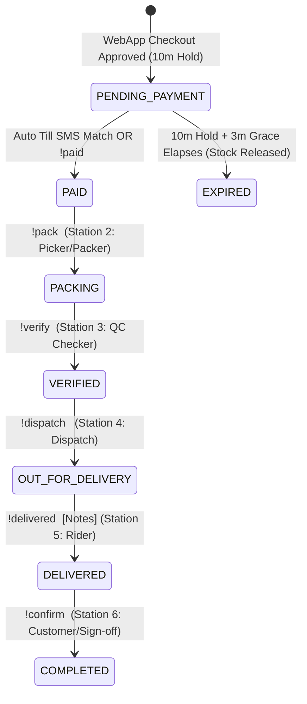
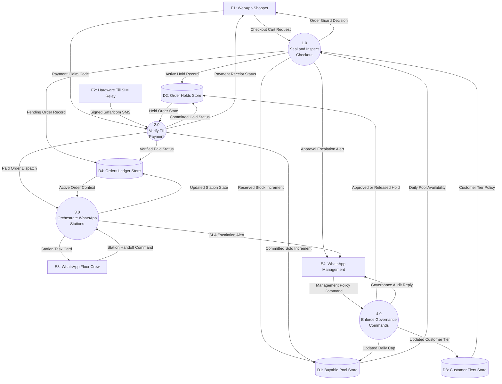
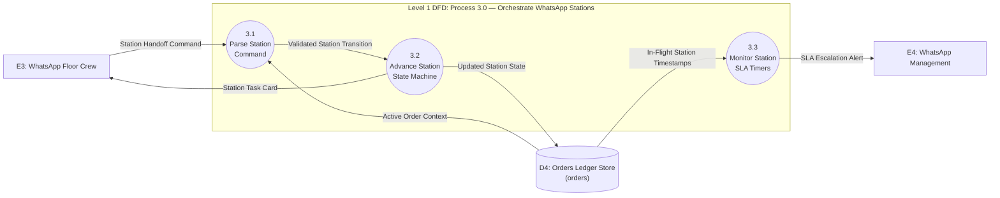

# Perpetual Live Orchestration Through WhatsApp: User Manual & Systems Analysis and Design (SAD) Technical Specification

**Document ID**: `SAD-WHATSAPP-PERPETUAL-2026-V3`  
**Standard**: Dennis, Wixom, & Roth (*Systems Analysis and Design*, 5th Edition)  
**Primary Codebase Modules**:
- `whatsapp_gateway/index.mjs` — Baileys Socket Lifecycle, 3-Tier Group Provisioning, SLA Escalation & Lease Reconciler Daemons
- `whatsapp_gateway/command_handler.mjs` — Multi-Shop Floor Station Commands, Order Guard Governance Commands, Catalog & Ticket Commands
- `whatsapp_gateway/http_routes.mjs` — Hardware Till SIM Relay (`/api/v1/till/sms-webhook`), 3-Factor Payment Verification, Broadcast Webhooks
- `whatsapp_gateway/order_guard.mjs` — Single Buyable Pool, Hold Approvals/Releases, and Payment Commits

---

# PART I: WHATSAPP LIVE ORCHESTRATION USER MANUAL

## 1. WhatsApp Architecture & Role Segregation

In the Perpetual platform, WhatsApp (`@whiskeysockets/baileys` on Port `5174`) serves as the **Live Operations, Fulfillment & Executive Governance Plane**. It operates two distinct sets of WhatsApp groups:

### 1.1 Per-Shop 3-Tier Fulfillment Groups (Created Automatically Per Shop)
Every onboarded shop (e.g., **Java House**, **QuickMart**, **KEby254 🇰🇪**) is isolated into three dedicated WhatsApp groups stored on the `shops` record:

| Group Tier | Database Column | Who Is Inside | Live Responsibilities |
|:---|:---|:---|:---|
| **Tier 1: Orders / Floor Crew** | `orders_group_jid` | Cashiers, Pickers, Packers, Quality Checkers | Receives verified paid orders (`PAID`), executes station handoffs (`!pack`, `!verify`), and manages shelf stock (`!product`). |
| **Tier 2: Dispatch / Riders** | `dispatch_group_jid` | Boda Riders, Van Drivers, Dispatch Coordinator | Receives verified packed orders (`VERIFIED`), claims delivery runs (`!dispatch`), and logs proof of delivery (`!delivered`, `!confirm`). |
| **Tier 3: Management / Governance** | `management_group_jid` | Shop Owner, Branch Manager, Auditor | Approves/declines high-value held orders (`!approve-order`, `!decline-order`), adjusts live buyable pools (`!pool`), manages customer tiers (`!tier`), receives 15-minute SLA breach alerts, and runs `!eod` reconciliation. |

### 1.2 Studio & Platform-Wide 3-Tier Community Groups
For platform-wide AI agent orchestration and IT incident management:
1. **`perpetua`**: Creative & general task feed.
2. **`Perpetua - IT Helpdesk`**: Automated 60-second lease timeout rollbacks, dead-man's switch alerts, and `TICK-XXXXXX` incident tickets.
3. **`Perpetua - Admin Oversight`**: Executive vitals (`!status`), active task pools, and ticket resolution audit trails.

---

## 2. Complete Live WhatsApp Command Reference

### 2.1 Order Guard & Buyable Pool Commands (Management Group)

| Command | Action & Live Effect | Example |
|:---|:---|:---|
| `!pool` or `!pool today` | Displays every product's live **Cap**, **Held**, **Sold**, and **Available** counts for today (`Africa/Nairobi` EAT) plus active holds. | `!pool today` |
| `!pool cap <item_id> <n>` | Immediately updates today's buyable pool cap (`daily_cap`) for `<item_id>`. | `!pool cap keby254-satin-bonnet 80` |
| `!pool max <item_id> <n>` | Immediately updates the per-order quantity ceiling (`max_per_order`) for `<item_id>`. | `!pool max keby254-satin-bonnet 5` |
| `!pool mode <item_id> <strict\|surebet>` | Switches an item between hard rejection (`strict`) and automatic quantity trimming (`surebet`). | `!pool mode keby254-loc-butter surebet` |
| `!pool apply-defaults [strict\|surebet]` | Applies category-smart Order Guard defaults across **all** items in the shop at once. | `!pool apply-defaults strict` |
| `!approve-order <ORDER_ID>` | Approves a held `NEEDS_APPROVAL` order (scoped strictly to your shop) and extends the customer's payment window by 10 minutes. | `!approve-order ORD-A1B2C3` |
| `!decline-order <ORDER_ID> [reason]` | Declines a held order and **immediately releases** its reserved stock back into the live buyable pool. | `!decline-order ORD-A1B2C3 Unverified wholesale request` |
| `!tier <phone_or_hash> <retail\|wholesale\|trusted\|flagged>` | Sets a customer's policy tier for your shop (`wholesale` = 5x cap, `trusted` = 2x cap, `flagged` = max 1 unit). | `!tier +254712345678 wholesale` |

### 2.2 The 6-Station Order Fulfillment Commands (Floor & Dispatch Groups)

Every order progresses through a strict 6-station state machine (`PENDING_PAYMENT` → `PAID` → `PACKING` → `VERIFIED` → `OUT_FOR_DELIVERY` → `DELIVERED` → `COMPLETED`):

| Station | Command | Who Runs It | Effect & Next Station Handoff |
|:---|:---|:---|:---|
| **Station 1: Payment** | `!paid <ID> [M-Pesa_Code]` | Manager / Cashier (or Auto Till SMS) | Commits the Order Guard hold (`held -> sold`), marks order `PAID`, and posts the **Station 2 Packing Card** to the Orders Group. |
| **Station 2: Packing** | `!pack <ID>` | Floor Picker / Packer | Claims the order for packing (`PACKING`), records `packed_by`, and prompts for Station 3 QC check. |
| **Station 3: QC Verify** | `!verify <ID>` | QC Supervisor | Confirms all items match the order (`VERIFIED`), and automatically dispatches the **Delivery Card** to the **Dispatch Group**. |
| **Station 4: Dispatch** | `!dispatch <ID> [Rider_Name]` | Dispatch Coordinator / Rider | Marks order `OUT_FOR_DELIVERY`, records `dispatched_by`, and starts delivery tracking. |
| **Station 5: Delivery** | `!delivered <ID> [Notes]` | Rider | Logs physical drop-off (`DELIVERED`) with optional delivery notes/photo reference. |
| **Station 6: Sign-Off** | `!confirm <ID>` | Customer / Manager | Closes the order lifecycle (`COMPLETED`) and includes it in the `!eod` ledger. |
| **Exception Recovery** | `!resurrect <ID> <M-Pesa_Code>` | Manager | Revives an order that expired before payment arrived, links the M-Pesa receipt, and pushes it to `PAID`. |

### 2.3 Catalog, Reorder & End-of-Day Commands

| Command | Description | Example |
|:---|:---|:---|
| `!menu` or `!products` | Lists all shop items with SKU, price in KES, stock availability, and Order Guard limits. | `!products` |
| `!product add <Name> \| <Price> \| <Cat> [\| <SKU>]` | Adds a new product directly from WhatsApp chat. | `!product add Hemp Beard Balm \| 750 \| Beard Care \| KE254-BB-02` |
| `!product price <ID/SKU> <KES>` | Updates a product's unit price in KES. | `!product price KE254-SB-01 600` |
| `!product stock <ID/SKU> <in\|out>` | Toggles an item in or out of stock immediately. | `!product stock KE254-SB-01 in` |
| `!reorder <OLD_ORDER_ID>` | Clones a customer's previous order items into a brand-new order in 1 command. | `!reorder ORD-9F8E7D` |
| `!eod` | Generates the **End-of-Day Reconciliation Report** (Total Revenue, Completed vs In-Flight vs Abandoned Orders, Verified Till Receipts). | `!eod` |

---

## 3. Hardware Till SIM Relay & 3-Factor M-Pesa Verification

Instead of relying on expensive or fragile STK Push prompts, Perpetual supports **Zero-Prompt Direct Till Verification**:
1. An Android phone holding the shop's Till Notification SIM runs an SMS Forwarder webhook pointing to:
   - `POST http://localhost:5174/api/v1/till/sms-webhook`
   - Header: `X-Till-Secret: <TILL_WEBHOOK_SECRET>`
2. When Safaricom sends an M-Pesa confirmation SMS, the gateway parses the **Receipt Code**, **Amount in KES**, and **Sender Phone/Name**, and inserts it into `till_payments`.
3. When the customer enters their M-Pesa receipt code on the WebApp (`POST /api/v1/storefront/orders/:id/verify-payment`), the gateway performs a **3-Factor Match**:
   - **Factor 1**: Exact `mpesa_receipt` match (`status = UNCLAIMED`).
   - **Factor 2**: `amount_kes >= order.total_kes`.
   - **Factor 3**: Timestamp within the active order window.
4. On match:
   - If the Order Guard hold is still active (within 10m + 3m grace), `commitOrder()` converts `held -> sold`, marks the order `PAID`, and broadcasts the **Station 2 Packing Card** to the shop's WhatsApp Orders Group.
   - If the customer paid **after** the 10m + 3m grace window expired and the last unit was already taken by someone else, `commitOrder()` returns `REFUND_REQUIRED` and alerts the **WhatsApp Management Group** to refund or fulfill manually.

---

# PART II: SAD TECHNICAL SPECIFICATION FOR WHATSAPP LIVE ORCHESTRATION

## 4. Phase 1 & 2: Requirements & Use Cases (Dennis, Wixom & Roth Ch. 3–4)

### 4.1 Functional & Non-Functional Requirements

| ID | Category | Requirement Statement | Verification Source |
|:---|:---|:---|:---|
| **FR-WA-01** | Shop-Scoped Routing | The gateway SHALL resolve the shop context from the originating WhatsApp `groupJid` (`orders_group_jid`, `dispatch_group_jid`, `management_group_jid`) and forbid cross-shop `!approve-order` or `!decline-order` execution. | `command_handler.mjs` (Test 24) |
| **FR-WA-02** | 6-Station Pipeline | The gateway SHALL enforce sequential station transitions (`!paid` → `!pack` → `!verify` → `!dispatch` → `!delivered` → `!confirm`) and record operator audit timestamps at each station. | `command_handler.mjs` |
| **FR-WA-03** | SLA Escalation Daemon | A background daemon running every `60s` SHALL inspect active orders (`PAID`, `PACKING`, `VERIFIED`, `OUT_FOR_DELIVERY`) and dispatch a warning to `management_group_jid` if an order stagnates for `> 15 minutes` without station progression. | `index.mjs` (`startOrderSlaDaemon`) |
| **NFR-WA-01** | Dead-Man's Switch | Every `6 hours`, the gateway SHALL verify end-to-end outbound message delivery and log a self-diagnostic heartbeat to `Perpetua - Admin Oversight`. | `index.mjs` (`startDeadManSwitchDaemon`) |
| **NFR-WA-02** | Auth Isolation | Baileys multi-device credentials SHALL be stored exclusively in `whatsapp_gateway/.auth_whatsapp_baileys/` to prevent cross-workspace session collisions. | `index.mjs` |

### 4.2 Fully Dressed Use Case: UC-WA-01 (Manager Approves High-Value Held Order & Crew Fulfills Across 6 Stations)

- **Use Case Name**: `UC-WA-01: Govern Held Order & Orchestrate 6-Station WhatsApp Fulfillment`
- **Primary Actors**: Shop Manager (`management_group_jid`), Floor Crew (`orders_group_jid`), Delivery Rider (`dispatch_group_jid`)
- **Preconditions**: An order exceeding `max_order_value` (`50,000 KES`) has been placed on the WebApp and is held in `NEEDS_APPROVAL` state.
- **Normal Flow**:
  1. Shop Manager receives an automated WhatsApp alert in `management_group_jid` with order ID, item summary, and total KES.
  2. Manager replies `!approve-order ORD-A1B2C3`.
  3. `command_handler.mjs` verifies `hold.shop_id === shop.id`, transitions the hold to `HELD` (`APPROVED`), and extends `expires_at` by 10 minutes.
  4. Customer completes M-Pesa Till payment; Hardware Till SIM Relay verifies the receipt, commits `held -> sold` in `OrderGuard`, and posts the **Station 2 Packing Card** to `orders_group_jid`.
  5. Picker replies `!pack ORD-A1B2C3` (`status = PACKING`).
  6. QC Checker replies `!verify ORD-A1B2C3` (`status = VERIFIED`); gateway automatically posts the **Dispatch Card** to `dispatch_group_jid`.
  7. Rider replies `!dispatch ORD-A1B2C3 Rider_Kamau` (`status = OUT_FOR_DELIVERY`), drops off the package, and replies `!delivered ORD-A1B2C3 Left at reception`.
  8. Customer/Manager replies `!confirm ORD-A1B2C3` (`status = COMPLETED`).

---

## 5. Phase 2: Validated Data Flow Diagrams (Ch. 5)

### 5.1 Level 0 Context & System DFD (Dual-Channel WebApp + WhatsApp Ecosystem)
Validated via `dfd_validator.py` (**PASS: 0 errors, 0 warnings**):

### 5.2 Level 1 Child DFD: Process 3.0 (Orchestrate WhatsApp Stations)
Validated via `dfd_validator.py` (**PASS: 0 errors, 0 warnings, Level Balancing verified**):

---

## 6. Phase 3 & 4: Physical Database Design, Volumetric Sizing & Cutover

### 6.1 3-Year Volumetric Storage Estimation (10 Shops, 500 Orders/Day/Shop)
- **Daily Order Volume**: $10 \text{ shops} \times 500 \text{ orders/day} = 5,000 \text{ orders/day}$ ($1,825,000 \text{ orders/year}$).
- **`orders` + `order_holds` Row Footprint**: $\approx 1.4 \text{ KB/order}$ (including `pii_sealed` and `order_sealed` AES-256-GCM envelopes).
- **Annual Storage Growth**: $1,825,000 \times 1.4 \text{ KB} \approx 2.55 \text{ GB/year}$ ($7.65 \text{ GB}$ over 3 years, including B-tree indexes on `(shop_id, business_date)` and `(shop_id, status)`).
- **`inventory_daily` Footprint**: $10 \text{ shops} \times 100 \text{ items} \times 365 \text{ days} = 365,000 \text{ rows/year} \times 256 \text{ B} \approx 93 \text{ MB/year}$.
