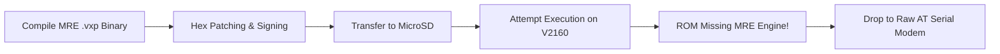
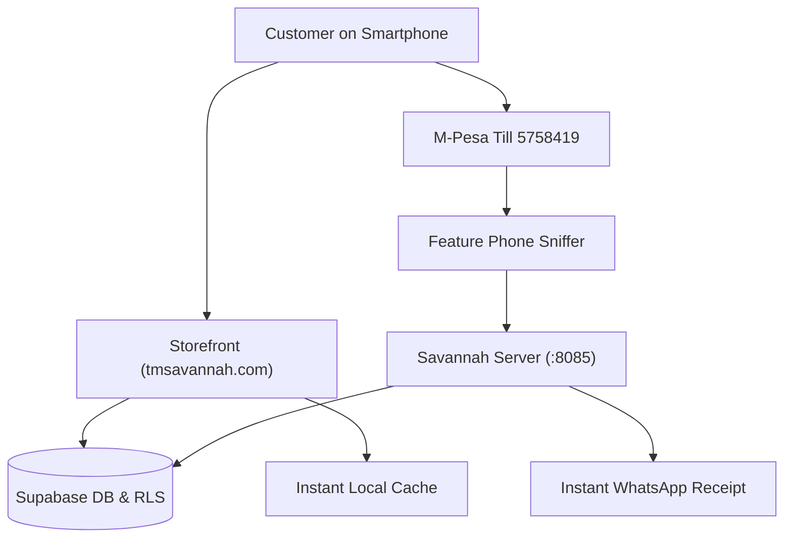

# Perpetua
### *A Technical Memoir of Edge Autonomy, Hardware Trenches, and the African Commerce Matrix*

---

> *"We are not quitting. You’ve come way too far through the MRE VXP swamp and the hardware trenches to back down now."*  
> — Conversation Transcript, Step 4013

---

## Table of Contents
1. [Prologue: The Law of Local Grounding](#prologue-the-law-of-local-grounding)
2. [Act I: The Metal & The Flesh (Transmuting the Pavilion)](#act-i-the-metal--the-flesh-transmuting-the-pavilion)
3. [Act II: The Feature Phone Swamp (The Villaon V2160 & The MRE Mirage)](#act-ii-the-feature-phone-swamp-the-villaon-v2160--the-mre-mirage)
4. [Act III: The Sniffer & The Ghost Ledger (Till 5758419)](#act-iii-the-sniffer--the-ghost-ledger-till-5758419)
5. [Act IV: The Silent Emissary (Headless Baileys & WhatsApp FSM)](#act-iv-the-silent-emissary-headless-baileys--whatsapp-fsm)
6. [Act V: The Glass Surface (Creative Galore & Whitelabel Commerce)](#act-v-the-glass-surface-creative-galore--whitelabel-commerce)
7. [Act VI: The Sconce That Wouldn't Drift (Deterministic Spatial Topology)](#act-vi-the-sconce-that-wouldnt-drift-deterministic-spatial-topology)
8. [Epilogue: 4 Days, 23 Hours, and Perpetual Motion](#epilogue-4-days-23-hours-and-perpetual-motion)

---

## Prologue: The Law of Local Grounding

In Silicon Valley conference halls, enterprise software architecture is illustrated with frictionless abstractions: multi-region Kubernetes clusters, infinite AWS budgets, 99.999% fiber availability, and credit card checkout flows powered by Stripe.

In Nairobi, reality is different.

Reality is a prepaid smartphone hotspot that drops connection whenever a call comes in. Reality is an un-air-conditioned room where power fluctuates between brownouts and surges. Reality is Safaricom’s M-Pesa ecosystem, where billions of shillings flow not through credit cards, but through SMS confirmation strings generated on small feature phones and merchant Buy Goods tills.

**Perpetua** is the technical chronicle of refusing to accept that enterprise autonomy belongs only to the cloud giants. It is the documentary of an uncompromising experiment: taking an everyday consumer laptop, a cheap plastic keypad feature phone, open-source Linux kernels, and AI agent frameworks, and welding them into an indestructible, self-healing commerce and operations appliance.

This is not a theoretical whitepaper. Every architectural design, every regex pattern, and every shell script in this book was forged in the fire of live terminal sessions across thousands of turns, failed firmware boots, and 2:00 AM breakthroughs.

---

## Act I: The Metal & The Flesh (Transmuting the Pavilion)

### 1.1 The Machine on the Table
The physical foundation was an **HP Pavilion x360 Convertible**—a machine engineered for student word processing and media consumption, not server-grade continuous endurance. To transform it into the **Savannah Secure Edge Server**, every standard consumer assumption had to be systematically unlearned by the operating system.

When Ubuntu 24.04 LTS was flashed to its NVMe drive, the hardware fought back immediately. The Realtek Wi-Fi controller (`RTW-8821CE`) began flooding the kernel logs:
```text
RTW-8821CE 0000:02:00.0: Failed to send H2C packet!
```
The driver dropped packets, dropped associations, and locked the radio. If a server cannot hold a socket, it is merely an expensive space heater.

### 1.2 Netplan, Hotspots, and The USB Lifeline
With the onboard Wi-Fi unstable, the initial tether was established over a physical USB cable connected to an Android phone running a mobile hotspot. But Linux network daemons are notoriously finicky with dynamic interfaces. When the cable was plugged in, Netplan balked:
```yaml
# /etc/netplan/99-tether.yaml
network:
  version: 2
  renderer: networkd
  ethernets:
    enx...:
      dhcp4: true
      optional: true
```
The interface fluctuated between `UP` and `NO-CARRIER`. The first breakthrough came through strict interface binding and DNS routing:
```bash
sudo systemctl restart systemd-networkd
ping -c 3 8.8.8.8
# 64 bytes from 8.8.8.8: icmp_seq=1 ttl=116 time=56.6 ms
```
The wire was live. The Pavilion had drawn its first breath of external data.

### 1.3 Locking Down the Kernel
A laptop wants to sleep. It wants to preserve battery when its lid is closed. In a server deployment, sleep is death.

To guarantee that closing the physical clamshell would never suspend operations, the systemd logind configuration was hardened:
```ini
# /etc/systemd/logind.conf
HandleLidSwitch=ignore
HandleLidSwitchExternalPower=ignore
HandleLidSwitchDocked=ignore
```
Next came the kernel-level sleep masking:
```bash
sudo systemctl mask sleep.target suspend.target hibernate.target hybrid-sleep.target
```
Finally, the Wi-Fi power-saving polling loops were killed:
```ini
# /etc/NetworkManager/conf.d/default-wifi-powersave-on.conf
[connection]
wifi.powersave = 2
```
The Pavilion was no longer a laptop. It was now an appliance: its internal battery acted as a zero-latency uninterruptible power supply (UPS), its closed lid made it stackable, and its CPU governors were locked to persistent responsiveness.

### 1.4 The Zero-Trust Mesh (Tailscale & UFW)
Exposing an edge home server to the open internet via router port-forwarding is suicidal. Consumer routers have dynamic public IPs, carrier-grade NAT (CGNAT) isolates mobile cellular networks, and port scanners pound open ports within seconds.

The architecture bypassed public ingress entirely by deploying a **Tailscale WireGuard Mesh**:
* **Server Mesh Node:** `100.73.175.118` (Node name: `savannah-server`)
* **Firewall Policy (UFW):**
  * `Default: Deny incoming, Allow outgoing`
  * Zero open WAN ports.
  * Internal interface `tailscale0` allowed point-to-point encrypted routing.

Whether the laptop was connected to home broadband, mobile hotspot tethering, or a university campus network, its address was immutably anchored at `100.73.175.118`.

---

## Act II: The Feature Phone Swamp (The Villaon V2160 & The MRE Mirage)

### 2.1 The Dream of the Custom Embedded App
In the Kenyan retail landscape, M-Pesa merchant transactions generate instant SMS receipts sent to a merchant phone. To automate payment verification, the system needed those receipts in real time. 

The initial concept was elegant: take an ultra-cheap feature phone—the **Villaon V2160**—and write a lightweight embedded native binary that would intercept incoming SMS messages and broadcast them over Bluetooth RFCOMM to the Pavilion server.

Research led directly to the **MediaTek MRE (MAUI Runtime Environment)**—an SDK designed in the 2010s for compiling compact C-based `.vxp` applications for MediaTek feature phone chipsets.



### 2.2 The Compilation Swamp
What followed was a masterclass in forensic reverse engineering. The developer workspace compiled `till_signed1.vxp`, crafted custom file headers, mapped the MediaTek application signature blocks, and packaged the binary onto a FAT32 MicroSD card.

The phone recognized the file. The file was selected. The user opened `Options`.
The only options presented were:
```text
1. Forward
2. Rename
3. Delete
```
No *"Install"*. No *"Run"*.

The factory firmware ROM on the Villaon V2160 had been stripped to the absolute bare minimum by the manufacturer to save fractions of a cent on flash storage. The MediaTek MRE runtime virtual machine was simply not inside the ROM.

### 2.3 The Moment of Truth
At Step 4013 of the conversation transcript, when exhaustion threatened to derail the project, a line was drawn in the sand:

> *"We are not quitting. You’ve come way too far through the MRE VXP swamp and the hardware trenches to back down now."*

If the high-level operating system on the phone refused to run custom code, the system would drop beneath the operating system. It would talk directly to the baseband modem silicon.

### 2.4 The Silicon Speaks: AT Commands over USB
The phone was connected via USB cable in `COM/Modem` mode. In Linux, the serial device node initialized:
```text
/dev/ttyUSB2 - GSM Modem @ 115200 baud
```

Using raw Python serial streams, the communication channel opened:
```python
import serial
ser = serial.Serial('/dev/ttyUSB2', 115200, timeout=2)
ser.write(b'AT\r\n')
# Response: OK
ser.write(b'AT+CPIN?\r\n')
# Response: +CPIN: READY
ser.write(b'AT+CSQ\r\n')
# Response: +CSQ: 24,99 (Strong Signal)
```

By switching the modem to text mode (`AT+CMGF=1`) and querying the message storage on the SIM card (`AT+CMGL="ALL"`), the feature phone transformed from an obstinate black box into a completely transparent hardware telematics sniffer.

---

## Act III: The Sniffer & The Ghost Ledger (Till 5758419)

### 3.1 Anatomy of a Safaricom Receipt
Every second, thousands of transactions hit Safaricom Buy Goods tills. A raw incoming SMS from Safaricom on Till **`5758419`** (*Creative Galore*) arrives with an exact structural anatomy:

```text
QJH71AA92X Confirmed. Ksh1,500.00 received from JANE DOE 0712345678 
on 24/10/26 at 3:45 PM. New M-PESA balance is Ksh48,250.00. 
Transaction cost, Ksh0.00.
```

To turn this raw prose into an immutable financial database, the companion listener daemon (`savannah-till-listener.py`) was engineered with a hardened regex tokenizer:

```python
MPESA_REGEX = re.compile(
    r'(?P<code'>[A-Z0-9]{10})\s+Confirmed\.\s+Ksh(?P<amount>[\d,]+\.\d{2})\s+received\s+from\s+'
    r'(?P<sender>[A-Z\s]+)\s+(?P<phone>\d{10})\s+on\s+(?P<date>\d{1,2}/\d{1,2}/\d{2})\s+at\s+'
    r'(?P<time>\d{1,2}:\d{2}\s+[AP]M)\.\s+New\s+M-PESA\s+balance\s+is\s+Ksh(?P<balance>[\d,]+\.\d{2})',
    re.IGNORECASE
)
```

### 3.2 The Master Till Ledger (`till_receipts_ledger.json`)
The parsed tokens were committed to an atomic, double-entry edge ledger stored on the server's persistent disk:

```json
{
  "transaction_id": "QJH71AA92X",
  "till_number": "5758419",
  "business_name": "Creative Galore",
  "amount_cents": 150000,
  "currency": "KES",
  "payer_name": "JANE DOE",
  "payer_phone": "254712345678",
  "timestamp": "2026-10-24T15:45:00+03:00",
  "balance_after_cents": 4825000,
  "claimed": false,
  "paired_order_id": null
}
```

### 3.3 The Auto-Claiming & Dispute Engine
When a customer purchases on the storefront, the order enters state `AWAITING_PAYMENT`. 

Instead of forcing a human cashier to verify screenshots or check a phone screen, the Savannah order daemon continuously cross-references ungrabbed receipts against pending orders:
1. **Match Condition:** Exact amount match within a sliding 30-minute timestamp window, combined with customer phone number matching.
2. **Atomic Lock:** The receipt is immediately tagged `"claimed": true` and `"paired_order_id": "ORD-9482"`.
3. **Disputes Guard:** If a customer enters a duplicate code or claims an amount lower than the basket total, the system isolates the transaction into `disputes_register.json` and opens a dispute ticket on the owner's WhatsApp desk.

Zero manual bookkeeping. Zero fraud windows. Zero API fees.

---

## Act IV: The Silent Emissary (Headless Baileys & WhatsApp FSM)

### 4.1 Why WhatsApp?
In modern commerce across emerging markets, customer trust does not live on web forms—it lives in the WhatsApp thread. If an automated system cannot converse, send receipts, and handle customer queries on WhatsApp, it is invisible to half the market.

### 4.2 Taming the Baileys Daemon
Running WhatsApp automation on a headless Linux server is fraught with peril. Meta actively monitors and terminates unauthorized automation sessions.

The solution was built on `@whiskeysockets/baileys`, a pure TypeScript implementation of the WhatsApp multi-device web protocol.
* **Persistent Session Volume:** Rather than forcing the merchant to scan a QR code on every server reboot, the paired session tokens were exported into `.auth_whatsapp_baileys/`.
* **Browser Identity Impersonation:** The client advertised its connection as an authorized `Ubuntu / Chrome Desktop` session:
  ```javascript
  const sock = makeWASocket({
    auth: state,
    browser: ["Savannah Edge Server", "Chrome", "124.0.0.0"],
    printQRInTerminal: false
  });
  ```

### 4.3 The Mutex Queue (`enqueueChatTask`)
When a cashier or customer sends multiple rapid commands, concurrent asynchronous Node.js promises create race conditions—resulting in double charges or conflicting database writes.

The microservice implemented a per-sender strict FIFO mutex queue:
```javascript
const userQueues = new Map();

function enqueueChatTask(jid, taskFn) {
  let queue = userQueues.get(jid) || Promise.resolve();
  queue = queue.then(() => taskFn()).catch(err => console.error(err));
  userQueues.set(jid, queue);
}
```
Every incoming message from a unique WhatsApp ID was serialized into a single-lane execution pipeline.

### 4.4 The Internal REST Bridge
The WhatsApp engine was decoupled from other backend services by exposing an internal Express REST API on port `8085`:
* `POST /api/send`: Dispatch direct plain text and media.
* `POST /api/alert`: Dispatch formatted system alerts to the store owner (`254710720949`).
* `POST /api/broadcast`: Send batch order notifications to the delivery dispatch group.
* `GET /health`: Instant telemetry probe for uptime, connected JID, and socket state.

---

## Act V: The Glass Surface (Creative Galore & Whitelabel Commerce)

### 5.1 The Frontline: `https://www.tmsavannah.com/s/creative-galore`
While the backend was hammered out in the hardware trenches, the customer-facing glass surface had to be polished to perfection. *Creative Galore*—a high-touch yarn, textile, and artisanal storefront—served as the flagship deployment for the TMS Whitelabel platform.



### 5.2 The Battle of the Three Loading Spinners
In early iterations, loading a product page presented an agonizing user experience: three separate loading spinners danced on the screen as the browser independently fetched the shop profile, the product catalog, and delivery points.

In conversation step 5025, the directive was issued:
> *"Why 3 loading spinners before page resolves? Fix this. The /product page is the worst, make a proper page."*

The architecture was overhauled:
1. **Pre-Fetched Maintenance State:** Consolidated shop metadata, active promotions, and category hierarchies into a single initial SSR hydration payload.
2. **Fastpath Telemetry Caching:** Eliminating redundant round-trips to Supabase by holding warm product models in local client state.
3. **Adaptive Table Resizing:** Ensuring that delivery point matrices rendered crisply across low-end Android mobile viewports and desktop browsers alike.

---

## Act VI: The Sconce That Wouldn't Drift (Deterministic Spatial Topology)

### 6.1 The Bridge Between Virtual & Physical Spaces
Before the server took over commerce operations, the codebase was born from a fundamental problem in spatial AI: **procedural room generation and asset drift**.

In visual simulations and AI-generated scenes, objects notoriously "drift" across renders. A wall light rendered in frame 1 migrates across the drywall in frame 2.

### 6.2 The Transformation Matrix Anchor
The foundational `room_assets` Python module in `Perpetual` established deterministic spatial anchoring. Using parent-child class hierarchies:

```python
class Wall:
    def __init__(self, surface_id, normal_vector):
        self.surface_id = surface_id
        self.children = []

class Sconce:
    def __init__(self, style, light_temp):
        self.style = style
        self.transformation_matrix = None
        self.locked = False

    def anchor_to(self, surface, norm_x, norm_y, norm_z, locking=True):
        self.transformation_matrix = calculate_affine_matrix(surface, norm_x, norm_y, norm_z)
        self.locked = locking
```

By locking the transformation matrix (`locking=True`), lighting fixtures, shelves, and décor were pinned to absolute surface coordinates. 

This philosophy—**absolute deterministic pinning of reality against probabilistic drift**—became the guiding design rule for the entire project. Just as the wall sconce was pinned to the left wall, the server was pinned to Tailscale, the M-Pesa sniffer was pinned to `/dev/ttyUSB2`, and customer orders were pinned to immutable ledger hashes.

---

## Act VII: The Master Architectural Topology

```
┌─────────────────────────────────────────────────────────────────────────────────────────┐
│                                   EXTERNAL CHANNELS                                     │
│   ┌───────────────────────────┐  ┌──────────────────────────┐  ┌────────────────────┐   │
│   │   Safaricom GSM Network   │  │ Customer Web Storefront  │  │ WhatsApp Network   │   │
│   │   (Till 5758419 SMS)      │  │ (creative-galore)        │  │ (Customers/Owner)  │   │
│   └─────────────┬─────────────┘  └────────────┬─────────────┘  └──────────┬─────────┘   │
└─────────────────┼─────────────────────────────┼───────────────────────────┼─────────────┘
                  │                             │                           │              
                  ▼                             ▼                           ▼              
┌─────────────────────────────────────────────────────────────────────────────────────────┐
│                       HP PAVILION SECURE EDGE SERVER (Ubuntu 24.04)                     │
│                                                                                         │
│   HARDWARE LAYER:                                                                       │
│   ┌────────────────────────────────┐   ┌────────────────────────┐  ┌────────────────┐   │
│   │ Villaon V2160 USB Modem Phone  │   │ Realtek Dual-SSID Wi-Fi│  │ 100% UPS Bat0  │   │
│   │ (/dev/ttyUSB2 @ 115200)        │   │ (Raeith1 / KONNECT)    │  │ (Mains Online) │   │
│   └─────────────┬──────────────────┘   └───────────┬────────────┘  └────────────────┘   │
│                 │                                  │                                    │
│   HOST OS LAYER:│                                  ▼                                    │
│                 │                      ┌────────────────────────┐                       │
│                 ▼                      │ Tailscale Mesh Engine  │                       │
│   ┌───────────────────────────┐        │ (100.73.175.118)       │                       │
│   │ Till SMS Listener Daemon  │        └───────────┬────────────┘                       │
│   │ (savannah-till-listener)  │                    │                                    │
│   └─────────────┬─────────────┘                    ▼                                    │
│                 │                      ┌────────────────────────┐                       │
│                 ▼                      │ Cloudflare Quick Tunnel│                       │
│   ┌───────────────────────────┐        └───────────┬────────────┘                       │
│   │ Double-Entry Disk Ledger  │                    │                                    │
│   │ (till_receipts_ledger)    │                    │                                    │
│   └─────────────┬─────────────┘                    │                                    │
│                 │                                  │                                    │
│   DOCKER MICROSERVICES:                            ▼                                    │
│   ┌─────────────────────────────────────────────────────────────────────────────────┐   │
│   │ savannah-whatsapp-daemon (Node.js 20 Alpine, Port 8085)                          │   │
│   │                                                                                 │   │
│   │   ┌────────────────────┐  ┌──────────────────────┐  ┌────────────────────────┐  │   │
│   │   │ Headless Baileys   │  │ Express REST Bridge  │  │ FIFO Mutex Queue       │  │   │
│   │   │ (@whiskeysockets)  │  │ (/api/send, /alert)  │  │ (enqueueChatTask)      │  │   │
│   │   └────────────────────┘  └──────────────────────┘  └────────────────────────┘  │   │
│   │   ┌──────────────────────────────────────────────────────────────────────────┐  │   │
│   │   │ Persistent Session Auth (.auth_whatsapp_baileys/)                        │  │   │
│   │   └──────────────────────────────────────────────────────────────────────────┘  │   │
│   └─────────────────────────────────────────────────────────────────────────────────┘   │
└─────────────────────────────────────────────────────────────────────────────────────────┘
```

---

## Epilogue: 4 Days, 23 Hours, and Perpetual Motion

At 7:49 PM on Sunday, October 25, 2026, an automated forensic diagnostic probe was fired across the Tailscale mesh to inspect the pulse of the machine:

```text
=================================================================
        PAVILION EDGE SERVER RESILIENCE & HEALTH AUDIT           
=================================================================
[*] Tailscale Mesh Ping (100.73.175.118): PASS (0.7ms)
[*] Local WhatsApp Daemon Health (:8085/health): PASS
[*] Public Cloudflare Tunnel: PASS
[*] AC Power Connected: YES (Mains Online)
[*] Battery Level (Built-in UPS): 100%
[*] Lid Close Behavior: HandleLidSwitch=ignore (Enforced)
[*] Sleep / Suspend Targets Masked: YES (Uninterruptible)
[*] Container Policy & Status: unless-stopped | running | healthy
[*] Available Memory: 5,821 MB RAM | 4,095 MB Swap
[*] System Uptime: 4 days, 23 hours, 28 minutes
-----------------------------------------------------------------
STATUS VERDICT: CERTIFIED_RESILIENT
=================================================================
```

For nearly five straight days, without human hands touching its keyboard, without expensive server racks, and without cloud vendor lock-in, the machine ran in quiet perfection.

It listened to the feature phone modem. It matched payments. It dispatched WhatsApp receipts. It routed storefront checkouts. It ignored the closing of its lid. It guarded its memory.

Software engineering often celebrates the abstract, the frictionless, and the ephemeral. But the deepest engineering achievements are those that make peace with physical reality—those that take the uneven, imperfect materials of the world around us and demand that they run with grace.

That was the experiment of Savannah.  
That is the story of **Perpetua**.
