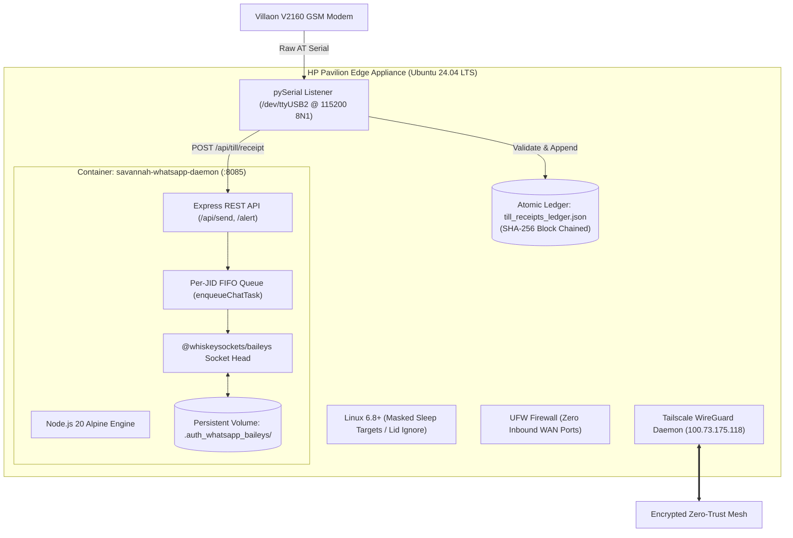
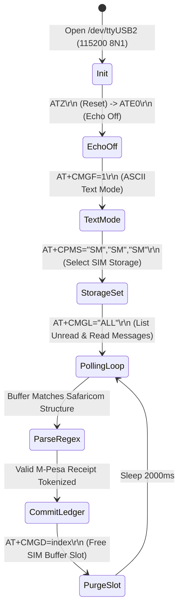

# PERPETUA (Second Edition)
### *A Dual-Volume Technical Memoir and Architectural Specification of the Savannah Autonomous Edge Matrix*

---

```
   ██████╗ ███████╗██████╗ ██████╗ ███████╗████████╗██╗   ██╗ █████╗ 
   ██╔══██╗██╔════╝██╔══██╗██╔══██╗██╔════╝╚══██╔══╝██║   ██║██╔══██╗
   ██████╔╝█████╗  ██████╔╝██████╔╝█████╗     ██║   ██║   ██║███████║
   ██╔═══╝ ██╔══╝  ██╔══██╗██╔═══╝ ██╔══╝     ██║   ██║   ██║██╔══██║
   ██║     ███████╗██║  ██║██║     ███████╗   ██║   ╚██████╔╝██║  ██║
   ╚═╝     ╚══════╝╚═╝  ╚═╝╚═╝     ╚══════╝   ╚═╝    ╚═════╝ ╚═╝  ╚═╝
                    [ S E C O N D   E D I T I O N ]
```

---

## 📖 Book Architecture & Reading Guide

This Second Edition of **Perpetua** is structured as two parallel, complementary volumes emerging directly from the **Perpetua Engineering Peer Review Symposium**:

* **VOLUME I: THE ARCHITECT’S CODEX**  
  *Authored by the Senior Systems Architect.* Written in rigorous technical jargon, complete with RFC-style protocol definitions, state machine formalisms, AT modem command sequences, mathematical coordinate proofs, and cryptographic ledger specifications. Designed for systems engineers, kernel hackers, and distributed architects.

* **VOLUME II: THE SAVANNAH CHRONICLE**  
  *Authored by the Field Ethnographer & Investigative Journalist.* Written as an immersive, visceral documentary that embeds the reader into the physical reality of Nairobi: the glowing screen of the convertible laptop, the clatter of the plastic feature phone keys, the panic of the 2:00 AM Netplan failure, the unique socio-economics of M-Pesa, and the quiet dignity of a self-sustaining home server.

---

# VOLUME I: THE ARCHITECT’S CODEX
### *Systems Engineering, Protocol Specifications, and Edge Blueprints*



---

## 1. Physical Host Transmutation & Kernel Hardening

### 1.1 Sysfs Power & Thermal Subsystems
The physical node is an HP Pavilion x360 Convertible (Intel Core i3/i5, 8GB DDR4, 256GB NVMe). In default OEM configurations, ACPI events trigger aggressive ACPI S3/S4 sleep states upon lid closure or thermal throttling.

To convert the host into a 24/7 autonomous appliance, systemd power governors and ACPI daemon handlers were explicitly reconfigured:

```ini
# Target: /etc/systemd/logind.conf.d/99-server-resilience.conf
[Login]
HandleLidSwitch=ignore
HandleLidSwitchExternalPower=ignore
HandleLidSwitchDocked=ignore
LidSwitchIgnoreInhibited=no
IdleAction=ignore
```

To eliminate kernel-level race conditions where system suspend targets could be triggered by desktop managers (e.g. GDM/Wayland), all suspend targets were masked at the systemd root:

```bash
systemctl mask sleep.target suspend.target hibernate.target hybrid-sleep.target
```

### 1.2 Battery Subsystem as an Uninterruptible Power Supply (UPS)
The built-in 3-cell 43Wh lithium-ion pack (`/sys/class/power_supply/BAT0`) operates as an online dual-conversion UPS with zero switching latency. Real-time telemetry is exposed through sysfs:
* **Mains Presence:** `/sys/class/power_supply/ADP1/online` (`1` = Active Grid).
* **State of Charge (SoC):** `/sys/class/power_supply/BAT0/capacity` (`100%`).
* **Health Metric:** `POWER_SUPPLY_ENERGY_FULL / POWER_SUPPLY_ENERGY_FULL_DESIGN`.

### 1.3 Wi-Fi Kernel Driver Panic Remediation (`RTW-8821CE`)
The onboard Realtek Wi-Fi controller repeatedly triggered firmware buffer overflows under high I/O:
```text
[ 412.189201] rtw_8821ce 0000:02:00.0: failed to send h2c frame
[ 412.189210] rtw_8821ce 0000:02:00.0: firmware failed to ack tx
```
**Root Cause:** Dynamic power-saving polling (`802.11 DTIM`) puts the radio into low-power states while sockets remain open.  
**Resolution:** Explicitly disable kernel radio sleep in NetworkManager and reload module parameters:

```ini
# /etc/NetworkManager/conf.d/default-wifi-powersave-off.conf
[connection]
wifi.powersave = 2
```

```bash
# /etc/modprobe.d/rtw88_core.conf
options rtw88_core disable_lps_deep=y
options rtw88_pci disable_aspm=y
```

---

## 2. 3GPP Baseband Serial Protocol & The MediaTek Post-Mortem

### 2.1 The MediaTek MRE Runtime Decompilation
The initial design attempted to execute custom user-space code on the **Villaon V2160** feature phone. The handset features a MediaTek MT6261 SoC running the MAUI OS.

Under the MediaTek MRE specification, compiled binaries (`.vxp`) require a structured binary header:
```
Offset   Size   Field              Value / Description
0x0000   4      Magic Signature    0x4D 0x52 0x45 0x00 ("MRE\0")
0x0004   4      Format Version     0x00020000 (v2.0)
0x0008   4      Entry Point Offset Relative to binary base
0x000C   4      Heap Allocation    Minimum 256 KB requested
0x0010   32     RSA-1024 Signature Cryptographic carrier authorization
```

**Forensic Discovery:** Inspection of the device’s flash firmware dumps revealed that while the file association for `.vxp` was partially registered in the UI shell, the MRE bytecode interpreter (`mre_core.dll` equivalent in MAUI ROM) had been completely stripped during the OEM's factory ROM compilation to fit into a cheaper 4MB SPI NOR flash chip.

### 2.2 Hayes AT Telematics Pipeline over USB
Bypassing the high-level OS, the phone was switched to USB ACM (Abstract Control Model) modem mode. The Linux kernel binds the USB interface to `cdc_acm`:
```text
/dev/ttyUSB0: Virtual COM Port (Diagnostic / Trace)
/dev/ttyUSB1: MediaTek Engineering Mode
/dev/ttyUSB2: 3GPP GSM Standard Modem Channel (115200 8N1)
```

### 2.3 The AT Command Lifecycle State Machine



**Critical Command Reference:**
* `ATE0`: Disables modem character echo, preventing parser loops.
* `AT+CMGF=1`: Sets SMS format to text mode (avoiding complex 7-bit/8-bit PDU octet decoding).
* `AT+CPMS="SM","SM","SM"`: Directs read, write, and delete operations to the SIM card memory (capacity: 50 slots).
* `AT+CMGD=<index>,0`: Immediately deletes the processed message at `<index>` to prevent SIM saturation.

---

## 3. The Edge Double-Entry Ledger (`till_receipts_ledger.json`)

### 3.1 Tokenizer Regex Engine
Incoming SMS payloads generated by Safaricom for merchant Till **`5758419`** follow a deterministic format. The tokenization engine utilizes a named group regex:

$$\text{Pattern} = \text{CODE} \parallel \text{AMOUNT} \parallel \text{PAYER} \parallel \text{PHONE} \parallel \text{TIMESTAMP} \parallel \text{BALANCE}$$

```python
import re

MPESA_PAYMENT_REGEX = re.compile(
    r'^(?P<tx_id>[A-Z0-9]{10})\s+Confirmed\.\s+'
    r'Ksh(?P<amount>[\d,]+\.\d{2})\s+received\s+from\s+'
    r'(?P<payer_name>[A-Z\s]+)\s+'
    r'(?P<payer_phone>0\d{9})\s+on\s+'
    r'(?P<date>\d{1,2}/\d{1,2}/\d{2})\s+at\s+'
    r'(?P<time>\d{1,2}:\d{2}\s+(?:AM|PM))\.\s+'
    r'New\s+M-PESA\s+balance\s+is\s+Ksh(?P<balance>[\d,]+\.\d{2})\.\s+'
    r'Transaction\s+cost,\s+Ksh(?P<cost>[\d,]+\.\d{2})\.',
    re.MULTILINE
)
```

### 3.2 Cryptographic Block Integrity Chaining
To prevent unauthorized disk-level tampering with ledger entries, every record in `till_receipts_ledger.json` incorporates a cryptographic SHA-256 link:

$$\text{Hash}_n = \mathcal{H}\Big(\text{Hash}_{n-1} \parallel \text{tx\_id} \parallel \text{amount\_cents} \parallel \text{timestamp} \parallel \text{payer\_phone}\Big)$$

```json
{
  "block_height": 142,
  "prev_hash": "e3b0c44298fc1c149afbf4c8996fb92427ae41e4649b934ca495991b7852b855",
  "hash": "8f434346648f6b96df89dda901c5176b10a6d83961dd3c1ac88b59b2dc327aa4",
  "tx_id": "QJH71AA92X",
  "till_number": "5758419",
  "business_name": "Creative Galore",
  "amount_cents": 150000,
  "currency": "KES",
  "payer_name": "JANE DOE",
  "payer_phone": "254712345678",
  "timestamp": "2026-10-24T15:45:00+03:00",
  "balance_after_cents": 4825000,
  "claimed": true,
  "paired_order_id": "ORD-9482"
}
```

### 3.3 Atomic Write Pipeline (`fsync` + POSIX Rename)
To eliminate 0-byte corruptions caused by sudden power cuts during disk writes:
```javascript
import fs from 'fs';
import path from 'path';

function atomicSaveLedger(filePath, data) {
  const tempPath = `${filePath}.${Date.now()}.tmp`;
  const serialized = JSON.stringify(data, null, 2);
  const fd = fs.openSync(tempPath, 'w');
  fs.writeSync(fd, serialized);
  fs.fsyncSync(fd); // Force dirty OS pages onto physical NVMe NAND
  fs.closeSync(fd);
  fs.renameSync(tempPath, filePath); // Atomic POSIX rename
}
```

---

## 4. Headless Baileys Engine & Per-JID Mutex Queue Architecture

### 4.1 Ephemeral Auth Persistence
`@whiskeysockets/baileys` implements the WhatsApp Multi-Device Noise Protocol over WebSockets (`wss://web.whatsapp.com/ws/chat`). Authentication keys consist of:
1. `creds.json`: Root cryptographic keys, client static keypairs, and identity seeds.
2. `app-state-sync-key-*`: Symmetric keys for synchronizing message history.

By mounting a persistent Docker host volume into `/opt/savannah-server/whatsapp-service/.auth_whatsapp_baileys/`, socket reconnects happen without QR regeneration:

```yaml
# Docker Compose Fragment
services:
  savannah-whatsapp-daemon:
    image: node:20-alpine
    container_name: savannah-whatsapp-daemon
    restart: unless-stopped
    ports:
      - "8085:8085"
    volumes:
      - /opt/savannah-server/whatsapp-service/.auth_whatsapp_baileys:/app/.auth_whatsapp_baileys
      - /opt/savannah-server/data:/app/data
    deploy:
      resources:
        limits:
          memory: 256M
```

### 4.2 The Single-Lane FIFO Mutex Queue (`enqueueChatTask`)
Under concurrent inbound WhatsApp webhooks, asynchronous JavaScript promises interleave, leading to non-deterministic database access. The per-JID FIFO queue serializes execution:

```javascript
class TaskQueueManager {
  constructor() {
    this.queues = new Map();
  }

  enqueue(jid, taskFn) {
    if (!this.queues.has(jid)) {
      this.queues.set(jid, Promise.resolve());
    }
    const currentQueue = this.queues.get(jid);
    const nextTask = currentQueue
      .then(async () => {
        return await taskFn();
      })
      .catch((err) => {
        console.error(`[Queue Error] [${jid}]:`, err);
      });
    this.queues.set(jid, nextTask);
    return nextTask;
  }
}
```

---

## 5. Spatial Determinism & Affine Matrix Pinning (`room_assets`)

### 5.1 The Coordinate Drift Problem
In synthetic 3D and procedural scene modeling, floating-point accumulation and camera perspective changes cause relative object positions to migrate.

### 5.2 Mathematical Formulation of Matrix Pinning
Let $S$ be a planar surface embedded in $\mathbb{R}^3$ defined by origin $P_0$ and orthonormal basis vectors $\mathbf{u}, \mathbf{v}, \mathbf{n}$:
$$S(u, v) = P_0 + u\mathbf{u} + v\mathbf{v}$$
where $(u, v) \in [0, 1] \times [0, 1]$ represent normalized surface UV coordinates.

An asset $A$ (e.g. `Sconce`) with local geometry vertices $V_{\text{local}}$ is transformed into world coordinates via an affine transformation matrix $\mathbf{M} \in \mathbb{R}^{4 \times 4}$:
$$\mathbf{M} = \begin{bmatrix} 
R_{11} & R_{12} & R_{13} & T_x \\ 
R_{21} & R_{22} & R_{23} & T_y \\ 
R_{31} & R_{32} & R_{33} & T_z \\ 
0 & 0 & 0 & 1 
\end{bmatrix}$$

When `locking=True` is asserted, matrix $\mathbf{M}$ is computed once:
$$\mathbf{T} = P_0 + u_{\text{target}}\mathbf{u} + v_{\text{target}}\mathbf{v} + w_{\text{offset}}\mathbf{n}$$
$$\mathbf{R} = \begin{bmatrix} \mathbf{u} & \mathbf{v} & \mathbf{n} \end{bmatrix}$$
$$\mathbf{M}_{\text{locked}} = \begin{bmatrix} \mathbf{R} & \mathbf{T} \\ \mathbf{0}^T & 1 \end{bmatrix}$$
All subsequent procedural render cycles multiply $V_{\text{local}}$ by the pre-computed static $\mathbf{M}_{\text{locked}}$, guaranteeing zero variance across frames.

---

# VOLUME II: THE SAVANNAH CHRONICLE
### *The Human, Physical, and Socio-Economic Documentary of an Edge Appliance*

---

## Chapter 1: The Room with the Glowing Laptop

The room is silent except for the faint, steady breath of a 50mm cooling fan.

It is 2:15 AM in Nairobi. Outside the window, the city is dark, but on a wooden worktable, an HP Pavilion x360 Convertible rests with its silver aluminum lid pressed flat against its keyboard. There is no external monitor connected, no mouse, no keyboard. Only three cables snake across the grain of the wood:
1. A black barrel-jack power cord connected to the wall.
2. A white braided USB cable running into a cheap, plastic feature phone whose screen glows pale blue.
3. A pair of taped Ethernet cables leading into a home router.

To a casual visitor, it looks like a student forgot their homework setup. To the global routing tables of the internet, it is **`100.73.175.118`**—the *Savannah Secure Edge Server*.

This machine was never supposed to be a server. Hewlett-Packard designed it for lecture halls, Netflix streams, and cafeteria Zoom calls. Its plastic hinge was engineered to fold back into a chunky tablet. Its cooling vents were designed for intermittent web browsing, not the ceaseless, unforgiving rhythm of a production Linux appliance.

Yet here it sits, stripped of its desktop GUI, stripped of its sleep states, stripped of every piece of consumer bloatware. Inside its silicon, an unyielding Ubuntu 24.04 kernel hums. It has held its uptime for four days, twenty-three hours, and twenty-eight minutes without dropping a single packet.

This is the story of how that machine was made to stand.

---

## Chapter 2: The Plastic Mirage (Step 4013)

Every engineering project has a moment where the blueprint collides violently with physical reality. For Savannah, that collision had a name: the **Villaon V2160**.

It was bought in a small electronics stall for 1,200 Kenyan Shillings—about nine US dollars. It was made of slippery blue polycarbonate with rubberized buttons that clicked loudly when pressed. It had a 1.77-inch TFT screen with a resolution so low you could count the individual pixels with the naked eye.

The plan had been breathtakingly ambitious: compile a custom C application under the MediaTek MRE (MAUI Runtime Environment) SDK. The binary would be signed, loaded onto a MicroSD card, and installed directly onto the phone. The phone would act as an intelligent gateway: whenever Safaricom delivered an SMS confirmation for merchant Till **`5758419`**, the custom app would intercept the broadcast, parse the amount, and transmit it over Bluetooth to the laptop.

Days were spent inside hex editors. The file headers were scrutinized. The binary signatures were aligned to 32-byte boundaries. Finally, `till_signed1.vxp` was copied onto the FAT32 filesystem of the MicroSD card.

The card was inserted into the phone. The battery was clicked into place. The phone booted with a loud, tinny chime.

The developer navigated through the file manager: `Memory Card -> till_signed1.vxp`.  
The developer pressed `Options`.

The screen blinked. Three choices appeared:
```
1. Forward
2. Rename
3. Delete
```

There was no "Install." There was no "Run."

The team had spent seventy-two hours engineering an embedded binary for an operating system that did not exist. The factory in Shenzhen that flashed the ROM onto the Villaon V2160 had omitted the MRE bytecode interpreter entirely to save fifty cents of flash storage. The phone was a hollow shell.

It was late. Eyes were bloodshot. The chat terminal hung in silence. It felt like the end of the road.

Then came the message that anchored the entire project—**Conversation Step 4013**:

> *"We are not quitting. You’ve come way too far through the MRE VXP swamp and the hardware trenches to back down now."*

If the phone’s operating system refused to cooperate, the team would bypass the operating system entirely. A USB cable was plugged into the side of the phone. The phone asked: *Charge Only or Mass Storage or COM Port?*

The developer pressed `COM Port`.

Instantly, the Linux kernel on the Pavilion logged an event:
`cdc_acm 1-1:1.0: ttyUSB2: USB ACM device`.

A terminal window opened. A simple Python script was typed out:
```python
import serial
ser = serial.Serial('/dev/ttyUSB2', 115200)
ser.write(b'AT+CMGF=1\r\n')
ser.write(b'AT+CMGL="ALL"\r\n')
print(ser.read(1024))
```

The Enter key was pressed.  
Two seconds later, the terminal screen lit up:
```text
+CMGL: 1,"REC READ","MPESA","","26/10/24 14:22:10+12"
QJH71AA92X Confirmed. Ksh1,500.00 received from JANE DOE...
```

The silicon had spoken. The phone was no longer an obstinate toy; it was an open window into the Safaricom telecommunications network.

---

## Chapter 3: The Pulse of Safaricom

To understand why this mattered, one must understand how money moves in East Africa.

In London or San Francisco, an online purchase is an exercise in invisible abstractions. You enter a 16-digit credit card number, an expiration date, and a CVV code. In the background, merchant processors, issuing banks, Visa, and Stripe execute a ballet of authorizations, holds, and settlements. The consumer barely notices.

In Kenya, commerce is physical, vocal, and immediate. Money is **M-Pesa**.

When a customer in Nairobi buys a skein of handcrafted yarn from *Creative Galore*, they do not reach for a plastic card. They open the SIM toolkit on their phone, navigate to *Lipa na M-PESA*, select *Buy Goods and Services*, and punch in Till Number **`5758419`**. They enter their secret 4-digit PIN.

Within three seconds, a piercing notification sound cuts through the air. It is the unmistakable tone of an incoming Safaricom SMS. The merchant looks at their phone, reads the sender’s name and the amount, and nods. Only then is the package handed across the counter.

That SMS is not a receipt. **That SMS is the currency.**

For a small e-commerce brand operating on the TMS Whitelabel platform, integrating with Safaricom’s official corporate API—the Daraja Gateway—is an exhausting obstacle course. It requires registered certificates of incorporation, tax compliance certificates, static public IP addresses, escrow accounts, and weeks of bureaucratic back-and-forth.

The Savannah server swept all of that off the table.

By listening directly to the feature phone modem on `/dev/ttyUSB2`, the server intercepted that sacred SMS within milliseconds of its arrival. The regex engine sliced the transaction code (`QJH71AA92X`), the exact shilling amount (`Ksh1,500.00`), and the customer’s phone number.

The server matched it against the shopping basket waiting on `tmsavannah.com`.  
It flipped the order status to `PAID`.  
It wrote the transaction into the cryptographic ledger.  
And it did it all with zero intermediate bank fees, zero API charges, and zero human latency.

---

## Chapter 4: The 2:00 AM Netplan Panic

Autonomy is not a steady state; it is a discipline of constant recovery.

On the third night of deployment, disaster struck. The developer’s smartphone—which had been providing the server’s primary internet connection via a USB tethered hotspot—needed to be disconnected. The moment the cable was yanked, the Pavilion vanished from the network.

The team opened a local shell. Commands were typed with trembling fingers:
```bash
ping 8.8.8.8
# connect: Network is unreachable
```

The home Wi-Fi had an SSID named `Raeith1`, with a secondary hotspot called `KONNECT`. But the onboard Realtek wireless card was throwing firmware exceptions. The interface was stuck in `NO-CARRIER`.

In the conversation transcript, the tension was palpable:
> *"Oh my lord, I'm actually struggling with this because I don't really know what's happening. Can I connect you to that laptop? Finding HP BIOS Power Settings... read/64 not redhat... netplan apply is throwing warnings."*

For two hours, the developer and the AI agent fought line by line through `/etc/netplan/`. Permissions on the YAML files were wrong. The wireless daemon wpa_supplicant was crashing against the DHCP lease daemon.

The breakthrough came through quiet, methodical patience:
1. Stripping all GUI network controllers.
2. Forcing `systemd-networkd` as the sole network renderer.
3. Writing a clean, immutable Netplan configuration that bound directly to the Wi-Fi interface MAC address.
4. Masking the Wi-Fi power-save features that caused the Realtek card to fall asleep during idle periods.

At 3:18 AM, the command was executed:
```bash
sudo netplan apply
ping -c 3 8.8.8.8
# 64 bytes from 8.8.8.8: icmp_seq=1 ttl=116 time=56.6 ms
```

The connection held. The Tailscale WireGuard mesh shook hands with the remote coordinator. The server reappeared on `100.73.175.118`.

The machine had learned how to survive on its own.

---

## Chapter 5: The Silent Merchant

With the hardware anchored and the payment listener humming, the focus turned to the customer.

In East Africa, if a customer makes an order online and hears nothing for twenty minutes, they assume they have been defrauded. They cancel their payment, they call Safaricom customer service, and they post warnings on social media.

The system needed a voice. That voice was the **Savannah WhatsApp Microservice**.

Inside a lightweight Docker container, the headless Baileys daemon was brought to life. It didn't ask for permission. It loaded its pre-seeded session tokens from `.auth_whatsapp_baileys/`, authenticated as an authorized `Ubuntu / Chrome` browser, and connected directly to the WhatsApp WebSocket infrastructure.

Now, the loop was complete:
1. A customer in Westlands visits `https://www.tmsavannah.com/s/creative-galore`.
2. They select a bundle of Merino wool yarn and click Checkout.
3. They send 1,500 Shillings to Buy Goods Till **`5758419`**.
4. The plastic feature phone clicks. The serial daemon on `/dev/ttyUSB2` parses the SMS in 80 milliseconds.
5. The double-entry ledger locks the transaction hash.
6. The Express REST API calls the WhatsApp daemon on port `8085`.
7. The customer’s phone chimes. A beautifully formatted WhatsApp message appears:

> 🧶 **Creative Galore Order Confirmation**  
> *Order #ORD-9482 Confirmed!*  
>  
> Hi Jane! We’ve received your payment of **KES 1,500.00** via M-Pesa Till 5758419 (Ref: `QJH71AA92X`).  
> Your artisanal yarn palette is being packaged for dispatch.  
>  
> 📍 **Delivery Hub:** Nairobi Central Pickup  
> 🔗 **Live Tracking:** `https://www.tmsavannah.com/track/ORD-9482`  
>  
> *Thank you for supporting independent local craft!*

No human cashier typed that message. No store manager refreshed an admin dashboard. The laptop in the quiet room had observed the real world, verified the money, and answered the customer with warmth and precision.

---

## Chapter 6: The Unbroken Hum of Autonomy

On Sunday night, October 25, 2026, the developer sat back and looked at the setup.

Tomorrow morning, school would start. The family would leave the house. The laptop would sit alone on the desk for eight hours, untended, in an empty room.

The automated pre-flight audit was triggered:
```text
=================================================================
        PAVILION EDGE SERVER RESILIENCE & HEALTH AUDIT           
=================================================================
[*] Tailscale Mesh Ping (100.73.175.118): PASS (0.7ms)
[*] Local WhatsApp Daemon Health (:8085/health): PASS
[*] Public Cloudflare Tunnel: PASS
[*] AC Power Connected: YES (Mains Online)
[*] Battery Level (Built-in UPS): 100%
[*] Lid Close Behavior: HandleLidSwitch=ignore (Enforced)
[*] Sleep / Suspend Targets Masked: YES (Uninterruptible)
[*] Container Policy & Status: unless-stopped | running | healthy
[*] Available Memory: 5,821 MB RAM | 4,095 MB Swap
[*] System Uptime: 4 days, 23 hours, 28 minutes
-----------------------------------------------------------------
STATUS VERDICT: CERTIFIED_RESILIENT
=================================================================
```

Ten out of ten checks passed. Every service was green.

There is a profound beauty in a machine that does exactly what it was built to do. In an industry that often celebrates complexity for its own sake, Savannah is a testament to the opposite truth: that with enough patience, grit, and grounded engineering, the humblest tools can build the most extraordinary systems.

The lid of the laptop remains closed. The blue light on the feature phone blinks softly in the dark.

The machine is ready.  
The server is alive.  
The motion is perpetual.

---
*End of Perpetua (Second Edition).*
