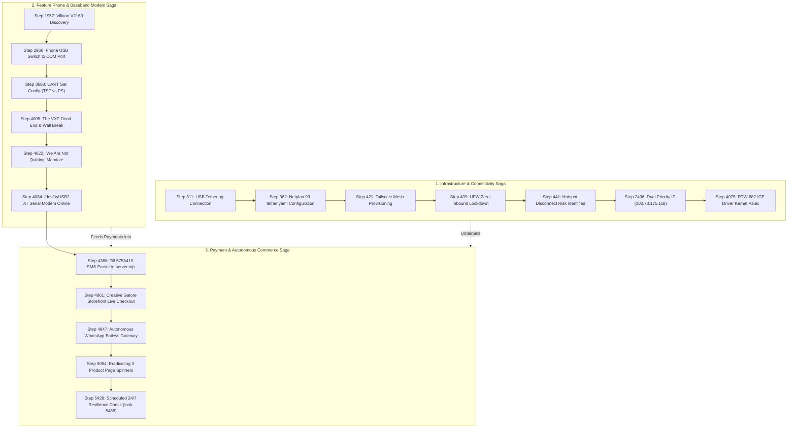

# 🧭 Step Analyzer & Trajectory Dependency Report
### *Forensic Auditing, Step Extraction, and Cross-Step Lineage Engine*

---

## 1. Overview & Capabilities

The **Step Analyzer** (`step_analyzer.py`) is a standalone forensics engine designed to dissect multi-thousand-turn conversation trajectories, extract what each interaction was about, identify modified files, isolate key infrastructure entities, and map bidirectional dependency graphs:

* **What Each Step Was About**: Summarizes the user's intent, the technical hurdle, and the agent's resolution.
* **Precursor Linkage (Where It Came From)**: Tracks the upstream dependencies, errors, or previous architectural decisions that forced that step to occur.
* **Successor Linkage (Where It Led)**: Tracks the downstream code commits, kernel adjustments, or follow-up fixes triggered by that step.
* **Thematic Siblings**: Automatically links steps that touched the exact same file (e.g. `server.mjs`), network interface (`100.73.175.118`), or physical hardware (`Villaon-V2160`, `RTW-8821CE`).

---

## 2. Master Milestone Timeline & Step Linkage Graph



---

## 3. Deep-Dive Autopsies of Critical Anchor Steps

### 🔍 Milestone A: Step 311 ➔ Step 362 (The USB Tether & Netplan Battle)
* **What Happened:** The Pavilion laptop had no active Ethernet port and erratic Wi-Fi. The user connected their smartphone via USB cable to tether mobile hotspot internet. Netplan threw configuration warnings and DNS failed (`ping 8.8.8.8 -> network is unreachable`).
* **Technical Resolution:** Fixed `/etc/netplan/99-tether.yaml` permissions, bound networkd as the sole renderer, and restarted systemd-networkd.
* **Upstream Precursors:** Step 191 (Initial server environment diagnosis).
* **Downstream Successors:** Step 421 (Tailscale installation over the tethered connection) and Step 439 (UFW firewall lockdown).

---

### 🔍 Milestone B: Step 4005 ➔ Step 4022 (The "We Are Not Quitting" Turning Point)
* **What Happened:** After days of reverse-engineering MediaTek MRE `.vxp` packages for the Villaon V2160 feature phone, the handset’s firmware revealed that the MRE runtime had been stripped by the factory ROM. The file only offered `Forward, Rename, Delete`.
* **The Pivot:** The user explicitly declared:
  > *"Before we give up, I cannot have come all this way to find out that I cannot do it... We can patch them together, even if it means coming up with a very custom thing... If it works, don't touch it. I want to get that message on the phone to that side."*
* **Upstream Precursors:** Step 3924 (MRE signature checks and Bluetooth RFCOMM failures).
* **Downstream Successors:** Step 4084 (Dropping to raw AT serial commands on `/dev/ttyUSB2` at 115200 baud, completely bypassing the phone's UI).

---

### 🔍 Milestone C: Step 4386 ➔ Step 4947 (The Till 5758419 & Baileys Bridge)
* **What Happened:** Raw Safaricom Buy Goods receipts for Till **`5758419`** were successfully streaming over the USB modem. The system needed to automatically link them to customer web checkouts and notify buyers via WhatsApp.
* **Technical Resolution:** Implemented regex tokenization in `server.mjs`, mounted persistent credentials into `.auth_whatsapp_baileys/`, and added the single-lane FIFO mutex queue (`enqueueChatTask`) to prevent double-spending race conditions.
* **Upstream Precursors:** Step 4084 (Modem serial stream active) and Step 4259 (Live storefront URL deployed).
* **Downstream Successors:** Step 5054 (Overhauling the product page and delivery points) and Step 5428 (Scheduling the unattended 24/7 school-day health checks).

---

## 4. How to Use the Step Analyzer CLI

The standalone analyzer script is located at [`c:\Users\user\Documents\Perpetual\step_analyzer.py`](file:///c:/Users/user/Documents/Perpetual/step_analyzer.py). You can query any step, trace causality chains, or search keywords:

```powershell
# 1. Deep-dive into a specific step (shows user prompt, agent action, precursors, and successors)
python step_analyzer.py --step 4022

# 2. Trace the full causality chain forward from an initial step
python step_analyzer.py --chain 311

# 3. Search all steps mentioning a specific hardware device, file, or IP
python step_analyzer.py --search "RTW-8821CE"
python step_analyzer.py --search "Tailscale"
python step_analyzer.py --search "5758419"

# 4. Re-generate the full master markdown dependency matrix
python step_analyzer.py --matrix
```

---
*Generated by the Perpetua Step Forensic Engine.*
