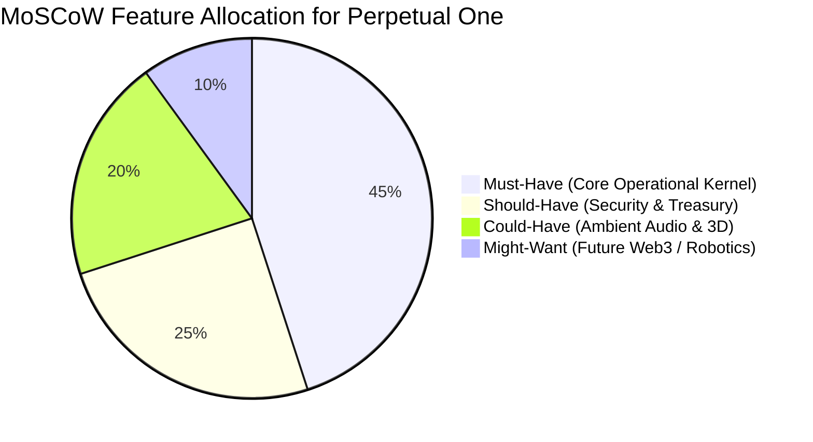
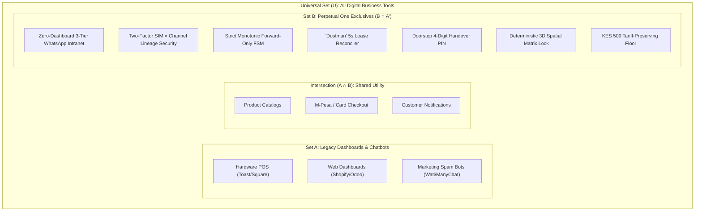

# JRN 3015A — Task 1: Concept Development & Set-Theory Differentiation
**Course:** JRN 3015A – Media Management | **Venture Name:** Perpetual One (`Perpetual`)  
**Product Category:** Conversational Media, Community Commerce & Autonomous Operations Desk  
**Deliverable File:** `media/Task1_Concept_and_Set_Theory_Differentiation.md`

---

## 1. Executive Concept & Proposed Venture

**Perpetual One** is an autonomous conversational media and e-commerce operating platform. It bridges digital brand storytelling, real-time merchant operations, and audience commerce through a unified, 3-tier WhatsApp Community infrastructure.

Traditional media enterprises (newspapers, digital publishers) struggle with monetization and audience retention because content consumption is detached from daily utility and transactional action. Conversely, traditional e-commerce platforms (Shopify, WooCommerce, Toast) trap deskless workers and customers behind friction-heavy mobile apps, complex logins, and rigid web dashboards.

**Perpetual One re-imagines media as an operational, interactive channel.** It transforms WhatsApp from a passive chat inbox into an event-driven corporate intranet and interactive showcase where:
1. Editorial product showcases and culinary/lifestyle narratives broadcast seamlessly to curated customer communities.
2. In-stream checkout happens via localized M-Pesa Rails without leaving the conversation.
3. Deskless floor teams (cooks, packagers, couriers) fulfill orders through simple WhatsApp station commands (`!paid`, `!pack`, `!dispatch`).
4. Physical showroom staging is visualized via a **Deterministic 3D Spatial Scene Engine** with affine transformation matrix locking.

---

## 2. Name & Brand Identity System

### A. The Name: "Perpetual"
* **Etymology & Philosophy:** Derived from the Latin *perpetuus* (continuous, uninterrupted, enduring). It signifies **continuous, uninterrupted operational cadence**—businesses that operate 24/7 with zero downtime, autonomous self-healing reconcilers, and friction-free conversational flow.
* **Tone of Voice:** Authoritative, resilient, minimal, and operationally sovereign.

### B. Visual Identity & Brand System
* **Primary Palette:**
  - **Midnight Sapphire (`#0A1128`):** Represents security, corporate trust, and enterprise stability.
  - **Emerald Terminal (`#10B981`):** Represents M-Pesa liquidity, active floor stations, and WhatsApp verified status.
  - **Saffron Amber (`#F59E0B`):** Represents packaging stations, pending alerts, and kinetic floor action.
  - **Pure Obsidian (`#111827`):** High-contrast base for typography and deterministic 3D staging.
* **Tagline:**
  - *Primary:* **"Operations Without Dashboards."**
  - *Secondary (Merchant-facing):* **"Your Entire Business Desk Inside WhatsApp."**

---

## 3. Product Feature Matrix (MoSCoW Prioritization)

Using systemic thinking and operational feasibility filters, the platform's capabilities are categorized to isolate core essentials from secondary enhancements:

### A. Must-Haves (The Non-Negotiable Core Kernel)
1. **3-Tier Parent-Nested WhatsApp Community:** Hardened channel separation across Floor Operations (`perpetua`), Executive Oversight (`Admin Oversight`), and IT Helpdesk (`IT Helpdesk`).
2. **Linear Monotonic FSM Stepper:** Enforced forward-only lifecycle (`PENDING` $\to$ `PAID` $\to$ `PACKAGING` $\to$ `VERIFIED` $\to$ `DISPATCHED` $\to$ `COMPLETED`).
3. **Strict Zero-Trust Two-Factor Matrix:** Every command verified against *Sender Phone SIM $\times$ Community Channel Lineage*. Unregistered numbers and orphan groups are bounced immediately.
4. **Doorstep 4-Digit Delivery Verification PIN:** Secret PIN generated dynamically and delivered directly to the customer's private WhatsApp to eliminate delivery fraud.
5. **The "Dustman" Autonomous Reconciler:** 5-second periodic daemon that recovers frozen agent leases ($>60\text{s}$) and purges zombie locks.

### B. Should-Haves (Treasury & Perimeter Fortification)
1. **Platform Cadence Action Dockets:** 24/7 East Africa Time (EAT) automated reporting at 06:30 (prep), 09:15 (settlement), 12:00 (rush), and 22:00 (closure).
2. **KES 500 Settlement Floor:** Automatic rollover of micro-payouts to protect merchants from Safaricom B2C tariff drag.
3. **Encapsulated Client Bridge (`PerpetualShopClient`):** HMAC-SHA256 signed requests with 300-second freshness replay defense.
4. **Anti-Injection Sanitizer:** Automated neutralizing of SQL, XSS, and command injection attempts.

### C. Could-Haves (Spatial & Ambient Audio)
1. **Deterministic 3D Spatial Engine:** Affine transformation matrix locking ($\Delta = 0.00000000$ camera drift) for digital staging of furniture and decor.
2. **Ambient Voice-to-FSM Parser:** Natural language transcription (English/Swahili/Sheng) converting voice notes into FSM mutations.
3. **Community Promotional Guardrails:** Automated rate limits (max 2/day, 2h cooldown) on customer broadcasts.

### D. Might-Want-to-Have (Future Horizons)
1. **Drone / Autonomous Vehicle Dispatch Handshake.**
2. **On-Chain Escrow Settlement over Stablecoins (USDC/KES).**

---

## 4. Market Problem & Unique Value Proposition (UVP)

### A. The Threefold Market Breakdown:
1. **The Deskless Worker Friction Trap:** Cooks, packagers, and riders cannot type passwords or manage complex SaaS UIs with wet or busy hands. 78% of retail software implementations fail due to floor staff abandonment.
2. **The Delivery Handover Blindspot:** Over 18% of e-commerce delivery disputes in urban Kenya stem from doorstep confusion, stolen goods, or unverified handoffs.
3. **Notification Fatigue & Management Chaos:** Traditional merchant WhatsApp groups devolve into chaotic banter where critical order alerts are lost between chit-chat, payment screenshots, and casual conversation.

### B. Perpetual's Unique Value Proposition (UVP):
> **"Perpetual One replaces fragmented SaaS dashboards and chaotic WhatsApp groups with a unified, zero-dashboard operational operating system—empowering deskless floor staff, managers, and couriers to run entire multi-tenant retail businesses directly within WhatsApp under cryptographic zero-trust security."**

---

## 5. Set-Theory Differentiation Analysis

To mathematically prove Perpetual's unique market position against existing media, e-commerce, and communication tools, we define:
* $\mathbf{U}$: The universal set of all digital business software, publishing platforms, and messaging systems.
* $\mathbf{A}$: The set of **Legacy Solutions** (Traditional e-commerce platforms like Shopify, dedicated POS systems like Toast, and standard marketing chatbots like Wati/ManyChat).
* $\mathbf{B}$: **Perpetual One** (The conversational operational commerce platform).

### Mathematical Set Derivations:

#### 1. $B'$ (The Complement of Perpetual One — What Perpetual Rejects)
$$B' = \{ x \in \mathbf{U} \mid x \notin \mathbf{B} \}$$
* Complex web dashboards requiring passwords and desktop screens.
* Hardware-locked POS tablets with expensive per-counter subscriptions.
* Spray-and-pray promotional WhatsApp chatbots that spam users without operational context.
* Fragmented, unencrypted communication where any group member can trigger financial actions.

#### 2. $B' \cup A$ (Legacy Universe + What Perpetual Refuses to Be)
$$(B' \cup A) = \text{Everything in the market that is NOT Perpetual One, plus legacy systems.}$$
* Represents the traditional world of brittle web dashboards, manual copy-pasting of payment codes, and disconnected logistics.

#### 3. $B \cap A'$ (Perpetual One's Defensible Moat — Pure Innovation)
$$(B \cap A') = \{ x \in \mathbf{B} \mid x \notin \mathbf{A} \}$$
* **This is Perpetual's proprietary territory that no legacy competitor possesses:**
  1. **Strict Monotonic FSM:** Anti-backwash engine that prevents completed orders from ever being rewound or reset.
  2. **Two-Factor Access Matrix:** SIM Phone Identity verified simultaneously with Community Channel Lineage.
  3. **The "Dustman" Autonomous Reconciler:** 5-second automatic rollback of dropped worker leases.
  4. **Doorstep 4-Digit Handover PIN:** Cryptographic delivery verification delivered directly to customer chat.
  5. **Deterministic 3D Matrix Locking:** Affine scene transformation with zero camera drift ($\Delta = 0.00000000$).
  6. **Tariff-Preserving Settlement Floor:** Automated KES 500 threshold preventing tariff drag.

#### 4. $A' \cap B'$ (The External Non-Commerce / Non-Media Universe)
$$(A' \cap B') = (A \cup B)'$$
* Enterprise tools unrelated to retail commerce or media (e.g. CAD software, scientific genomics tools, heavy industrial robotics).

---
*Task 1 Deliverable Complete. Aligned with JRN 3015A Media Venture Design Protocol.*
