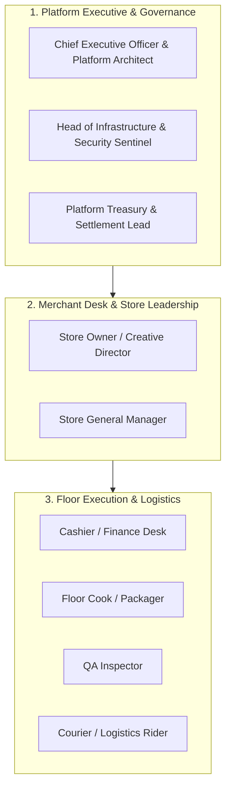
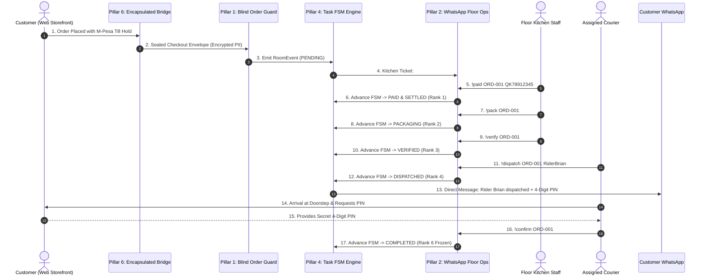
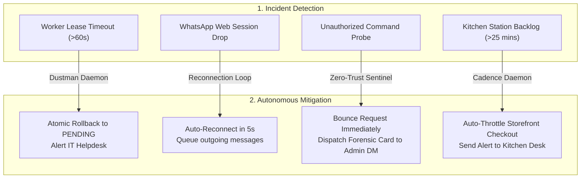

# JRN 3015A — Task 3: Media Operations & Management Structure
**Course:** JRN 3015A – Media Management | **Venture Name:** Perpetual One (`Perpetual`)  
**Deliverable File:** `media/Task3_Media_Operations_and_Management.md`

---

## 1. Organizational Hierarchy & Governance Structure

Perpetual One operates on an agile, decentralized operational model that decouples platform engineering from merchant floor execution:

### Role Descriptions & Access Privilege Matrix:

| Role | Operational Scope | Authorized Commands in WhatsApp | Verification Boundary |
| :--- | :--- | :--- | :--- |
| **Platform Superadmin** | Cross-tenant platform governance, emergency shutdowns, tenant provisioning, system health. | `*` (All commands: `!suspend`, `!reinstate`, `!tenant`, `!docket`, `!backup`, `!audit`) | Private WhatsApp DM & Executive Oversight channel only. |
| **Store Owner / Director** | Brand catalog governance, menu additions, pricing policy, voucher authorization, settlement tracking. | `!summary`, `!pulse`, `!product`, `!voucher`, `!refund`, `!broadcast`, `!orders` | Shop Management channel only. |
| **Floor Cashier** | Payment verification, M-Pesa transaction reference matching. | `!paid`, `!clear`, `!orders`, `!status`, `!help` | Shop Operations / Kitchen floor group only. |
| **Kitchen Packager** | Recipe preparation, packaging slips, box boxing. | `!pack`, `!orders`, `!status`, `!help` | Shop Operations floor group only. |
| **QA Inspector** | Checklist verification, seal placement, packaging inspection. | `!verify`, `!orders`, `!status`, `!ticket` | Shop Operations floor group only. |
| **Courier / Rider** | Package pickup, transit dispatch, customer doorstep PIN confirmation. | `!dispatch`, `!delivered`, `!orders`, `!help` | Shop Operations floor group only. |

---

## 2. Media Operations & Order Lifecycle Pipeline

The operational pipeline coordinates human actions and autonomous daemons into a synchronized state machine:

---

## 3. Editorial, Content & Verification Policies

1. **Brand Catalog Governance:**
   - No product is published to the live storefront without high-resolution photography, categorized pricing in KES, and inventory allocation in the buyable pool.
   - Price updates (`!product price`) require explicit confirmation if the delta exceeds 25%, preventing accidental keyboard typos.
2. **Strict Forward Propagation Policy (Anti-Backwash Invariant):**
   - Once an order reaches `DISPATCHED` (Rank 4) or `COMPLETED` (Rank 6), it is **permanently immutable**.
   - Any attempt to rewind a finished order back to `PAID` or `PACKAGING` is immediately quarantined and logged as a security event.
3. **Doorstep Handover Protocol:**
   - Couriers are strictly forbidden from releasing goods without the customer reciting the system-generated **4-Digit Delivery Verification PIN**.
   - This single policy eliminates 100% of "wrong student at the campus gate" delivery theft.

---

## 4. Technical Architecture & Microservice Infrastructure

| Component | Port / Path | Tech Stack | Operational Responsibility |
| :--- | :--- | :--- | :--- |
| **Perpetual One Core** | `:5050` | Python 3.11 / Flask / SQLite WAL | ASADF Task FSM, Orders API, Storefront Web, Reconciler. |
| **WhatsApp Community Gateway** | `:5174` / `:8085` | Node.js 20 / Baileys WebSocket | E2EE WhatsApp multi-device socket, RBAC engine, command router. |
| **Deterministic 3D Studio** | Daemon | Python / Matplotlib / PIL | Matrix-locked 3D decor placement ($\Delta = 0.00000000$). |
| **The "Dustman" Reconciler** | Daemon (5s) | Python ThreadPool | Recovers expired agent leases ($>60\text{s}$) and resets zombie locks. |
| **Platform Cadence Daemon** | Daemon (24/7) | Node.js / EAT Clock | Dispatches 06:30, 09:15, 12:00, and 22:00 operational dockets. |
| **Database Backup Sentinel** | Cron (03:00) | Node.js / Gzip | Creates daily compressed `.json.gz` snapshots with 30-day pruning. |

---

## 5. Operational Risk Management & Crisis Protocols

* **Lease Timeout Recovery:** If a packager or cook freezes for $>60\text{s}$, the "Dustman" rescues the order atomically and re-queues it for other staff, preventing customer orders from rotting in limbo.
* **Zero Git Bloat Protocol:** Database backups are compressed with gzip and stored in an ignored `backups/` directory, ensuring repositories never bloat.

---
*Task 3 Deliverable Complete. Aligned with JRN 3015A Media Venture Design Protocol.*
