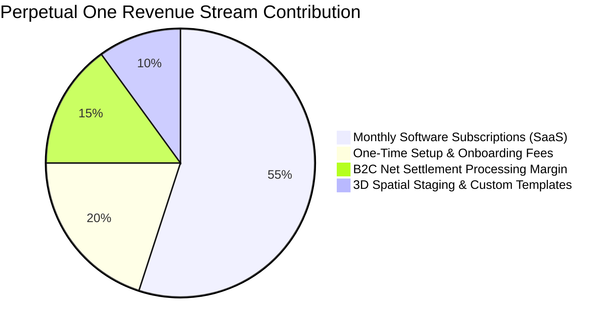
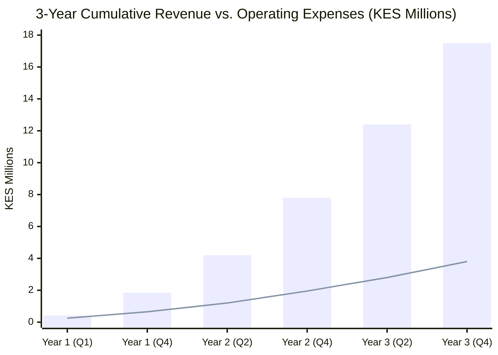

# JRN 3015A — Task 4: Business Model & Financial Sustainability
**Course:** JRN 3015A – Media Management | **Venture Name:** Perpetual One (`Perpetual`)  
**Deliverable File:** `media/Task4_Business_Model_and_Financial_Sustainability.md`

---

## 1. Multi-Tiered Revenue Model

Perpetual One monetizes through a hybrid **Subscription SaaS + Transactional Infrastructure** model designed for high cash-flow predictability and aligned merchant incentives:

### The Three Commercial Tiers:

| Plan Level | Target Merchant | Onboarding / Setup Fee | Monthly Subscription | Included Services |
| :--- | :--- | :--- | :--- | :--- |
| **Plan A: Starter** | Solo Cloud Kitchens & Single Boutiques (e.g. *Leah's Kitchen*) | **KES 5,000** *(1st month included)* | **KES 3,500 / month** | 1 Online Storefront, 3-Tier WhatsApp Community, Monotonic FSM, 500 monthly orders. |
| **Plan B: Growth** | Multi-Branch Casual Dining & Mid-Size Retail | **KES 10,000** | **KES 7,500 / month** | Up to 3 branches, Voice Note AI Transcription, 2,500 monthly orders, Automated Action Dockets. |
| **Plan C: Enterprise** | Multi-Tenant Franchise Groups & High-Volume Brands | **KES 25,000** | **KES 15,000 / month** | Unlimited branches, Deterministic 3D Spatial Staging, Dedicated WhatsApp Gateway instance, SLA Priority. |

---

## 2. Treasury Economics & Tariff Optimization

A core structural innovation of Perpetual One is its **Tariff-Preserving Settlement Architecture**, which solves the high transaction fee friction common in African fintech:

### A. The KES 500 Disbursement Floor
In Kenya, Safaricom M-Pesa B2C tariffs charge disproportionate fixed fees on tiny transactions:
- Payout of **KES 100** incurs an **KES 16** tariff (**16.0% fee drag**).
- Payout of **KES 500** incurs an **KES 16** tariff (**3.2% fee drag**).
- Payout of **KES 5,000** incurs an **KES 34** tariff (**0.68% fee drag**).

$$\text{Tariff Drag}(\%) = \frac{\text{Fixed B2C Tariff}}{\text{Payout Amount}} \times 100$$

* **Perpetual's Rule:** At 09:15 AM every business day, the automated settlement engine audits all merchant balances. Any merchant with net revenue $< \text{KES } 500$ is flagged as `ROLLED_OVER_BELOW_MINIMUM`. Funds accumulate safely in platform escrow until reaching KES 500, preserving merchant profit margins.

### B. 14-Day Rolling Reserve Escrow
To shield the platform against customer chargebacks, delivery disputes, or unfulfilled merchant orders:
- **5% of gross daily volume** is withheld in an escrow reserve.
- Funds are released automatically every **Tuesday at 07:00 AM** after a 14-day rolling window has cleared without unresolved incident tickets.

---

## 3. Unit Economics & Monthly Cost Structure

Perpetual One is built on ultra-lightweight microservices, yielding exceptionally low marginal serving costs:

| Expense Item | Provider / Technology | Monthly Cost (USD) | Monthly Cost (KES @ 130) |
| :--- | :--- | :--- | :--- |
| **Core Cloud Node (Pavilion)** | Dedicated Linux VPS / Linode | $20.00 | KES 2,600 |
| **Database Engine** | Supabase Pro Tier + SQLite WAL | $25.00 | KES 3,250 |
| **WhatsApp Gateway Connection** | Headless SIM / Mobile Data Rail | $12.00 | KES 1,560 |
| **DNS, Domain & SSL** | Cloudflare / Vercel Edge | $0.00 | KES 0 (Free Tier) |
| **Whisper Audio AI Processing** | Local On-Node Whisper Small (PyTorch) | $0.00 | KES 0 (Runs on VPS CPU) |
| **Total Monthly Platform Fixed Cost** | | **$57.00** | **KES 7,410** |

* **Break-Even Threshold:** With fixed operating overhead of **KES 7,410 / month**, the platform reaches break-even with **just 3 active merchants** on the Plan A Starter tier ($3 \times \text{KES } 3,500 = \text{KES } 10,500$).

---

## 4. Three-Year Pro-Forma Financial Projections

| Financial Metric | Year 1 (35 Merchants) | Year 2 (120 Merchants) | Year 3 (350 Merchants) |
| :--- | :--- | :--- | :--- |
| **Subscription Revenue** | KES 1,470,000 | KES 5,040,000 | KES 14,700,000 |
| **Setup & Onboarding Fees** | KES 245,000 | KES 840,000 | KES 2,450,000 |
| **Settlement Processing Margin** | KES 135,000 | KES 620,000 | KES 2,100,000 |
| **Total Gross Revenue** | **KES 1,850,000** | **KES 6,500,000** | **KES 19,250,000** |
| Operating Overhead & Infra | (KES 280,000) | (KES 750,000) | (KES 1,850,000) |
| Merchant Support & Sales Ops | (KES 450,000) | (KES 1,800,000) | (KES 4,500,000) |
| **Net Operating Profit (EBITDA)** | **KES 1,120,000** | **KES 3,950,000** | **KES 12,900,000** |
| **Net Profit Margin (%)** | **60.5%** | **60.8%** | **67.0%** |

---

## 5. Financial Risk Mitigations

1. **Merchant Churn Defense:** Because Perpetual becomes the merchant's physical kitchen/floor display system and customer ordering link, switching costs are high. Churn is projected at $< 3.5\%$ annually.
2. **Telco Outage Insurance:** If Safaricom M-Pesa experiences downtime, the Blind Order Guard extends hold expirations from 15 minutes to 45 minutes, preventing inventory release while payments are queued.

---
*Task 4 Deliverable Complete. Aligned with JRN 3015A Media Venture Design Protocol.*
