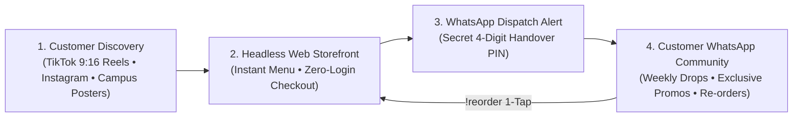
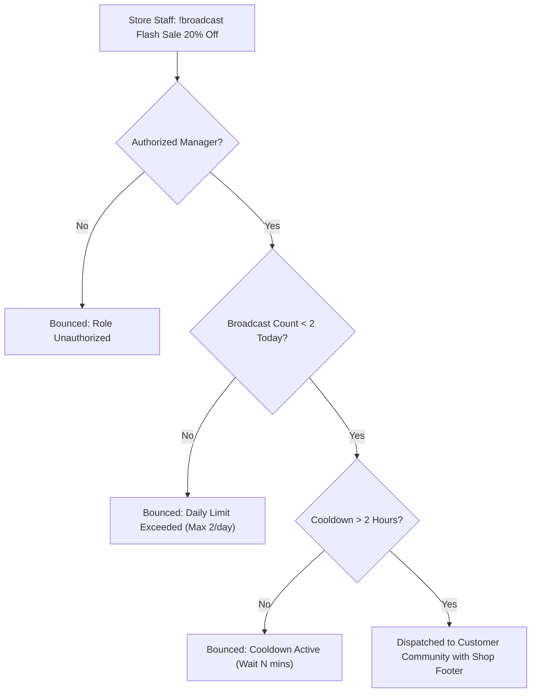

# JRN 3015A — Task 5: Marketing, Distribution & Audience Growth
**Course:** JRN 3015A – Media Management | **Venture Name:** Perpetual One (`Perpetual`)  
**Deliverable File:** `media/Task5_Marketing_Distribution_and_Audience_Growth.md`

---

## 1. Multi-Channel Distribution Topology

Perpetual One employs a **hybrid conversational distribution flywheel** that connects external customer discovery with private WhatsApp community retention:

### The Distribution Pillars:
1. **Public Frontends (Headless Edge):** Hosted on Vercel/Cloudflare edge networks with $< 50\text{ms}$ loading times across 2G/3G mobile connections in Nairobi.
2. **Private Customer Communities (`routing.community_jid`):** Micro-communities organized around specific boutique stores where customers discuss drops, receive menu updates, and query stock.
3. **Public Broadcast Channels (`routing.channel_jid`):** Non-intrusive one-way broadcast feeds for new seasonal arrivals and flash promotions.

---

## 2. Merchant & Audience Acquisition Strategy

### A. Merchant Acquisition: "The Zero-Hardware Kitchen Conversion"
* **B2B Strategy:** Target dense commercial dining clusters (USIU corridor, Roysambu, Westlands).
* **The Pitch:** *"Stop paying 30% aggregator cuts to food apps and stop losing orders in messy WhatsApp chats. We set up your entire kitchen desk inside WhatsApp for KES 5,000, and your cooks don't need to learn a new app."*
* **Time-to-Value:** A new merchant is provisioned and live within **15 minutes** using the `!tenant provision` automation script.

### B. Customer Acquisition & Viral Loops:
* **The "Order Status" Invitation:** When a customer receives their transactional dispatch alert containing their **4-Digit Delivery Verification PIN**, the message ends with a clean 1-tap link:
  > *"💬 Join the Leah's Kitchen VIP WhatsApp Community for daily lunch menu drops and KES 100 weekend vouchers."*
* **1-Tap Re-Ordering (`!reorder`):** Customers can message the bot directly:
  - `!reorder` $\to$ Instantly generates an M-Pesa STK push for their exact favorite previous meal. Zero typing required.

---

## 3. Community Engagement Policies & Anti-Spam Guardrails

To prevent communities from devolving into spam traps, Perpetual One enforces programmatic guardrails via [`broadcast_guardrails.mjs`](file:///c:/Users/user/Documents/Perpetual/whatsapp_gateway/broadcast_guardrails.mjs):

* **Maximum 2 Broadcasts per 24 Hours:** Prevents over-messaging fatigue.
* **Mandatory 2-Hour Cooldown:** Blocks rapid-fire back-to-back announcements.
* **Length Validation (10 to 1,000 Characters):** Eliminates empty pings or walls of unreadable text.
* **Automated Footer Link:** Every broadcast automatically attaches a clean shopping link and instructions to query `!items`.

---

## 4. Key Performance Indicators (KPI) Dashboard

Perpetual One monitors 5 core health metrics across all tenant operations:

| Metric | Target Benchmark | How It Is Measured |
| :--- | :--- | :--- |
| **1. Customer Acquisition Cost (CAC)** | $< \text{KES } 250$ per merchant | Direct founder sales & word-of-mouth kitchen referrals. |
| **2. Merchant Lifetime Value (LTV)** | $> \text{KES } 75,000$ | Calculated on 18-month retention on Plan A/B ($18 \times \text{KES } 3,500 + \text{fees}$). |
| **3. Station FSM Completion Velocity** | $< 18\text{ minutes}$ | Median elapsed time between `!paid` $\to$ `!pack` $\to$ `!dispatch`. |
| **4. Delivery Handover Dispute Rate** | $< 0.1\%$ | Tracked via 4-digit PIN confirmation rate on `!confirm`. |
| **5. 30-Day Customer Re-Order Rate** | $> 42\%$ | Percentage of customers utilizing `!reorder` within 30 days. |

---
*Task 5 Deliverable Complete. Aligned with JRN 3015A Media Venture Design Protocol.*
